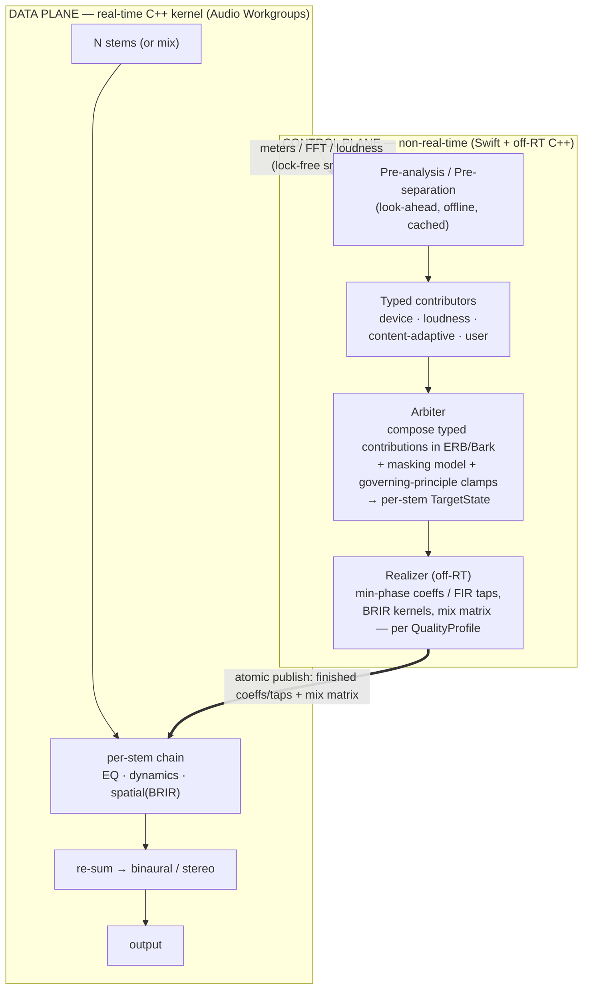

# Adaptive Sound — Architecture (v0.3)

**Status:** Canonical design · **Date:** 2026-06-13 · **§2.5 (shipped pipeline) reconciled to the code:** 2026-10-13 (product council, at `a206107`); the faithful default and what persists updated for R1.1-A (2026-10-15)
**Supersedes:** [proposal.md](../session-notes/proposal.md) (v0.1). **Shaped by:** [proposal-review.md](../session-notes/proposal-review.md) (panel 1) + [review-v0.2.md](../session-notes/review-v0.2.md) (expert panel 2) + founder talk-through.

> **v0.3 (expert-panel fold-in):** **shared late-reverb** decomposition (not 6 independent BRIRs — the ~6× cost cut); **re-sum mixbus discipline** (loudness-matched per-stem trim); **bass + lead-vocal exempt from spatial spread**; masking re-scoped to the **excitation-pattern (ERB) subset** (full Moore-Glasberg is ~50× too slow); stems **gated on perceptual artifacts, not SDR**; BRIR room amount **content-adaptive**; Demucs **weights auto-downloaded on first run** (code MIT; NC-trained weights not redistributed), **MLX primary**; global tap reframed as a **high-consent, captures-everything** capability. Detail: [review-v0.2.md](../session-notes/review-v0.2.md).
**Companion docs:** [prior-art.md](../session-notes/prior-art.md) · [../product/PRD.md](../product/PRD.md) · [../product/requirements.md](../product/requirements.md) · [../product/user-journeys.md](../product/user-journeys.md) · [../product/backlog.md](../product/backlog.md) · [../sprints/00-sprint-model.md](../sprints/00-sprint-model.md)

> One-line: **turn any good-quality song into a personal, perceptually-tuned, spatially-rendered mix** — on modern Macs, headphones or speakers.

---

## 0. Locked decisions & ADR registry

Canonical decision registry for the architecture. Product/scope locked decisions live in PRD §0 (LD-1…LD-10) and are extended here (LD-11…LD-19).

**Sprint Model (BA-2, locked 2026-06-13):** Development uses **sprint-based Kanban** (5–10 story points per sprint, ~1 week) instead of phase gates. Each sprint ships a locally-testable binary; manual testing occurs at sprint end before team retro; **done-done criteria are validated per sprint** (Claude asks, user picks acceptance). **Enablers ship before features** (dependency ordering). Shipping to GitHub releases is a manual decision, not automatic per sprint. Epics span multiple sprints; each sprint is independently implementable and testable.

See **[../sprints/00-sprint-model.md](../sprints/00-sprint-model.md)** for sprint sequencing, done-done templates, and team cadence details.

| LD | Decision |
|---|---|
| LD-1…LD-10 | (PRD §0) own-player→system-wide; immersive=spatial+tonal; both outputs; local-files MVP; phased content brain; on-demand mic; generic HRTF→**now BRIR, see LD-14**; **LD-8 Conversational Tuning withdrawn 2026-07-12** (natural-language / conversational tuning removed from scope); personal/OSS; quality-first/ample-hardware. |
| **LD-11** | **Source quality & non-goals.** Assume reasonably good sources (lossless / high-bitrate). **Audio repair/restoration is a non-goal** (no de-noise/de-clip/upsample to "fix" bad audio). Network may be used for non-sensitive, latency-tolerant work; **core playback + RT DSP stay offline-capable.** |
| **LD-12** | **Perceptual tonal model.** Clarity/adaptive decisions are made in **ERB/Bark with a masking + partial-loudness model**, not raw dB-on-log. Contributors are **typed** (EQ-curve + per-band dynamic + transient + spatial), not a single magnitude curve. The dB curve is a *realization/interchange* format only. |
| **LD-13** | **Phase realization = minimum-phase by default.** Phase mode is chosen by **content** (transient density from pre-analysis); linear/mixed-phase is opt-in or band-limited where it genuinely helps. (Pre-ringing, not latency, is the real cost.) |
| **LD-14** | **BRIR-first immersion.** Headphone spatialization defaults to a **binaural room response** (HRTF + early reflections + late reverb); dry HRTF is a "minimal" mode. Head-tracking is **opt-in** for music. Speaker immersion = **M/S width + ambience extraction (mono-safe)**; crosstalk-cancellation is opt-in (centered near-field only). Crossfeed opt-in. |
| **LD-15** | **Stem-based object engine** (Phase 1.5). Offline **6-stem** separation (vocals/drums/bass/guitar/piano/other), cached; **full per-stem chains incl. spatial placement**, re-summed to binaural; **masking computed between stems**. **Own-player-only** (live tap path is mix-only); real-time-lite separation is a research track. |
| **LD-16** | **"Reimagine" intensity** = one continuous control. **0% = original mix, stem engine bypassed (bit-faithful, zero separation artifacts)** → rising = clarity → spatial widening → **100% = full stem-based spatial reimagining**. Crossfades original↔stem-render + scales spatial spread / unmask depth. Mix-range in Phase 1; stem-range unlocked in Phase 1.5. *(Amended in effect by Sprint EQ decision 25, 2026-10-10 — "the EQ always plays in full": the user's EQ now sits **outside** the Intensity blend, so 0 % is bit-faithful only while the EQ is flat or off; with an EQ on, 0 % plays EQ → limiter. See §2.5 "The kernel's four paths".)* |
| **LD-17** | **Dynamics & loudness.** **No program DRC by default** (transparent LUFS normalization + true-peak safety limiter only). Loudness compensation = **fraction of the equal-loudness contour *difference*** + per-device SPL calibration + loudness-matched makeup, **rate-limited to volume changes**. |
| **LD-18** | **Target hardware & runtime posture.** Floor = **Apple-Silicon Pro-class (M1 Pro) with ≥16 GB**; anything that runs this is stronger. The app is the **foreground, primary activity** ("lean-back listening," not background multitasking), so it may **use multiple cores and occupy memory generously**. Supersedes the base-model-8 GB-Air framing in §15 (materially reduces that risk); still degrade gracefully if backgrounded or if other apps run. **Power:** default max-quality on AC; auto-switch to the Efficiency profile on battery (user-overridable). |
| **LD-19** | **App shape.** A focused **full-window listening experience** (now-playing + scene visualizer + the Reimagine dial) **plus a menu-bar extra** for quick control (toggle / volume / Reimagine). Both surfaces share one app-level audio engine. |

**ADRs** (details in §18): **Accepted —** 001 Foundation · 002 Phase-2 taps *(design; ⛔ won't, this horizon)* · 003 BRIR-first spatial · 004 BNNS-Graph RT ML · 005 vDSP feature analysis · 006 Perceptual typed-contributor model + off-RT Realizer (min-phase default) · 007 Stem object engine *(design; ⛔ won't, this horizon)* · 008 Reimagine intensity · **009 withdrawn 2026-07-12 (natural-language layer removed from scope)** · 010 Dynamics/loudness policy.

---

## 1. Objectives, assumptions, non-goals

**Objective.** An **immersive** music experience on **modern capable Apple-Silicon Macs (M1 Pro / 16 GB floor and up; LD-18)**, on headphones & speakers, that lets the listener **actually hear what's being played** (clarity, detail, correct balance, externalized stage), and that **adapts dynamically** — automatically to content, level, and device.

**Assumptions:** ample CPU/RAM/network (LD-10); good-quality sources (LD-11); macOS / Apple-Silicon-first; own-player latency is free (we are the clock).
**Non-goals:** audio repair/restoration (LD-11); lyrics/recommendation; Windows/DAW-plugin formats.

---

## 2. Architecture at a glance

A constant **spine**: a non-real-time **control plane** decides *what the sound should be*; a real-time **data plane** renders it. They communicate via a lock-free parameter snapshot down and a lock-free meter/analysis snapshot up.



**RT rules (every kernel line):** no heap alloc, no locks, no Obj-C/Swift runtime, no I/O; pre-allocate; bounded deterministic work per buffer; cross-thread state via atomic snapshot + ramping; the **Realizer does all design/fitting off-RT** — the kernel only ramps & runs finished coefficients.

> **Status note (built vs. target).** The diagram above is the **target** control-plane/data-plane architecture (the stem object engine is its full-fat form). The **shipped** pipeline is narrower — see **§2.5 Shipped pipeline** for what actually runs today. In short: the per-stem chain + the **perceptual** Arbiter + the **masking-driven** Realizer + masking/BRIR are **design, not yet implemented**; what ships is a stereo/N-channel two-AU graph with the EQ/Clarity/BRIR/Crossfeed/Loudness/Limiter kernel present (EQ live — since Sprint EQ an accurate 31-band graphic EQ that plays what it draws, loudness-neutral; Clarity/BRIR no-op stubs; Crossfeed real + default-off; Loudness/Limiter real), a steerable equal-power intensity blend, and a **control-plane `Realizer`** (off-RT, coalesces EQ / intensity / crossfeed / track-loudness intents, designs the EQ, sole publisher) — plus a parallel bit-perfect HAL output path. The control-plane `Realizer` is **distinct from** the perceptual Arbiter + masking-driven Realizer of §4 / ADR-006, which remain design.

---

## 2.5 Shipped pipeline (Sprints 4–5b, Pure Mode, gapless, S6–S10.8 incl. Sprint EQ and Sprint G)

This section documents what is **actually built**, as distinct from the target architecture in §2 and the phased design in §3–§16. **Source of truth: the code** (`Sources/AdaptiveSound/` + `Sources/AudioDSP/` + the `*Kit` targets); sprint records in [../sprints/](../sprints/). **Rule: if this section and the source disagree, the source wins and this section is stale — file a doc fix** (this section is a convenience snapshot, not a status board). File:line citations are as of `7761693` (2026-10-14, R1 merged — PR #88, #89).

**Module map (`Package.swift`).** One app target (`AdaptiveSound`: SwiftUI views, the view models, the engine bridge) over: `AudioDSP` (C++ / Obj-C++: the kernel, the two AUs, the Realizer, the Pure HAL engine and decoders, the C-ABI), `AudioFormatKit` (the device-width format resolver shared with `VerifyAUGraph`; the Enhanced sample-rate converter `StreamingResampler`, shared with `SRCQualityMeasure`), `OutputDeviceKit` (the output-device rule and the user's chosen device, `OutputDeviceSelection`), `PlaybackQueueKit` (queue / order / resume / transport-snapshot logic, the on-deck tickets, the seek rule `SeekTarget`), `EQEditKit` (the EQ editing model, per-output pins, the Master Gain law), `TrackLoudnessKit` (load-time track loudness analysis), `LibraryStore` (GRDB) + `StoreSQLiteShim`, `LibraryScan`, `LibraryBrowseKit` (browse / list / selection decisions), `DesignTokenKit` (the Liquid Glass tokens and layout maths). Headless gates: `VerifyAUGraph`, `VerifyLibraryStore`, `SRCQualityMeasure`. Pure logic lives in the kits so `swift test` reaches it without the app target; since R1 one test target, `AdaptiveSoundTests`, also drives the app target itself (`@testable import`: the shipped view model's on-deck and output-device contracts, PR #88).

**Library spine (S8+, a separate subsystem — not in the audio graph above):** a persistent, **GRDB.swift-backed** `LibraryStore` (`public final class LibraryStore: Sendable` over a GRDB `DatabaseWriter` — `LibraryStore.swift:32`; a `DatabasePool` for file stores; migrations `v1`…`v9`, `Schema.swift:56-88`, additive-only so playlists and play stats survive — v8 (R1, PR #88) binds each music folder to its drive, `folders.volume_uuid`, and a walk sweeps only on evidence, else refuses and pauses the folder (`LibraryScan/SweepRefusal.swift`) — evidence of what it read: rows under what it could not read are spared, the rest swept (R1.1-A, C-55); a playlist song is "missing" only by that same evidence (`LibraryScan/FileAvailability.swift`, KI-LIB-01); v9 (R1.1-A, C-61) rebuilds the search index with every mark a token character and every row NFKC-normalised (`Schema+SearchTokens.swift`), the rule the grids' Filter and type-to-select share (`LibraryBrowseKit/SearchFold.swift`); a store it cannot open safely is refused, never wiped — S10.8 C) with folder scan → metadata/artwork → FSEvents watch → id-preserving move-match (`LibraryScan`), backing the S9 browse/search UI, the S10 queue/playlists/Recently Played and the S10.8 glass Library. Detail: `Sources/LibraryStore/` + [../sprints/s8-1-persistent-store-design.md](../sprints/s8-1-persistent-store-design.md) (note its SUPERSEDED storage-engine decision). *(R1.1-A:)* the scan admits `.opus` and `.oga` too — Apple's decoder opens Ogg Opus and Vorbis on macOS 26, and a format table holds every admitted extension to a real file that opens (KI-LIB-05 closed). The tag pass reads through **Apple first for every format** (`MetadataExtractor`: the Vorbis comments as raw `vorb/…` items, a lossless file's depth from its format flags, a FLAC's PICTURE block in bounds-checked Swift — `FLACPicture`); FFmpeg reads a file only when the listener turned it on and Apple can't (FD-3, below).

### Two output paths (mutually exclusive per playback start)

The engine (`AudioEngineBridge`, reached from the app only through the `AudioPlaybackEngine` protocol) drives **two** parallel output paths; the active one is chosen at each `startAudio(fileURL:pureMode:startAt:epoch:)` call:

1. **Enhanced path (default)** — `AVAudioEngine`-hosted graph (built at 48 kHz stereo, `AudioEngineBridge+Lifecycle.swift:50`, then reconfigured to the source width). Owns decode (`AVAudioFile`), device routing (it plays on the system default output), and the render thread. Rate-mismatched files run through an explicit streaming **`AVAudioConverter` at Apple's Mastering algorithm, maximum quality** (`StreamingResampler`, `AudioFormatKit`; driven by `AudioEngineBridge+EnhancedResampler.swift`) — flat to 20 kHz, images and aliases ≤ −148 dB, bit-exact at equal rates, gated by `make gate` (R1.1-A, council C-26; it was the Normal algorithm until then). Files at the graph rate are scheduled directly with no SRC (`scheduleSegment`, so a start or seek can begin mid-file). Every start, seek and re-establish lands through one path — `restartEnhanced` / `commitEnhanced` (`AudioEngineBridge+EnhancedRestart.swift`): the request is placed by `SeekTarget` (finite, ≥ 0, the nearest frame, at or past the end = the track ends now), the file is prepared, and only then is the schedule replaced and the position base moved (council C-25). The graph itself runs at 48 kHz on every edge, so AVAudioEngine converts nowhere inside it; a device not at 48 kHz still gets AUHAL's own output-side conversion (unmeasured; the Engine sprint runs the graph at the device rate).
2. **Pure Mode path (bit-perfect, opt-in)** — a HAL-direct output engine (`HALOutputEngine.mm`, `kAudioUnitSubType_HALOutput`) that **bypasses `AVAudioEngine` entirely** and the DSP graph, playing on the app's device directly: hog mode + an integer physical format where the device allows (full bit-perfect), else a rate-matched float stream (`evaluatePureViable`, `AudioEngineBridge+PureMode.swift:25`). Decode is runtime-pluggable: **Apple-first, FFmpeg an opt-in fallback** (`FileDecodeSource.cpp`: Apple `ExtAudioFile` is the default and reference decoder). *(R1.1-A, FD-3, council C-99:)* FFmpeg is **off by default** ("Use FFmpeg for other formats", Settings ▸ Formats; `ListeningSettings.useFFmpeg` sets the one process-wide switch, `FFmpegLoader.h` / `FFmpegOptIn`); while it is off nothing `dlopen`s it. When on, it is used only for a file Apple can't open, loaded only from `/opt/homebrew/lib` or `/usr/local/lib` by its exact major-versioned name, only when the resolved file and its folder are owned by root or the user and writable by no one else (`vetLibrary`), opened by that path and checked with `dladdr`; the baked major-version guard stays. Enhanced decodes through `AVAudioFile` only, so a file only FFmpeg reads plays only in Pure. The residual risk — a third-party C parser in-process — is KI-SEC-01. *(R1.1-A, C-34 / C-33:)* why Pure isn't playing bit-perfect is one named reason (`PureModeReason`: the C++ policy's codes across the C boundary, `PureModeBridge.h`, plus the engine's own "waits for Master Gain"), shown beside the Now Playing badge and in Settings; Pure's pre-check reads the file through Pure's own decoder (`pureModeEvaluateFile` → `FileDecodeSource::probe`), and `bitExactness` labels a source deeper than what reaches the device "not bit-perfect" (Pure decodes through float32: 24 significant bits). A Pure seek parks the render callback on a `RenderGate` (`include/RenderGate.h`) instead of stopping the output unit (Sprint G, PR #86); since R1 (PR #88) `close()` bars new passes at once and waits only for the one inside, and a teardown never reopens the gate — a pass that outlives its unit's stop leaves its engine and source parked, never freed. User-toggled in Settings (`AudioViewModel.pureModeEnabled`, `AudioViewModel.swift:106`); falls back to Enhanced when the device/file combination isn't viable — since R1 (PR #88) that includes a file whose channel count is not the device stream's (`PureModePolicy.cpp:126-135`; mapping inside Pure is not done) and a device format the converter cannot write byte for byte (`NativePcmFormat::fromAsbd`, `include/PureModeFormat.h`); non-finite samples convert to silence (`FiniteSamples.h`). Pure has no EQ or effects (so EQ Compare is disabled there).

### The two-AU N-channel graph (Enhanced path)

```
player → effectsAU (N→N) → spatialAU ('aspz', N→M) → mainMixer → output
```
(`AudioEngineBridge+Graph.swift:64-73`; the reconfigure re-wires the same chain, `AudioEngineBridge+Reconfigure.swift:136-139`.)

- **effectsAU** (`AUAudioUnit.mm`; held as ONE `EffectsUnit` value — node + `AUAudioUnit` — in `storedEffectsUnit`, reached only through `effectsNode` / `withEffectsAU`, `AudioEngineBridge.swift:54-59`) hosts the C++ `DSPKernel` (`DSPKernel.cpp`). Chain: **EQ** (always, ahead of everything) → *coloration* Clarity → BRIR → **Loudness** → **Crossfeed** → **Limiter**. Clarity/BRIR are no-op stubs; Crossfeed is a real user-toggled stage, bs2b (default-off → bit-exact); Loudness/Limiter are real. Intensity is a **continuous equal-power wet/dry blend** of the coloration chain only — see "The kernel's four paths" below. ~~Default 0.20 (`AudioViewModel.swift:142`).~~ *(R1.1-A, founder decision FD-2, 2026-10-14: the default is **0** — P0 / P1, so no leveller, no blend and, with the EQ off, no limiter — and the control is hidden, Intensity held at 0, until S17 (`AudioViewModel.offersIntensity`). Since Crossfeed sat inside the blend, it was silent at 0 (KI-SND-05).)* *(R1.1-A, founder decision 2026-10-14: Crossfeed is an **output stage of its own** — after the blend and the normaliser, before the limiter (`DSPKernel::renderOutput`) — at its preset's full strength whatever Intensity is; it is bs2b, faithfully (council C-42), and plays on headphones as the one output classifier finds them (`classifyOutputDevice`: the data source first — the Mac's jack included — then the transport). The limiter's release is program-dependent (C-39).)*
- **spatialAU** (`SpatialRendererAU.mm` + `Spatial/SpatialRenderKernel.cpp`, subtype `'aspz'`, the bridge's `spatialAudioUnit`) is the **device-boundary render stage** that maps processing width N to device width M = min(N, device channels) (`AudioFormatKit/MultichannelFormat.swift:90-94`). When **M == N** it is a **bit-exact identity route**. When **M < N** (a 5.1/7.1 file on a stereo output — reachable on any stereo device) it runs the interim **channel-truncation stub** (`SpatialRenderKernel.cpp:61-81`, "TODO(S4)"): the first M channels play and the rest — centre, LFE, surrounds — are dropped. The real binaural fold ([S4 design](../sprints/05-sprint-5b-s4-binaural-design.md)) is **deferred to Phase 2 (S18)**. *(Council finding, 2026-10-13: the truncation was planned as an S0–S3 interim; it is now user-visible in a release ~~and is not in known-issues~~ — now known issue KI-MC-01 → interim fix US-R1F-08, final fix S18.)* *(Decided 2026-10-14, FD-9: the interim is the standard ITU-R BS.775 fold-down in this same slot, scheduled for R1.1-B — after channel roles come from the file's labels (KI-MC-02, council C-44) and with a ceiling after this stage (C-43, since the limiter runs before it). It bends the "no naive downmix" rule until S18 replaces it here; truncation was the more naive option. [Council report](../reviews/2026-10-council/README.md).)*
- The graph reconfigures to the source channel count on file load (`configureGraphForSource`, `AudioEngineBridge+ChannelLayout.swift:64`; a same-count no-op for stereo) — the N-channel (≤7.1) two-AU pipeline, no naive downmix.

### The kernel's four paths (`DSPKernel::process`, `DSPKernel.cpp:145-301`; Sprint EQ, PR #73)

Every block: non-finite samples are scrubbed to silence on every path (`:157-166`); the causal loudness tap sees the source (`:170`); the EQ adopts its target (`:174`). Then:

| Path | When | What runs |
|---|---|---|
| **P0 — bit-perfect** | Intensity settled at 0, the EQ an identity (flat or off) and crossfeed off, held for 2 s (`:191-212`) | Nothing: the in-place block is returned untouched (the limiter's look-ahead ring is kept primed). Entry and exit cross-fade over 5 ms with a correlation-aware constant-power law (`crossfadeWithBypass`, `:350-397`). |
| **P1 — EQ only** | Intensity settled at 0, EQ or crossfeed on (`:233-244`) | EQ → Crossfeed → Limiter at the **EQ-only ceiling** (−0.1 dBTP on a wired output, so a loud master's EQ On isn't squashed under its bit-perfect Off — decision 29, `Limiting/OutputCeiling.h`). No coloration, no normaliser. |
| **P2 — full chain** | Intensity settled at 1 (`:245-252`) | EQ → Clarity → BRIR → Loudness → Crossfeed → Limiter, in place. |
| **Blend** | Anything between (`runBlendPath`, `:256-301`) | Dry = the **EQ'd** signal (decision 25: the blend never undoes the EQ); wet = the coloration chain; equal-power `cos/sin(r·π/2)` per sample; then Loudness with its contribution gliding toward `min(1, r/0.1)` no faster than 0↔1 per 2 s (decision 33), then Crossfeed and the Limiter. |

### Live-graph reality (read this before assuming the kernel is "the sound")

- **The EQ (Sprint EQ, PR #73 — decisions 21–33 in [s10-8-glass-sweep-plan.md](../sprints/s10-8-glass-sweep-plan.md)).** The EQ screen edits an `EQSession` (`EQEditKit`: 31 points of ±12 dB — `EQBands.pointLimitDb` — plus five Tone regions, built-in and user presets, per-output pins) through `EQViewModel.perform(_:)` (`EQViewModel.swift:107`), whose one send is `publish()` (`:134`) → `AudioViewModel.publishEQ(points:isOn:)` (`AudioViewModel.swift:427`) → `AudioPlaybackEngine.publishEQ` → `AudioEngineBridge.publishEQ` (`AudioEngineBridge+EQControl.swift:21`, borrowing the AU via `withEffectsAU`) → the `publishEQ` C-ABI (`AUAudioUnit.mm:429`) → `Realizer::setPendingEq` (`Realizer.mm:205`). On its queue the Realizer's own `GraphicEQDesigner` (`EQ/GraphicEQDesigner.h`: 31 bells whose **cascade** is solved by weighted least squares to play the drawn points — Välimäki & Liski 2017) designs the finished SVF coefficients the RT `EQModule` runs. **The graph draws what plays:** the UI's own designer instance (`EQDesigner.swift`) reads back the played response at the engine's design rate (`EngineSnapshot.eqDesignRate`). The summed-dB clamp (`EQSafetyClamp`) and the 1–2-bell fitter are **retired** (decisions 23 / 26).
- **Loudness-neutral EQ (EQ1c, decision 26).** `TrackLoudnessAnalyzer` (`TrackLoudnessKit`) decodes each track a second time off the audio path and posts its loudness profile through the bridge (`AudioEngineBridge+TrackLoudness.swift`); the Realizer's `TrackLoudnessGain` publishes −ΔL (how much louder the curve makes this track) in `eq.outputGainDb`, riding the EQ module's smoother. A track whose analysis fails uses the kernel's causal estimate (`Loudness/CausalLoudnessTap`). Enhanced only.
- A **control-plane `Realizer` SHIPPED** (`AudioEngine/Realizer.h` / `.mm`): a `shared_ptr`-owned, off-RT C++ object that owns the canonical `TargetState` and the design sample rate, coalesces EQ / intensity / crossfeed / track-loudness intents into per-kind `PendingSlot`s with at most one drain queued, designs the EQ, re-solves on a rate or width change (`reinitializeKernel`), is the **sole caller** of `publishTargetState`, and has a queue-draining teardown. This is the *plumbing* control plane only — the **perceptual Arbiter and the masking-driven Realizer of §4 / ADR-006 (typed-contributor composition, roex masking, L-M biquad fitter) remain design, not yet wired.**
- **Clarity and BRIR modules are instantiated no-op stubs** in `DSPKernel` (`Clarity/ClarityModule.h` / `Spatial/BRIRModule.h` — pass-through `process`). **Loudness is NOT a stub**: `LoudnessModule` (`Loudness/LoudnessModule.h` / `.cpp`) is a real ITU-R BS.1770-5 gated-loudness worker (off-RT measurement jthread + SPSC ring; the worker parks while nothing reaches it, `WorkerParking`) with a smoothed makeup-gain feedback path (clamped −20…+12 dB, slewed 1 dB/s), enabled by default (`LoudnessParams.enabled = 1`, `TargetState.h:64`) and applied on the Blend and P2 paths (not P0/P1). The **Limiter** (`Limiting/LimiterModule.h`, the shared `TruePeakKernel`) is real and runs on every path but P0.
- **Gain.** Master Gain is turn-down only (0 dB at the top, dB-linear over 60 dB — `EQEditKit/MasterGainLaw.swift`): on Enhanced it sets the player's volume on `engineQueue` (`AudioEngineBridge+MasterGain.swift:24-35`); on Pure — where the bit-perfect stream is never scaled — **it turns the output device's own volume down instead** (R1.1-A, founder 2026-10-15, council C-29; the rule is `MasterGainOnPure`, EQEditKit, over the `DeviceVolumeControl` HAL seam). Entering Pure lowers the device by the cut from the level it found (the loan's ceiling — never exceeded) before Pure renders; the slider moves it (latest wins); the listener's own change (volume keys) stands and is read as a change to the Mac's own volume with the cut on top; leaving Pure (stop, pause, Enhanced, device loss, quit) puts the level back once the render stopped. On a device with no volume the app can set, Pure waits while Master Gain is turned down (`PureModeReason.waitsForMasterGain`). The loans not yet put back ride in `EngineSnapshot.pureVolumeLoans`, are kept with the listener's settings and handed back at engine-ready (`returnPureVolumeLoans`), so a crash or an unplugged device leaves no device turned down. *(R1.1-A:)* Master Gain is kept across launches and **never restored louder than it was left** (council C-102 — see "What persists" below).
- **Meters / spectrum / BS.1770-5 loudness readout come from a Swift tap on `mainMixerNode`** (`SpectrumAnalyzer` + the C++ `LufsMeter` via `loudnessMeterAddStereo`, `AudioEngineBridge+Graph.swift:135-180`), **not** from the kernel's `LoudnessModule`. The readout measures L/R only (known-issues ENH-002). The Monitoring tab's per-channel before/after spectra are separate taps on the player node (before) and the effects-AU output (after) (`AudioEngineBridge+Graph.swift:182-215`); they analyse only while Monitoring shows (`MonitorAnalysisSwitch`, `setMonitorAnalysis`).
- **Live readouts** (R1.1-A, council C-51 / C-52 / C-53).
  - *The analyser measures* (`Spectrum/SpectrumAnalyzer.swift`; the oracle is `SpectrumAnalyzerOracleTests`): a short-time FFT over every tap sample — a Hann window that keeps the shipped 85 ms at every rate (4096 / 8192 / 16 384 frames at 48 / 96 / 192 kHz, so ≈ 11 Hz bins everywhere), half-window hops, ×2 zero padding (scalloping ≤ 0.35 dB), the window's mean removed, each magnitude divided by the window's sum (a sine of amplitude A reads A: 0 dBFS full scale). Each band owns the bins inside its 1/6-octave span (no bin in two bands, none holds DC); one frame per tap buffer, each band's loudest; release y = max(x, e^(−Δt/τ)·y) with Δt the buffer's own length. The tap thread touches raw memory and Accelerate only. Frames cross to the main thread through `SpectrumTripleBuffer` — the C++ `DoubleBufferSnapshot`'s wait-free triple buffer, in Swift.
  - *The views draw on one clock and read one sampler.* `LiveTimeline` (`UI/Spectrum/LiveTimeline.swift`: `TimelineView(.animation)`, paused unless a song plays and the window can be seen — `windowIsVisible`, from `NSWindow.occlusionState`, read once at the root in `ContentView`) drives the Now Playing lens (up to 60 Hz: its bars ease), the EQ's silhouette and Monitoring (20 Hz). They read `SpectrumSampler` (`Spectrum/SpectrumSampler.swift`), a plain class the view model holds (`AudioViewModel.spectrum`), at the timeline's instant — so the stream never passes through Observation. It eases the bars to each frame (the shipped 80 ms `easeOut`), feeds `PeakHoldTracker` the real time between draws while playing, and shows nothing on Pure. The lens is one `Canvas` (bar and cap edges on the pixel grid as the shipped `HStack` placed them; gradients resolved once per appearance). Nothing else polls the spectrum.
  - *The transport tick* (`AudioViewModel+TransportTick.swift`, 20 Hz on the main run loop) runs only while a song plays or a start, pause or stop is on its way (`transportTickIsLive`), armed at engine-ready, the tick that finds nothing live its last; while it sleeps, the paused scrubber (`placePlayhead`, on the resume point's `didSet`) and the hero's intents (`refreshSignalPathIntents`, on publish) update on their own.
  - *The kernel's analysis workers* (`LoudnessModule`'s meter, `CausalLoudnessTap`) nap while audio flows and park when none reaches them — paused, leveling off, bit-perfect, no estimate (`include/WorkerParking.h`: a `std::atomic` wait; the render thread's push costs one atomic add, and a futex wake only when the worker is parked).
  - *VoiceOver*: a reading that moves while shown — the scrubber, the loudness meters, the scan strip — is one element with a fixed label, its reading in the value (quantised: the playhead to the second via `AudioViewModel.elapsedSeconds`, LUFS to the LU, the true peak up to the dB) and `.updatesFrequently` (`liveReadout(_:value:)`, `UI/Controls/LiveReadout.swift`).

### Gapless / continuous playback + auto-advance

- **Enhanced gapless** (`AudioEngineBridge+Gapless.swift` / `+GaplessRoll.swift`): resampler→resampler / passthrough→passthrough / cross-rate seams without `player.stop()`; AAC priming / MP3 LAME delay trimming is handled automatically by `AVAudioFile`/`ExtAudioFile` edit lists (`AudioEngineBridge+Gapless.swift:40-43`).
  - **One stream across a same-format resampled seam** (R1.1-A, council C-22; KI-GAP-04): when the next track has the playing one's format (rate, channel count, layout — `StreamingResampler.canContinue(with:)`), its frames continue the stream through the SAME Mastering converter (`continueStreamIntoNextTrack`), so the join converts exactly as one input would — measured bit-identical to one continuous conversion (`EnhancedSeamTests`), where a converter per track clicked at −13 to −27 dB re peak (±240 frames) and could land the next track a frame early. The reader takes the next track at the read after the playing one's last, with its last full and partial chunks still queued (186–372 ms at 44.1 kHz), so the end-of-file roll that raced the last buffers (P3 D39 b) is gone for these seams. The join is placed in frames (`outputFrame(atInputFrame:)`: the converter lines its output up with the input's timeline, ⌈n × out/in⌉); its chunk is scheduled as two buffers, and the completion of the ending track's last one counts the seam (`commitJoin`) — the count, `lastFileURL`, the loudness gain (`trackBecameAudible`) — when the player has consumed that frame, not when the decode ended (D40), and the playhead base moves back by exactly the ending track's length. A seek or re-establish before the join is heard starts a fresh converter and puts the taken track back on deck (`supersedeEnhancedScheduleLocked`); a stop or a new start drops it. A seam that changes rate or channel count, or a next track armed after the take, keeps the end-of-file roll with a fresh converter and its timing (KI-GAP-02). The Engine sprint replaces this engine (one decode-and-convert worker feeding a ring, counted on the render side).
- **Pure gapless** (`GaplessSource.cpp`): same-rate sample-accurate seams. The file opens off every bridge queue (`pureModeOpenDecodeSource`), then arms on `engineQueue` (`pureModeEngineArmOpenedNextTrack`), `PureModeBridge.h:150-184`; a rate/format mismatch advances with a brief reconfigure gap. AAC/MP3 decode through Apple here too, so their encoder delay is trimmed; the FFmpeg fallback's trim is the open item ([US-PLAY-07](../product/backlog.md), S11).
- **What plays next** (council D41): the view model's ONE producer (`armOnDeck`) numbers every on-deck request (`OnDeckTicket`: the epoch of the start it follows, a sequence that is never reset), and the engine applies only the newest request of its current playback (`OnDeckGate`, threading rule 3). An admitted request takes effect at once: Enhanced sets the slot; Pure takes the old pick off immediately (`pureModeEngineClearNextTrack`, an exactly-once exchange with the render's seam claim) and arms the new one only after its file opens and only if its request is still the newest. Arming never replaces, and the end is final: a track that ended with nothing armed never seams into a pick armed later. So a last-moment change that reached the engine before the current track ended — its pick still opening, unable to join gaplessly, or unreadable — gives a short gap and the right song. After a queue edit (an append, a drag, a removal) the next song follows the edit (council C-17, `keepOnDeck` → `PlaybackOrder.onDeck(afterEditing:)`): in order it is the row now under the playing one, as VLC and foobar2000 compute it; a shuffle pick or a Play Next stands. Two residual windows remain, because a seam reports a count, not which track it played (follow-up F1, seam identity, closes both): **A2** — a request not yet admitted when the track ends (the rest of the main-thread turn, one hop, and any `engineQueue` backlog; on Enhanced then `resampleQueue`'s) finds the old pick still armed, so the old pick plays while the new one is shown — at a same-format resampled seam "ends" is when the stream takes the next track, 186–372 ms before the join is heard at 44.1 kHz (R1.1-A; the end-of-file roll took it 0–186 ms before), so this window is a chunk longer there; **A2′** — an edit made after a seam but before the view model's next tick (up to 50 ms, plus the 33 ms clock) is shown as playing while the pick the seam took plays. Known and deferred to the transport state-machine work: `ended` stays latched across a seek, so a scrub back into a track that already ended (with nothing armed) is lost — the next tick starts the next track.
- **Auto-advance**: the view model's 20 Hz tick (`AudioViewModel+TransportTick.swift`, running while a song plays or a transport command is on its way) reads the seam count and end flag from the engine's `snapshot()` copy (`TransportSnapshot`, `PlaybackQueueKit`; Sprint G — it used to poll `trackTransitionCount()` / `playbackEnded()` live) and arms the next on-deck track. Both paths satisfy one GaplessController contract (`AudioPlaybackEngine.swift`, "GaplessController contract"; `GaplessContractTests`).

### Device model (pin vs. follow)

- App-selected device is **authoritative** by default. A Settings toggle (`pinPlaybackToSelectedDevice`, default `true`) chooses behaviour when a **new** device connects mid-playback: **PIN** re-asserts the selected device; **FOLLOW** adopts the newly-connected default and re-establishes playback on it.
- Resilience *(superseded by Sprint G, 2026-10-13 — kept for history)*: an `AVAudioEngineConfigurationChange` observer re-establishes the Enhanced path after route/format changes; a `kAudioDevicePropertyDeviceIsAlive` listener **pauses** the Pure path on device loss (never auto-jumps).
- **One output-device path (Sprint G):** every output event — the device list, the system default output (`kAudioHardwarePropertyDefaultOutputDevice`), the app device's `DeviceIsAlive`, and `AVAudioEngineConfigurationChange` — goes through `AudioEngineBridge+OutputDeviceMonitor.swift` on `configChangeQueue`, which reads fresh facts and asks one tested rule, `OutputDevicePolicy.action` (`OutputDeviceKit`).
  - **Device lost while playing → pause, on Enhanced and Pure alike** (never continue on another device); the selection then moves to the new system default.
  - **The device the user chose is kept apart from the device the app plays on** (`OutputDeviceSelection`, R1 / council N92): only a pick in the device menu or turning PIN on moves the choice, held by UID so a reconnect under a new id still matches. The device the app starts (or re-initializes) on is not a choice: until the user picks, PIN behaves exactly as FOLLOW. After a loss the fallback is temporary — the app follows the system default and never re-asserts a device the user did not pick — and when the chosen device returns it is the app's device again, once the device menu would list it (an output stream: a Bluetooth device appears mid-handshake without one): the next Play plays on it, and playback that resumed on the fallback moves back (Enhanced restarts on it; Pure moves with the output). ~~In-session only: the choice is not persisted across launches yet.~~ *(R1.1-A, DEV-1:)* the choice outlives the session: the view model reads it back from the engine after a pick or PIN turned on (`chosenOutputUID()`), keeps it with the listener's settings, and hands it back at engine-ready (`restoreChosenOutput` → `OutputDeviceSelection.restoreChoice`). That is not a pick: the rule is asked with `.choiceRestored` and makes the chosen device the app's device when it is here — idle, so the system default is left alone until Play re-asserts it. The device the app launches on is still never a choice.
  - **System default changed outside the app:** PIN re-asserts the chosen device while Enhanced plays or is about to start (idle: left alone); FOLLOW adopts it fully — selection, per-output EQ, transport / limiter ceiling, rate readout, crossfeed check (`AudioViewModel.adoptOutput`).
  - **Device chosen while Pure plays:** playback restarts at the playhead on the new device; the normal start path picks Pure or falls back to Enhanced.
  - The app's own default changes settle without a loop (`selectDevice` sets the app device before the system default).
  - The output menu lists only user-selectable devices: hidden devices, private aggregates and the app's own `CADefaultDeviceAggregate-…` are excluded (`DeviceListPolicy`, C++; Sprint G).

### What persists, and the faithful default (R1.1-A)

*Founder decision FD-2, 2026-10-14; council C-12, C-102, DEV-1.* Everything persists in the one location the launch picks (`AppDataLocation`, semgrep `persist-one-location`): the library store, and the injected `defaults`.

- **A new install plays the music as it was recorded:** Intensity 0 (hidden until S17), the EQ Flat and **Off** (`EQMigration.freshInstall`), Master Gain at unity, Pure off, crossfeed off, shuffle and repeat off, "Keep playback on this device" on, no output chosen. Leveling has no switch until R1.1-B; at Intensity 0 the normaliser never runs.
- **The listener's settings — one store.** `SettingsKit` holds one typed value, `ListeningSettings` (Pure, Master Gain, crossfeed and its strength, shuffle, repeat, the pin, the chosen output's UID, "Use FFmpeg for other formats" — off — and Pure's device-volume loans not yet put back), every default the faithful one, and `SettingsStore`, which keeps it as ONE versioned JSON value (`listeningSettingsV1`, its version inside too — the `eqStateV2` pattern). `AudioViewModel` restores it in `init` (`+ListeningSettings`) and saves it from each setting's `didSet`. Safe decoding, field by field: a bad or missing field is its faithful default; a value that can't be read at all is copied aside (`.unreadable`). **Master Gain is never restored louder than it was left:** a level above unity (never left — the law is turn-down only) or one that can't be read comes back Silent. Crossfeed is kept as chosen, not as the output allows (it plays on headphones only: `crossfeedPlays`). R1's `queue.cursor.shuffle` / `.repeatMode` are read once, when no value exists, and left for a downgrade. Intensity is never kept.
- **Writes are cheap and coalesced:** `save` records the newest value and writes it once at the end of the main-actor turn, not at all when it equals what is stored; `shutdown` flushes. No time debounce (a crash in the window could restore a louder gain); the slider's 1 dB steps bound a whole sweep to 61 writes. Main actor only: never the audio thread, no AVFAudio or HAL call.
- **The rest:** the EQ keeps its own per-output memory (`eqStateV2`, `EQViewModel+Persistence`); the queue's rows live in the store's built-in "current" playlist, and its cursor (position and offset) in `queue.cursor.*` at a clean quit (atomic restore is R1.1-B, C-65); view state uses `@AppStorage` over the same defaults.

### Threading rules (app ↔ engine)

*Sprint G, 2026-10 — the disconnect freeze. Evidence: [main-thread-audio-audit-2026-10.md](main-thread-audio-audit-2026-10.md).*

**Why.** Every AVFAudio accessor on a node of a live `AVAudioEngine` — `isPlaying`, `lastRenderTime`, `playerTime(forNodeTime:)`, `volume`, `outputFormat`, `installTap`, even `.auAudioUnit` of an attached unit, on *any* node — takes ONE engine-wide recursive mutex (`AVAudioNodeImplBase::GetAttachAndEngineLock`). `stop`, `start`, `pause` and `connect` hold it for their whole run, including the time they wait on the HAL; `player.stop()` also runs pending completion handlers synchronously inside it. When a device dies, macOS holds the device's lock for seconds, so a `player.stop()` waits in `GetDeviceLatency` and every other caller waits behind it. Switching headphones off froze the app for 3–7 s because the main thread's tick asked `isPlaying`. Shown by the audit's two offline experiments (a completion handler sleeping inside `stop()`; a slow `allocateRenderResources` inside `engine.start()`) and by forum thread [770787](https://developer.apple.com/forums/thread/770787). The same rule covers the CoreAudio HAL itself (`AudioObject*`, `AudioUnit*`, the Pure C-ABI).

**The rules.**

1. **The main thread never calls into AVFAudio engine objects, the HAL, an AU, or the Pure C-ABI, and never `.sync`s onto a bridge queue or takes a lock held across such work.** It reaches the engine only through `AudioPlaybackEngine` (`AudioPlaybackEngine.swift:59-241`), whose synchronous surface is copy-or-hand-off only: `snapshot()` (one `EngineSnapshot`: transport, signal path, loudness, EQ design rate — `EngineSnapshot.swift`), the publishes (EQ / intensity / crossfeed / output transport, which borrow the effects AU's pointer via `withEffectsAU`; Master Gain, queued onto `engineQueue` — on Pure it reaches the device from there, latest wins), `returnPureVolumeLoans` (queued onto `deviceVolumeQueue`), the spectrum and monitoring reads (wait-free triple buffers) and the monitoring switch (one atomic store), the pin and device id, and the chosen device (`chosenOutputUID()`, a leaf-lock read; `restoreChosenOutput`, a hand-off to `configChangeQueue`). The channel layout and the track-loudness profile are published by the bridge itself, never from the main thread. Everything that waits runs on a bridge queue.
2. **Queue ownership** (declared in `AudioEngineBridge.swift:231-298`).

   | Queue | Owns |
   |---|---|
   | `engineQueue` | Transport and graph: start / stop / seek, the graph build and reconfigure, initialize / teardown, every Pure C-ABI call (`withPureEngine` asserts it), on-deck admission (`OnDeckGate`: every `setNextTrack`, on both paths), the transport clock (a 30 Hz timer, running only while playing, that samples the playhead, seam count and end flag and publishes `TransportSnapshot`). |
   | `resampleQueue` | The streaming resampler and the gapless seam state; the buffer scheduling and completion chain. |
   | `configChangeQueue` | Every output-device event (device list, system default, `DeviceIsAlive`, `AVAudioEngineConfigurationChange`) and the re-establish. |
   | `deviceVolumeQueue` | The Pure device's own volume: Master Gain on Pure (`MasterGainOnPure` — the entry, the slider's moves, leaving, the loans a previous run left) and the device's change listener. |

   Waits run one way only, so no cycle can form: `engineQueue` may `.sync` onto `configChangeQueue` (listener bind / unbind), `resampleQueue` and `deviceVolumeQueue` (Pure's entry and leaving: the device lowered before Pure renders, put back after it stopped); `configChangeQueue` onto `resampleQueue`; `resampleQueue` and `deviceVolumeQueue` wait on no queue, and nothing `.sync`s onto `engineQueue`. CoreAudio listeners never run on the main queue.
3. **Numbered transport requests.** The view model numbers each start / seek / stop (`nextTransportEpoch()`, `AudioViewModel+TransportCommands.swift`) in the turn the user asks for it — a Stop or Pause too, never later in its task — and the engine publishes a transitional snapshot stamped with that number at the top of the operation, before any slow work. The view model ignores older snapshots (`TransportSnapshot.isCurrent(for:)`), so the replaced track's end flag or playhead can never act on the new one (the SFB `sequenceNumber` pattern). **Newest stands** (council C-15): the engine runs a command only if it has not begun a newer one (`beginTransportOperation` returns `false` and changes nothing), so a Stop that a Play overtook on its hop to `engineQueue` no longer silences the song shown as playing; and the view model applies a command's outcome only while it is still the newest (`transportCommand`: a start, then its prime, or a stop; `finish(_:)`). A press while one runs acts on it — Space during a start pauses it, Next starts the next song, a second Play joins it — and the play / pause control shows what was last asked (`playIntent`). The tick auto-advances only with nothing on its way, and the on-deck is the view model's to re-arm only from a start's prime on (`onDeckIsLive`), so nothing is armed for a new playback before the prime takes its seam baseline. On-deck requests are numbered too (council D41): each `setNextTrack` carries an `OnDeckTicket` — the epoch of the start it follows (its playback) and a sequence that is never reset — and `engineQueue` admits only the newest request of the current playback (`OnDeckGate`; a start or stop begins a playback, a seek does not, and playbacks only move forward — a start or stop that reaches the queue after a newer one changes nothing, as the transport epoch only grows — since C-15 such a command is dropped before it begins a playback, so this is a second guard). Requests can reach the queue, and Pure opens can finish, in any order; the newest one still wins (SFB's sequence number + playback generation).
4. **`stateLock` is a leaf.** It is held only to copy or swap a field: no callouts, no HAL or AVFAudio work, no last release of an object under it (swap out, release after unlocking). The effects AU is ONE value (`EffectsUnit`: node + `AUAudioUnit`), borrowed with a count; the teardown waits for the borrows to end before releasing it, so a main-thread borrow can never become the last owner.
5. **Completion handlers only hop** (`resampleQueue.async`): `stop()` runs them inside the engine lock.
6. **Device loss pauses first.** The alive listener marks the path interrupted before any HAL read, so the main thread sees the pause at once even while the stop waits on the dying device.

**Enforced by:** semgrep (`.semgrep.yml:72-143`) `main-thread-no-audio-hardware` (all of `Sources/AdaptiveSound` except the bridge's own files — `AudioEngineBridge*.swift`, `PureModeSession.swift` — and the stall self-test: engine-bound `AVAudio*` types, the bridge's node accessors, HAL / AU / Pure calls, `.sync` onto a bridge queue), `main-thread-no-concrete-bridge` (outside the bridge the app holds only `any AudioPlaybackEngine`, so a downcast can't reach queue-confined members), `coreaudio-listener-not-on-main` and `bridge-not-main-actor`; and `make main-thread-stall` in the strict gate (`scripts/strict-gate.sh`; the self-test is `Debug/MainThreadStallSelfTest.swift`) — the real bridge and view model on an offline engine, holding the engine lock for 2.5 s, failing if any main-thread entry takes 25 ms (or more than 1% take 5 ms). A regex can't follow calls, so a new synchronous member of `AudioPlaybackEngine` must be added to the self-test's `EntryProbe`.

### Two bit-perfect concepts (don't conflate them)

| Concept | Mechanism | Scope |
|---|---|---|
| **Kernel bit-perfect path (P0)** | Inside the effects AU (`DSPKernel::process`, `DSPKernel.cpp:191-212`): Intensity settled at 0 **and** the EQ an identity (flat or off), held 2 s → the in-place block is returned untouched; 5 ms correlation-aware cross-fade in and out. *(Before Sprint EQ — PR #73, decision 25 — Intensity 0 alone was the bypass; the EQ now plays at every Intensity, so 0 % with an EQ on is P1, EQ → limiter.)* | The **bit-exact** "hear exactly what's played" anchor *within the Enhanced DSP graph* (LD-16, as amended). Verified by the null test's memcmp bypass suite (`Tests/DspBypassTests.inc`) and the EQ bit-transparent-bypass sweep. |
| **Pure Mode HAL path** | A separate `HALOutputEngine` that bypasses the whole `AVAudioEngine` graph + DSP and renders the decoded stream to the device unchanged | A user-facing, device-level bit-perfect playback mode (hog + integer format where the device allows). Verified by `RoundTripTests` (software-chain, in the null test) + on-device by ear. |

### Validation gate (the real one)

The DSP gate is the **C++ null-test harness** — `bash scripts/build-null-test.sh` (**229** registered tests on the R1.1-A Pure / FFmpeg lane, 2026-10-15 — `Tests/DSPKernelNullTest.cpp` `kTests`; suites include `RealizerTests`, `IntensityTests`, `GaplessContractTests`, the gapless arm contract (`GaplessArmContractTests.inc`, R1), the Pure format / conversion refusal table and the depth rule (`PureModeTests.inc`, R1 / R1.1-A), FFmpeg's opt-in and hardened load (`FFmpegLoaderTests.inc`, R1.1-A), the Sprint EQ engine / break-it / loudness-neutral suites, `DeviceListPolicyTests` and `RenderGateTests`; fixtures in `<repo>/test-data/`). Its **stereo golden master is `0xE7AF0C67F9340785`** (`GoldenMaster_StereoN2_v1`, `Tests/MultichannelTests.inc:45`, and the crossfeed-off canary, `Tests/CrossfeedTests.inc:100`): a chirp through +6 dB @ 1 kHz EQ + the active limiter, so it guards the *processed* chain against unintended change. It was **re-baselined in Sprint EQ's EQ1b** (the accurate SVF graphic EQ replaced the retired biquad fitter); the earlier `0xE7267654BA01D315` held from S6 until Sprint EQ (PR #73, 2026-10-11). `make gate` adds `swift run VerifyAUGraph` (AU-graph integration), `swift run SRCQualityMeasure` (the Enhanced SRC gate: the production converter on every rate pair the app converts — passband within 0.1 dB to 20 kHz, images and aliases ≤ −100 dB, bit-exact at equal rates, ≥ 2× real time — with the pre-R1.1 Normal converter as a control that must fail) and `swift run VerifyLibraryStore`. `swift test` runs the Swift suites headless (native swift-testing) as part of `make strict-gate` (with periphery, the sanitizers, leak detection and `make main-thread-stall` — `scripts/strict-gate.sh`); the DSP golden-master gate, however, remains this C++ harness. **Open oracle:** THD+N (S7) is not built. See [validation-strategy.md](validation-strategy.md).

> **S6 architecture-review gate (2026-06-19):** the shipped pipeline above was hardened under the S6 review. See [../sprints/s6-architecture-review-findings.md](../sprints/s6-architecture-review-findings.md) (findings + prioritized fix list) and [../sprints/s6-tier3-spine-design.md](../sprints/s6-tier3-spine-design.md) (the Tier-3 spine: `RtSwappableResource` extraction, control-plane `Realizer`, steerable intensity, `GaplessController` conformance).

---

## 3. Foundation (ADR-001)

> **Built vs. design.** ADR-001 is **shipped** (AVAudioEngine + custom v3 AU + C++ kernel) — but see §2.5: the effects AU is in the graph with EQ driven live and a steerable intensity blend, there is now a **second** bit-perfect HAL output path that bypasses AVAudioEngine, and an off-RT **control-plane `Realizer`** owns/publishes the `TargetState`. Still design: the kernel's Clarity/BRIR modules (no-op stubs) and the **perceptual** Arbiter + masking-driven Realizer of §4 (Loudness/Limiter, by contrast, are real and active).

AVAudioEngine host + **one custom `AUAudioUnit` (v3)** whose render block calls a **C++ DSP kernel**; Swift↔C++ via **Swift/C++ interop** + small facade. AVAudioEngine owns decode, format/SR conversion, device routing, the render thread. Reference: `bradhowes/LPF` (MIT); Apple `AudioUnitSDK` (Apache-2.0). *(Shipped reality: **two** custom v3 AUs — the N→N effects AU and the N→M device-boundary spatial AU `'aspz'` (Sprint 5b) — and the Swift↔C++ boundary is a C-ABI (`AudioDSP/include/*.h`, `noexcept`), not Swift/C++ interop; a parallel Pure Mode HAL path bypasses the graph — §2.5.)*

## 4. The signal model — typed contributors, perceptual decisions (LD-12)

> **DESIGN — NOT YET SHIPPED.** Everything in §4 (the typed-contributor model, the **perceptual Arbiter**, the **roex / excitation-pattern masking model**, the **greedy-add + Levenberg-Marquardt biquad-cascade fitter**, the masking-driven Realizer) is **design intent**, not implemented on the current branch. What ships today: the EQ coefficient design is the Sprint EQ `GraphicEQDesigner` (31 fixed-centre bells, the cascade solved by weighted least squares — `AudioDSP/EQ/GraphicEQDesigner.h`; it replaced the S6-era `computeBiquadCascade` / `EQModuleCoefficients` fitter in PR #73), not the L-M fitter described below; `ClarityModule` is a no-op stub with no masking model, and there is **no perceptual Arbiter**. **Note (do not conflate):** a *control-plane* `Realizer` SHIPPED in S6 (`AudioEngine/Realizer.h` / `.mm`) — but it is only the plumbing that owns the `TargetState`, designs the EQ cascade off-main, coalesces intents, and is the sole publisher. It is **not** the masking-driven, typed-contributor Realizer described below. The design content here is retained as the target. See §2.5 for shipped reality and [../sprints/s6-tier3-spine-design.md](../sprints/s6-tier3-spine-design.md) for the control-plane Realizer.

The tonal/spatial/dynamic state is **not** a single dB curve. Each source contributes a **typed contribution**:

| Contributor | Emits |
|---|---|
| Device correction | EQ curve (to target) |
| Loudness compensation | volume-dependent EQ curve (fractional contour-diff, LD-17) |
| Content-adaptive | EQ + dynamic-EQ + (per-stem) balance moves |
| Masking/clarity | dynamic per-band gain (ERB/Bark, between-stem) |
| User manual | typed moves |

**Arbiter** composes contributions **in the perceptual (ERB/Bark) domain** using a masking model — the affordable **excitation-pattern / masked-threshold (ERB) subset**, *not* full time-varying Moore-Glasberg partial loudness (which is ~50× too slow per channel and has no shippable implementation) — enforces **governing-principle clamps** (locked-band records written on user-confirm, cleared on undo/session-end), and emits a **per-stem `TargetState`** (EQ curve + dynamics + transient + spatial placement + level). The **re-sum is a managed mixbus** (§9), not a passive adder.

### Masking model selection (locked: Moore-Glasberg roex, ERB-rate)

**Model choice (ADR-006 amendment):** The Arbiter uses the **roex(p) auditory filter** excitation-pattern model on the ERB-rate scale (34 bands, 50 Hz–16 kHz), fitted from Moore, Glasberg & Baer (JASA 1997) psychophysical masking data. The level-dependent slope parameter `p = p₀ × 10^{-αL}` (where `L` is excitation level in dB, `p₀ ≈ 31.5`, `α ≈ 0.008`) captures the upward spread of masking's dependence on source loudness — critical for accuracy at high listening levels. Per-band masked threshold is the excitation pattern plus an absolute threshold floor (ISO 226 Table B.1). Implementation: vDSP vector multiply-accumulate for the 34-band roex convolution per frame; ~70 floating-point operations per frame (negligible off-RT cost).

**Why this model:** (1) Matches architecture coherence (ERB bands used throughout the DSP pipeline); (2) better physics than fixed-slope alternatives (level-dependent masking slope matches auditory measurements); (3) zero computational penalty (all candidate models run in microseconds); (4) directly parameterized on ERB → natural integration with the Realizer's biquad fitting. Research shows no perceptual difference in music enhancement quality between roex and simpler spreading functions (MPEG, Bark) in this application (off-RT, frame-averaged spectra, conservative unmask targets).

**Use:** Compute excitation pattern of the masking signal(s) per frame; evaluate masked threshold per ERB band; provide the masking depth (`masking_depth[n] = E[n] - T[n]`) to the clarity and between-stem-unmasking contributors. For between-stem unmasking (Phase 1.5), compute excitation of all stems except the target and evaluate against the target's level.

### Arbiter arbitration rules (locked)

**Hierarchical composition with proportional clamping:**

1. **Governing-principle lock (confirmed user intent):** When the user confirms an intent (e.g., "boost vocals"), the Arbiter records a locked band and direction in the `TargetState`. Auto-contributors (content-adaptive, masking, device-correction) cannot override the direction of a locked band; they may only refine *magnitude* within the band or propose moves in other bands.

2. **Additive composition (auto-contributors):** Contributions that model *different* physical phenomena (device frequency response + loudness compensation) are summed per ERB band. Contributions that model *the same* phenomenon with *different confidence* (e.g., two content-adaptive suggestions) select the more conservative (smaller change) or are blended by confidence weight.

3. **Proportional clamping:** If the sum of all contributions in a band exceeds the per-band hard clamp (e.g., +12 dB for low frequencies per LD-11), scale all contributions in that band proportionally rather than dropping one contributor entirely. This preserves the direction of user intent and auto-suggestions while respecting hearing-safety limits.

4. **Governing principle floor:** On session load, all locked bands are replayed at the user's confirmed values. Undo clears lock-bands and reverts to mix level. Session end clears all locks.

**Realizer (off-RT)** turns each `TargetState` into finished, ready-to-run artifacts per the active **QualityProfile**: **minimum-phase** biquad cascades (default) or **linear/mixed-phase FIR** (opt-in / content-permitting, LD-13); BRIR convolution kernels; the stem-mix matrix. *Nothing is designed/fitted on the RT thread.*

### Biquad cascade fitting (locked: greedy add + L-M optimizer, ERB-weighted)

**Goal:** Convert the Arbiter's per-ERB-band target gain curve into a cascade of **1–10 biquad filters** that approximates it with ≤±1 dB weighted error, fit in ~10 ms off-RT.

**Algorithm (greedy iterative add):**

1. **Initialize:** Start with 2 biquads initialized at the frequency with maximum target gain (peaking type, Q=1.4, gain clamped to ±6 dB). Set the L-M optimizer loose to refine these 2.

2. **Optimize:** Run Levenberg-Marquardt optimizer on all current biquads jointly (semi-analytical Jacobian: log-magnitude separability in cascade, semi-analytical per-biquad derivatives). Terminate L-M when gradient norm < 1e-5, step norm < 1e-7, or 200 iterations.

3. **Evaluate error:** Compute weighted Chebyshev-adjacent error `E_max = max_k( W[k] × |H(f_k) − G_target[k]| )` over the 34 ERB band centers. This is the **maximum weighted absolute error in dB** (not RMS), which catches localized failures in perceptually salient bands.

4. **Stop or add:** If `E_max ≤ 1.0 dB`, accept the cascade. Else if cascade has < 10 biquads, find the band `k*` with largest weighted residual, initialize a new peaking biquad at `f_erb[k*]` with gain = `residual[k*]` clamped to ±6 dB, and loop back to step 2.

5. **Finalize:** Promote the lowest-frequency biquad to a **low shelf** and the highest-frequency biquad to a **high shelf** (for cleaner sub-bass and treble rolloff). Sort all biquads by ascending center frequency. Convert all coefficients from double to float; use **Transposed Direct Form II** (TDF-II) for numerical stability on the RT thread.

**Per-biquad parameter constraints:**

| Parameter | Bounds | Reason |
|---|---|---|
| Center frequency `f0` | 50 Hz – 20 kHz | Avoid poles near Nyquist; clip to audio bandwidth |
| Q | 0.5 – 10.0 | Hard ceiling at Q=10 for numerical safety (pole radius ~0.9993); Q > 10 is perceptually implausible for music EQ |
| Gain (peaking) | −12 dB – +12 dB | Safety clamp per LD-11; if optimizer wants to exceed this, add another biquad instead |

The L-M step applies box constraints by simple clamping after each update (projected gradient).

**Error weighting function (perceptual accuracy):**

Three multiplicative components:

```
W[k] = W_ath[k] × W_erb[k] × W_intent[k]  (normalized so max = 1.0)
```

- **W_ath[k]** (absolute threshold): Suppress error in bands near or below ISO 226 absolute threshold. At nominal 75 dB SPL listening level: `W_ath[k] = 1 − sigmoid((T_q(f_k) − 75) / 10)`, where `T_q(f_k)` is the 0-phon threshold from ISO 226. Primarily down-weights <100 Hz and >12 kHz.

- **W_erb[k]** (ERB normalization): Normalize by ERB bandwidth so higher-frequency bands (wider in Hz but narrower perceptually) don't dominate. `W_erb[k] = ERB_min / ERB(f_k)`, where `ERB(f) = 24.7 × (4.37f/1000 + 1)` (Moore & Glasberg).

- **W_intent[k]** (governing principle amplification): When the Arbiter marks a band as user-confirmed (governed by an explicit user target), weight it 4×. Arbiter annotates per-band `intent_salience ∈ [0, 1]`; set `W_intent[k] = 1.0 + 3.0 × intent_salience[k]`.

**Why weighted Chebyshev, not RMS?** Users A/B against familiar music at known levels. A single 3 dB error in the vocal band (2–5 kHz) is immediately audible even if the RMS error over all bands is 0.5 dB. Chebyshev error catches localized failures; the weighting ensures perceptually unimportant bands don't dominate.

**Convergence & timing:** Greedy initialization (starting at max-gain frequency) puts the optimizer in the right basin immediately. Typical convergence: 20–50 L-M iterations per greedy pass; 5 passes for a typical 8-dB curve = ~200 iterations total, ~5–15 ms on M1 Pro (double precision, vDSP vector math for biquad evaluation). Well within the ~1–2 second off-RT budget.

**Future optimization path (Phase 2):** Once you have a corpus of fitted cascades, train a small on-device **IIRNet** (Eghbalzadeh et al.) model to predict (target curve → biquad parameters) directly. Inference is sub-millisecond; trade L-M design flexibility for real-time responsiveness if you ever need live parameter sweeps.

## 5. The "Reimagine" intensity control (LD-16)

A single continuous knob governs *how much we transform*:

| Intensity | Behavior |
|---|---|
| **0%** | Original mix, stem engine bypassed — **bit-faithful**, zero separation artifacts (this is the "hear exactly what's played" anchor) |
| Low | Subtle masking-aware clarity + gentle BRIR externalization; sources near original places |
| Mid | Audible clarity + spatial widening; stems placed in the virtual room |
| High | Full reimagining: active per-stem spatial placement + aggressive unmask/rebalance (separation artifacts most exposed — accepted here) |

Mechanism: **crossfade original↔stem-render** + scale spatial spread / unmask depth. **Phase 1** implements the mix-level range; **Phase 1.5** raises the ceiling into the stem-based range. (Open: the exact intensity→parameter mapping curve — OQ.)

> **Shipped (QW1 + Sprint EQ):** the knob exists (Now Playing, default 20 % — *hidden and held at 0 since R1.1-A, FD-2, until S17*) and drives the kernel's equal-power blend of the coloration chain (Clarity → BRIR → Crossfeed, of which only the opt-in Crossfeed is audible today) plus the loudness normaliser's glide — §2.5 "The kernel's four paths". The EQ is outside the knob (decision 25), so "0 % = original" holds only with the EQ flat or off. The full mapping is [S17](../sprints/sprint-plan.md) ([US-RMG-02](../product/backlog.md), SPIKE-REIMAGINE-MAP); the stem range is Phase 1.5 (⛔ won't, this horizon).

**v0.3 review fixes (mastering panel):** the **default sits low-to-lower-mid** (the musical sweet spot), not at the top. *(Reversed for the shipped mix-level knob by FD-2, 2026-10-14: the default is 0 — faithful — and the control is hidden until its effects are real; the low-to-mid default is S17's to revisit.)* There is a small **dead-band above 0%** so leaving the bit-perfect anchor doesn't crossfade the original against an imperfect-phase stem-sum (avoids a discontinuity/comb and the mid-knob "quality valley"). The render is **loudness-matched across the whole knob** so A/B isn't biased by level. **Bass and the lead vocal are exempt from spatial spreading at every intensity** (§7).

## 6. Stem-based object engine (Phase 1.5 · LD-15)

> **DESIGN — NOT YET SHIPPED.** The stem object engine (Demucs separation, per-stem chains, between-stem masking, stem caching) is **Phase 1.5 design intent**, not implemented. The shipped pipeline (§2.5) processes the **mix**, not stems. **⛔ Won't, this horizon** (founder re-anchor 2026-06-19; [sprint-plan §5](../sprints/sprint-plan.md)) — kept as the future design.

Pre-separation pipeline: on add/first-play, run **Demucs 6-stem** offline (**MLX primary**, Core ML secondary — STFT/complex ops don't convert cleanly; runs on GPU, ~seconds/track, latency-free), **cache stems to SSD** (FLAC; bounded LRU, ~120–160 MB/track). Code is MIT; the **model weights are auto-downloaded on first run** — NC-trained, so *not* redistributed in the repo (keeps it MIT/Apache-clean and setup one-tap, per the founder's open-source + minimal-setup steer).

**Weights download & integrity (supply-chain security):** Weights are fetched from the **official Demucs GitHub releases** (primary) with a **fallback to Hugging Face MLX-Community** if GitHub is unreachable. **Integrity verification:** use GitHub's native release checksums (typically SHA-256, published in release notes or as separate artifact files); validate the downloaded weights against the pinned hash before loading. **Failure mode:** if verification fails or both sources are unreachable, warn the user ("Separation weights unavailable; operating in mix-only mode"), disable the stem engine (fall back to mix-level DSP only), and proceed with the rest of the app functioning normally. **Updates:** users obtain new model weights by downloading a new app version (in-app weight updates deferred to far-future roadmap). The weights download happens once (on first add/play of a track); subsequent plays load from the local cache (LRU).

**Security note:** the app enforces a **code invariant** that stems are only ever derived from user-supplied local files — never from tapped audio or DRM sources (LD-15). The separation pipeline source-type is type-checked; untrusted sources (tap/aggregate) are rejected at compile time. The kernel renders **N stem-objects** — each its own EQ + dynamics + **spatial placement** — but through a **shared late-reverb tail + a cheap per-stem early/direct filter**, *not* 6 independent full BRIRs (the ~6× cost cut; §7, §15). **Bass (≲120 Hz) is high-passed out of the spatial path and summed mono; the lead vocal stays centered** (review C4). Masking/unmasking is computed **between stems** (ERB subset, §4); **user moves can target a stem** (e.g. bringing up the guitar). Stems are **gated on a perceptual-artifact estimate (not SDR)** — guitar/piano are the least-robust 6-stem case; poor stems fold into "other" / fewer stems, and confidence **clamps the per-track Reimagine ceiling**. **Own-player-only**, and **stems are only ever derived from user-supplied local files — never tapped/DRM audio**; the live tap path (Phase 2) is mix-level; real-time-lite separation is a research track.

## 7. Spatial / immersion (LD-14 · ADR-003)

> **DESIGN — NOT YET SHIPPED.** BRIR convolution, head-tracking, M/S width / crosstalk-cancellation are **design intent**. What ships is the device-boundary spatial render AU (`'aspz'`): for device width M == source width N it is a **bit-exact identity route**; for M < N it truncates to the first M channels (interim stub — §2.5). No binaural fold yet: the Apple-native binaural fold (S4) is **deferred** behind the bit-perfect Pure-Mode pivot, now sequenced as **S18** (SPIKE-BRIR + BRIR spatial render v1). Crossfeed (QW1) is the one shipped headphone stage. See §2.5.

- **Headphones — BRIR-first.** Convolve with a **binaural room response** (HRTF + early reflections + late reverb carrying interaural difference); dry SADIE-II HRIR is the anechoic core *inside* the BRIR; headphone-correction EQ is for **timbre only** (it does not externalize). Synthesize the room (image-source + FDN) or use CC0/CC-BY IRs. **Head-tracking opt-in** (`CMHeadphoneMotionManager`, macOS 14+). Loader: `libmysofa` (BSD-3); convolution via vDSP / FFTConvolver (MIT).
  - **v0.3:** one **shared late-reverb tail across stems** + cheap per-stem early/direct filters (not one full BRIR per stem). **Room amount is content-adaptive** — less on already-reverberant material (avoid reverb-on-reverb wash that *reduces* clarity), more on dry sources. **Bass excluded from the BRIR path + summed mono; lead vocal kept centered** (depth/early-reflections allowed, not L/R spread) — binaural-izing bass or a centered vocal combs and destabilizes the phantom center.
- **Speakers.** **M/S width + ambience extraction with hard mono-compatibility** (preserve the M channel). Crosstalk-cancellation/transaural is an opt-in "centered near-field desk" mode (stereo-dipole narrow span) — never aggressive XTC blind on laptop speakers.

## 8. Tonal / EQ realization (LD-13)

Minimum-phase by default (FabFilter-style); **content-driven** phase selection (transient-dense → min-phase even in player). Linear/mixed/low-latency-linear-phase as opt-in for material where group-delay linearity matters. Realized off-RT (§4).

## 9. Dynamics & loudness (LD-17 · ADR-010)

- **Re-sum mixbus (review C3 · ADR-011):** the per-stem chains sum through a *managed bus*, not a passive adder — **per-stem makeup ≤ gain-reduction removed** (no net loudness from per-stem dynamics), a **loudness-matched per-stem trim** so the sum's loudness + spectral centroid track the intensity-0 reference, a **headroom budget** (~−6…−3 dBFS pre-limiter so the safety limiter rarely engages), and **metered limiter gain-reduction** so "transparent" is verifiable. Centered content (kick/snare/bass/lead vocal) is group-delay-aligned to limit comb filtering on re-sum.
- **Dynamics:** transparent **LUFS normalization** + a **true-peak safety limiter** (≥4× oversampling, −1 dBTP, ~1 ms look-ahead, ITU-R BS.1770-5). **No program DRC by default**; if any, prefer **dynamic EQ** over multiband compression. *(Shipped: the normaliser targets −16 LUFS (`AudioConstants.h:34`); the limiter uses an 8× polyphase true-peak detector (`TruePeakKernel.h:27`) and a **3 ms** look-ahead (`AudioConstants.h:30`), −1 dBTP — −0.1 dBTP on the EQ-only path to a wired output.)*
- **Loudness compensation** *(not built — forward-plan S14)*: a **fraction** of the equal-loudness **contour difference** (ISO 226) between an assumed program reference and the actual playback level; requires a **per-device SPL calibration**; **loudness-matched makeup**; **rate-limited to volume changes** (never program dynamics). Defeatable.
- **Psychoacoustic bass:** multiband + transient/steady-state hybrid NLD, **mono-summed**, **device/SPL-gated** (only when the transducer can't reproduce the fundamental). ⚠ Patent: mono-sum avoids Waves US-11,102,577; IP review before release (OQ-16).

## 10. Adaptivity engine + pre-analysis (LD-5, LD-6)

> **DESIGN — mostly not built.** The one shipped piece is load-time **track loudness analysis** (`TrackLoudnessKit`, Sprint EQ): the current and next track are decoded a second time off the audio path into a K-weighted spectral profile that drives the loudness-neutral EQ gain (§2.5). No content-adaptive contributor, ambient mic or genre/mood analysis exists; see the [Adaptive Tone proposal](../design/adaptive-tone/README.md) (not scheduled).

Pure functions `signal → typed contribution`. **Pre-analysis** scans ahead (up to full track), parallelized across cores/ANE, cached: LUFS, true-peak, dynamic range, spectral balance, genre/mood, transient density, (Phase 1.5) per-stem features. **Ambient mic is on-demand only** (LD-6: ~3 s sample, then released — no continuous polling). Adaptation cadence is **conservative**: coalesced updates, slow ramps, hysteresis/deadbands; it must **never be perceived as "the EQ moving"** (a Phase-0 KPI) and must not fight intentional musical contrast.

## 11. Hearing-safety gain clamps (design)

> **Natural-language layer withdrawn 2026-07-12** (feature removed from scope; ADR-009 / LD-8 withdrawn). Prior design in git.

**Hearing-Safety Numeric Clamps (DESIGN — NOT YET SHIPPED; design locked for Phase 0):**

> The clamp engine and the Arbiter that would enforce these do **not** exist on the current branch. This table is the **design** the perceptual Arbiter will implement (old "Sprint 6" numbering — now forward-plan **S15–S16**; SPIKE-HEARING-SAFETY-VALIDATION would validate it); it is not active in shipped playback. **What does ship (2026-10):** EQ points capped at ±12 dB (`EQEditKit/EQBands.swift:26`) with the EQ loudness-neutral (decision 26), the true-peak limiter on every processed path (−1 dBTP; −0.1 dBTP for the EQ-only path on a wired output, decision 29), and a turn-down-only Master Gain (`MasterGainLaw`). The old summed-dB `EQSafetyClamp` was retired in Sprint EQ (decision 23). See §2.5.

The Arbiter (when built) enforces these gain-safety clamps on all contributor/user-gain output to prevent hearing damage:

| Parameter | Bound | Hard Clamp | Notes |
|---|---|---|---|
| **Per-band boost** | +10 dB | +12 dB | Frequency-variable: sub-bass +8 dB, bass/mid/air +10 dB, 3–5 kHz (hearing-hazard zone) +8 dB |
| **Per-band cut** | −12 dB | −15 dB | Cuts are not hearing-risk; caps prevent artifacts (notch-filter effect) |
| **Short-term loudness (3 s, BS.1770)** | −5 LUFS | Hard via re-sum scalar | Catches sustained boosts the true-peak limiter misses |
| **Integrated session loudness** | −9 LUFS (gated) | Soft clamp + transparency | Prevents accumulated gain requests from ratcheting loudness up |
| **Cumulative gain-driven loudness change** | +12 dB | Hard; proportional scaling | Six bands at +10 dB each ≠ +10 dB overall; cap prevents surprise volume spikes |
| **Confirmation gate trigger** | +8 dB per band | UX gate | Shows magnitude explicitly; suggests volume control as primary lever |
| **Low-confidence magnitude** | ±3 dB | Conservative default | Applied when confidence < 0.5; prevents hallucinated large gains |

**Rationale:** A +10 dB bass boost at 75 dBSPL → 85 dBSPL (NIOSH 8-hour limit for hearing-hazard frequencies). The true-peak limiter catches peaks but not sustained energy boosts; the short-term LUFS ceiling handles this. Tighter cap at 3–5 kHz (+8 dB) because this is the ear's most vulnerable frequency range. Confirmation gate at +8 dB makes large boosts visible to the user, who can use the volume control (the primary lever for safe listening) instead. Phase 0 SPIKE-HEARING-SAFETY-VALIDATION will measure whether users feel +10 dB is appropriately responsive to a large-boost request or too conservative. (Sources: NIOSH criteria; WHO-ITU H.870; audio-dsp-agent analysis grounded in ISO 226 / Fletcher–Munson physics.)

## 12. ML placement

> **Nothing here ships.** No ML runs in the app today (no Core ML / MLX / BNNS in `Sources/`). The separation rows belong to the Phase 1.5 stem engine (⛔ won't, this horizon); genre/mood and feature analysis wait on the adaptive sprints (S15+).

| Task | Where | Tech |
|---|---|---|
| Source separation (6-stem) | **offline** pre-pass, cached | Demucs/HTDemucs — **MLX primary**, Core ML secondary; **code MIT, weights auto-downloaded on first run** (NC-trained → not redistributed) |
| Masking (between-stem / clarity) | off-RT control | vDSP — **excitation-pattern / masked-threshold (ERB) subset** (not full Moore-Glasberg) |

### Decision tree: MLX vs. Core ML vs. mix-only

**Primary path (production):** MLX unconditionally.  
- MLX can handle STFT and complex-arithmetic operations that don't convert cleanly to Core ML.
- Runs on GPU at ~5–15 sec/track (typical file, M1 Pro hardware); acceptable latency for offline pre-pass.
- Weights auto-download once on first add/play; cached stems reuse the result.

**Secondary path (pre-release optimization only):** Core ML conversion attempted *only if* MLX proves insufficient at Phase 1.5 tuning.  
- Conditional: measure actual runtime per hardware tier (M1 Pro, M4, M5). If MLX meets perf targets, no conversion needed.
- Conversion is lossy (STFT complexity losses); only pursue if tuning data shows MLX latency is user-visible problem.
- SPIKE-SEP-QUALITY: measure sec/track at three hardware tiers; lock measurement by Phase 1.5 gate.

**Safety fallback (always enabled):** mix-only mode.  
- Triggered if weights download fails integrity check (SHA-256 mismatch), both sources (GitHub + HF) unreachable, or both ML paths error at runtime.
- Warning shown to user ("Separation unavailable; using mix-level DSP"); app proceeds with full feature set except stem chains.
- Stem features (FR-STEM-02…06) are disabled; Reimagine knob shows mix-range only.

See §6 (Weights download & integrity), FR-STEM-01 (requirements), and SPIKE-SEP-QUALITY (backlog) for details.
| Genre/mood | off-RT pre-analysis | Create ML-trained → Core ML / SoundAnalysis |
| Feature analysis (BPM/key/spectral) | off-RT | vDSP (librosa ISC as reference) |
| **Real-time** ML (if any) | **render thread** | **BNNS Graph** only — *contingent: no RT ML is currently needed; reserved escape hatch (ADR-004)* |

## 13. Phase 2 — system-wide (ADR-002)

> **⛔ Won't, this horizon** (founder re-anchor 2026-06-19; [sprint-plan §5](../sprints/sprint-plan.md)): "our story is *this Mac → this DAC, bit-perfect*". Design kept as the future roadmap; nothing below is built.

Core Audio **process taps** (macOS 14.2/14.4+): muted global tap + private aggregate device → capture, run the **same kernel** (BoundedLatency profile, **mix-level**), replay — no HAL driver/sudo. AudioServerPlugIn (libASPL, MIT) is the **fallback** for older macOS. **Stem features are own-player-only**; the tap path is mix-only.

**v0.3 (security panel C9):** the muted global tap is a **high-consent, captures-everything capability** — it fires a TCC system-audio-recording prompt + the **purple recording indicator** (screen-recording-class) and ingests *all* apps' audio, **including calls**. Therefore: an explicit pre-prompt explainer; **auto-exclude/skip communication apps** (FaceTime/Zoom/Teams) by default; **tapped audio is never persisted** and never feeds stem separation; verify the exact Info.plist key (`NSAudioCaptureUsageDescription`?) + min-OS (14.2 vs 14.4) in the SDK headers.

## 14. Cross-cutting

- **Param bus:** Arbiter→Realizer publishes a **per-stem TargetState→finished-coeffs snapshot** atomically (double/triple-buffer); RT reads latest + ramps (≥50 ms). Events (load IR/stems) via SPSC. Meters/FFT/loudness up via seqlock/ring, polled by a UI timer (≥30 fps for the analyzer; ≥2 Hz for the transparency view).
- **IR hot-swap (convolver lifetime):** At session init, exactly **2 pre-allocated `ConvolverSlot` objects** (generalize to N for future per-profile IR caching). Each slot holds the full BRIR convolution engine. The active slot index is an `std::atomic<uint8_t>` published by the non-RT Realizer with `memory_order_release`, read by the RT render thread with `memory_order_acquire` (once per buffer, held for the duration). **When the Realizer must swap IRs** (Reimagine knob change, device switch), it: (1) loads new IR data into the inactive slot (entirely off-RT); (2) waits for the current crossfade to complete (≥50 ms, see below); (3) atomically stores the new active slot index. The crossfade window is strictly longer than one render callback, so the previously active slot is guaranteed idle by the time the Realizer reuses it. **No convolver slot is ever freed** — object lifetime is managed entirely by the non-RT plane. Overlapping swaps are serialized: the Realizer queues up to 1 pending swap; intermediate requests are dropped (last-writer-wins).
- **Crossfade during IR swap:** Triggered by Reimagine knob or device switch. The **crossfade duration is tied to the parameter ramp (≥50 ms)**; both old and new IRs run for this window, crossfaded on the output. The crossfade masks any discontinuity between slots.
- **Threading / Audio Workgroups:** with up to **6 stems × full chains × BRIR convolution**, the render uses **`os_workgroup`** to fan parallel per-stem work across cores while holding the per-buffer deadline.
- **Privacy (NFR-PRIV):** mic → SPL scalar only, never transmitted; graceful offline fallback (LD-11).
- **Quality floor (NFR-QUAL):** the **bit-transparent path = intensity 0 with the EQ flat or off** (kernel path P0 since Sprint EQ; verified by a memcmp-equal bypass; a *kernel-bypass* within the Enhanced graph). Distinct from the shipped **Pure Mode HAL path**, which is bit-perfect by bypassing the whole AVAudioEngine graph + DSP at the device boundary (§2.5). THD+N budget tracked across the chain; validated at 44.1/48/88.2/96 kHz.
- **Persistence:** device↔profile binding; cached stems + pre-analysis. *(Shipped today: the listener's settings, the EQ's per-output memory, the library and the queue — §2.5 "What persists".)*

## 15. Performance & feasibility budget ⚠ (key review target)

The ambition (6 stems × per-stem EQ/dynamics/**BRIR convolution** + masking) is the **chief feasibility risk**. Mitigations: heavy work is **off-RT** (separation, FIR/BRIR design, masking analysis — all pre-computed/cached); the RT kernel runs **fixed, partitioned convolutions** parallelized via **Audio Workgroups**; **QualityProfile** scales partition sizes / stem count / convolution length under battery/thermal. **The raised hardware floor + sole-occupancy posture (LD-18) materially reduce this risk** vs. an 8 GB fanless Air — an M1 Pro has more performance cores, a fan, and ample RAM, and the app need not share the machine. The **shared-late-reverb decomposition** (one room tail + cheap per-stem placement filters) is now the **planned approach** (v0.3, §6/§7) — it cuts the dominant convolution cost ~6× (turns "6 long convolutions" into "1 long + 6 cheap"). **Hardware context:** the shipping generation sits well above the floor — M4 (38-TOPS NE, ~120 GB/s) → M4 Pro/Max (10–12 P-cores, 273–546 GB/s, 64–128 GB) and M5 (per-GPU-core neural accelerators, ~4× M4 GPU-AI compute, 153 GB/s) — i.e. ~3–4× the floor for this AI/convolution work, so on shipping hardware the risk is **Low** and the spike is for tuning QualityProfile caps, not go/no-go. **Open:** measured per-stem RT cost, total memory for 6 cached stems + BRIR kernels, and the worst-case render budget on **the M1 Pro / 16 GB floor** (spike before Phase 1.5 — see backlog).

## 16. Phasing & Sprint Implementation

| Phase | Scope |
|---|---|
| **0 — Player MVP** | Local-file playback through the kernel; param bus; passthrough → first DSP |
| **1 — Mix-based core** | Perceptual tonal/clarity, correction, loudness-comp, adaptive engine, **BRIR** immersion, **Reimagine knob (mix range)** |
| **1.5 — Stem object engine** | Offline 6-stem separation + per-stem chains + spatial placement; between-stem masking; **Reimagine knob (stem range)** — *⛔ won't, this horizon* |
| **2 — System-wide** | Process-tap path (mix-level), libASPL fallback — *⛔ won't, this horizon* |

*(This is the PRD's **product-capability** phase axis. The sprint plan's "Phase 1 / Phase 2" is the **execution** axis — parity S6–S14, then the adaptive pivot S15–S18; see the Rosetta note in [PRD.md](../product/PRD.md). Natural-language tuning and hearing personalization were **cut** 2026-07-12.)*

### Phase 1 — sprint breakdown

> **Sprint sequencing and status are NOT tracked here.** The authoritative forward schedule (and the single prose status surface) is [../sprints/sprint-plan.md](../sprints/sprint-plan.md); the historical per-sprint design records live in [../sprints/](../sprints/). This section previously re-narrated Sprints 4/5/6 in the **old** numbering, which collides with the forward S-scheme — the old "Sprint 6" adaptive-clarity is **not** the forward-plan S6.

**Old-numbering → forward-plan mapping** (this Phase model to the sprint plan): the Phase-0/1 player + mix-core work shipped across the old Sprints 4/5/5b and the forward S6–S10.8 (loudness safety, the 31-band EQ — rebuilt as the accurate, loudness-neutral graphic EQ in Sprint EQ, N-channel two-AU graph, Monitoring, Pure Mode + gapless, the library spine + browse UI, queue / playlists / Recently Played / media keys, the Liquid Glass UI, the Sprint G device and threading model) — released as **R1 = v1.0.0-alpha** (shipped 2026-10-14 with the council's blocker fixes, PR #88 — see [docs/releases/v1.0.0-alpha.md](../releases/v1.0.0-alpha.md)). The perceptual **Clarity + Arbiter + loudness-compensation** — the original "Sprint 6" content — now sits in the forward plan at **S14** (loudness-comp) and **S15–S16** (masking model + Clarity/Realizer). Its engineering design is §4 / §11 of this document + [../sprints/06-sprint-6-adaptive-clarity.md](../sprints/06-sprint-6-adaptive-clarity.md) (⚠️ superseded numbering; design retained).

### Validation framework

The canonical validation strategy (per-merge gates, nightly regression, per-sprint listening panel) lives in **[validation-strategy.md](validation-strategy.md)** — that doc is authoritative; do not duplicate its gate definitions here. In brief, the DSP gate is the C++ null-test harness (`swift test` runs in `make strict-gate` but is not the DSP golden-master gate). Cross-reference: [../product/roadmap.md](../product/roadmap.md) for timeline and phase milestones.

## 17. Open questions & risks

- **Feasibility budget** (§15) — *must spike before Phase 1.5.*
- **6-stem separation quality/artifacts** (guitar/piano) — quality-gating policy.
- **Reimagine intensity→parameter mapping curve** — define & user-test.
- **Masking model** — resolved toward the **excitation-pattern / masked-threshold (ERB) subset** (v0.3, §4); remaining: exact spreading function, and whether masking-aware unmask beats naive level-match (SPIKE-MASKING-MODEL).
- OQ-15b/c reconciliation defaults · OQ-16 bass IP review · OQ-17 libbs2b license · OQ-18 min-phase-vs-linear per content.
- Separation isn't lossless → at high Reimagine intensity, artifacts are exposed by design; the intensity-0 anchor + quality-gating + conservative defaults manage this.

## 18. ADR details

**v0.3 amendments (expert panel — see [review-v0.2.md](../session-notes/review-v0.2.md)):** ADR-002 +tap is high-consent (TCC + purple indicator; auto-exclude comms apps; never persist); ADR-003 +shared late-reverb, content-adaptive room, bass/lead-vocal spatial exemptions; **ADR-004 → contingent** (no RT ML currently needed — reserved escape hatch); ADR-006 +masking = excitation-pattern (ERB) subset; ADR-007 +shared-reverb decomposition, MLX-primary, weights download-on-first-run, gate on perceptual artifacts (not SDR); ADR-008 +default low-to-mid, dead-band above 0%, loudness-matched across the knob. **New: ADR-011.**

- **ADR-001 (Accepted):** AVAudioEngine + single custom AU (C++ kernel), Swift/C++ interop. *Consequence:* fast to first sound; the kernel is reused in the Phase-2 tap path.
- **ADR-002 (Accepted):** Phase-2 = process taps primary, libASPL fallback. *Consequence:* no driver for most users; stem features can't apply to live audio.
- **ADR-003 (Accepted, rewritten):** BRIR-first spatial; dry HRTF = minimal mode; head-tracking opt-in. *Consequence:* externalization actually works; needs a BRIR set + room synthesis.
- **ADR-004 (Accepted):** RT ML via BNNS Graph; Core ML/Create ML off-RT. *Consequence:* RT-safe ML; analysis ML stays off the render thread.
- **ADR-005 (Accepted):** vDSP feature analysis (librosa ISC reference). *Consequence:* avoids GPL MIR libs; more engineering.
- **ADR-006 (Accepted, rewritten):** typed contributors + ERB/Bark perceptual decisions + masking model + off-RT Realizer (min-phase default, content-driven phase). *Consequence:* real clarity gains; more complex Arbiter; dB-curve demoted to realization format.
- **ADR-007 (Accepted):** stem-based object engine — offline 6-stem, full per-stem chains incl. spatial, Phase 1.5, own-player-only. *Consequence:* signature capability; large compute/feasibility risk (§15); artifacts at high intensity.
- **ADR-008 (Accepted):** single Reimagine intensity control (0 = original bypass → full reimagine). *Consequence:* one honest control spanning fidelity↔transformation; needs a tuned mapping curve.
- **ADR-009 — withdrawn 2026-07-12 (natural-language layer removed from scope).** Prior design (NL typed-macro interface + per-stem targeting + SAFE/SocialEQ priors) in git; may be re-added.
- **ADR-010 (Accepted):** dynamics = LUFS-normalize + true-peak limiter, no program DRC default; loudness-comp = fractional contour-difference + SPL calibration. *Consequence:* fidelity-preserving; loudness-comp needs a calibration step.
- **ADR-011 (Accepted, v0.3):** **Re-sum mixbus discipline** — per-stem makeup ≤ gain-reduction removed, loudness-matched per-stem trim to the intensity-0 reference, headroom budget pre-limiter, metered limiter GR, group-delay-aligned center. *Consequence:* tonal balance + dynamics stay honest across the Reimagine knob; the re-sum is a managed mixbus, not a passive adder.
