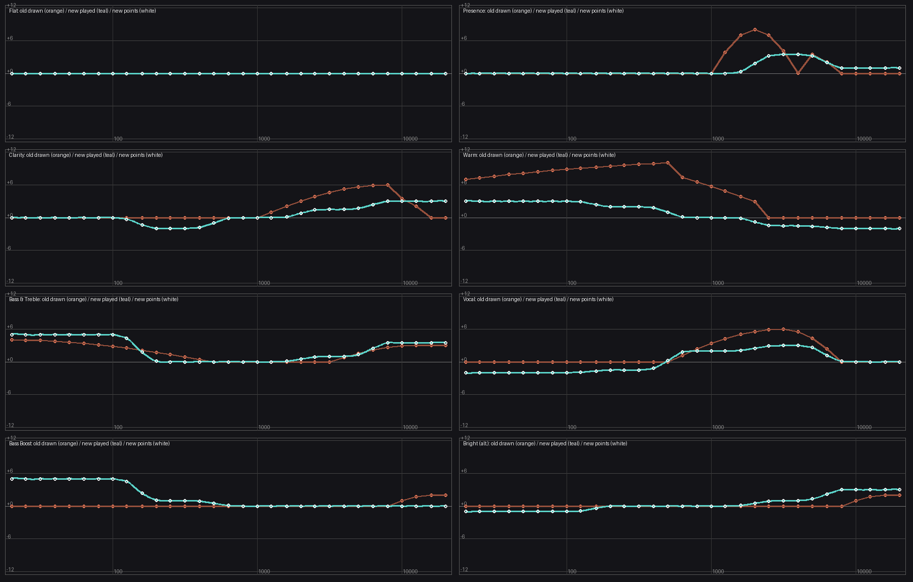
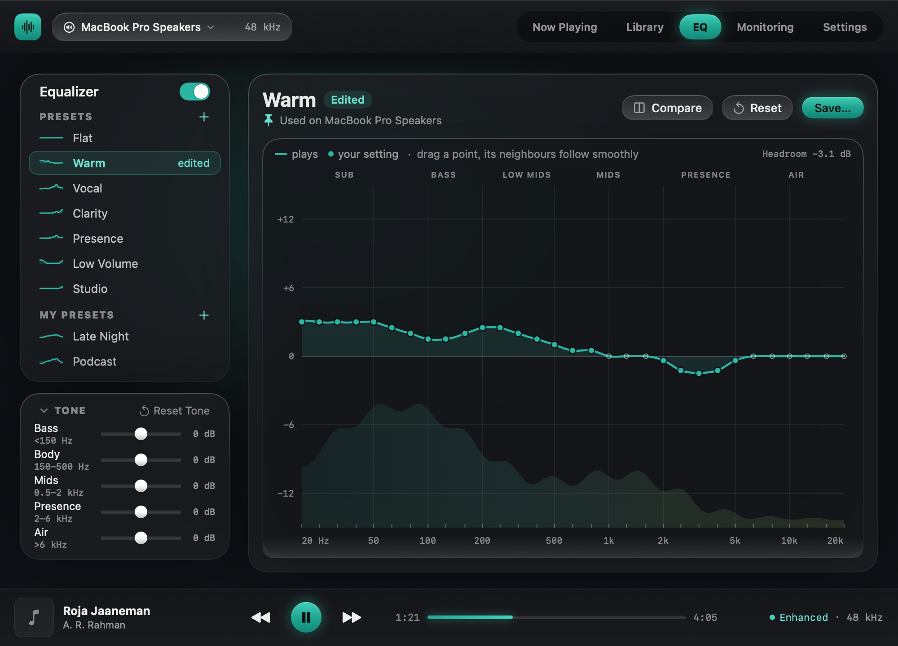
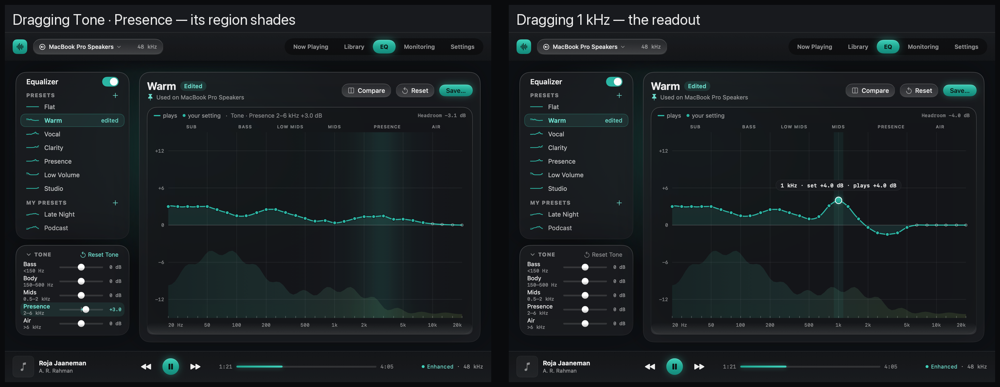

# EQ — "The Lens", 31 points (design + decisions)

*2026-10-09. The founder asked for an EQ redesign "for elegance, not just a glass look". Inputs: a
product market survey ([eq-market-research.md](../../product/eq-market-research.md) — 23 products,
70 sources), a ui-designer study ([design-study.md](design-study.md), renders in `png/`), and an
audio-dsp verification of today's engine (below). Founder decisions 21–23 in the
[sweep plan](../../sprints/s10-8-glass-sweep-plan.md) §B; built as **Sprint EQ** (§E).*

## Founder decisions

- **21 — Full redesign before R1** (not the honest-fix-now / editor-later split the study recommended).
- **22 — The Lens look, 31 draggable points only.** The Lens's layout and features (value readout
  while dragging, Compare, Reset, an EQ On/Off, presets incl. the user's own, per-output memory, a
  visible safety ceiling, the honest played curve) — but the user shapes sound with **all 31 points**;
  **no five-point mode** (the study's five named points are NOT built). So the engine must play an
  accurate 31-band graphic EQ. *(Layout revised by 24; the features above all stay.)*
- **23 — Safety = automatic headroom + a visible +12 dB ceiling.** Today's summed-dB clamp is retired. *(Revised by 26.)*
- **24 — Layout = V1b** (below), chosen over the Lens's single card, "Sound first" (B) and
  "Profiles" (C), then three B-based prototypes (V1–V3) and one revision.
- **25 — The EQ always plays in full:** it runs ahead of the Intensity blend. "Intensity 0 with EQ Off"
  is the bit-perfect state.
- **26 — Loudness-neutral EQ** (revises 23): a gain predicted from the track's gated spectrum keeps
  the loudness unchanged, replacing the −max|H| preamp; the −1 dBTP limiter catches rare peaks. Off
  is a true bypass and level-fair at once. The Headroom readout goes; the +12 dB ceiling stays.
- **27 — Preset switch with unsaved edits:** switch at once, with a "Bring back edits" message.
- **28 — Compare = hold to hear without the EQ** at the same loudness. A pinned output remembers
  exactly what was last heard on it.
- **29 — Loud masters, EQ-only path:** limiter ceiling −0.1 dBTP (like the original), −1 dBTP on
  Bluetooth.
- **30–32 — Presets re-voiced** (smooth Tone-built shapes, +3 to +5 dB peaks); "Loudness" → "Bass & Treble";
  "Studio" → "Bass Boost" (a saved Studio loads as Flat). [plan/preset-revoice.md](plan/preset-revoice.md),
  

**Build plan:** [plan/amendments.md](plan/amendments.md) (wins), [plan/engine-plan.md](plan/engine-plan.md),
[plan/ui-plan.md](plan/ui-plan.md). Evidence: [evidence/](evidence/). Prototype: `research/eq-geq-poc/`.

Evidence for 25–28: the plan check plus a three-reviewer adversarial panel (breaker, state-of-the-art
challenger, architect), backed by a literature survey and a survey of how other players implement
EQ. Records are in the [sweep ledger](../../sprints/s10-8-sweep-ledger.md) (Sprint EQ).

## Layout: V1b (decision 24)

- **Left rail, two stacked cards.**
  - **Equalizer:** EQ On/Off; **Presets** (built-in, each with its small curve glyph) and
    **My Presets** below them.
  - **Tone:** five one-line rows. Each row has its name, its region in small text (Bass <150 Hz,
    Body 150–500 Hz, Mids 0.5–2 kHz, Presence 2–6 kHz, Air >6 kHz), a ±12 dB slider centred at 0,
    and its value. The header has a fold chevron and "Reset Tone", which is disabled at all-zero.
  - **The link to the graph:** the region labels use the graph's own axis. Hovering or dragging a
    slider highlights its row, shades exactly its region on the graph, and shows a readout
    ("Tone · Presence 2–6 kHz +3.0 dB"). The points visibly move.
- **Right, one graph card.**
  - **Header:** "Warm · Edited", the **"Used on <output>" pin** (per-output memory, also in the
    menu), Compare, Reset, Save.
  - **Body:** the 31-point graph, with **today's drag (neighbours follow)**, the played curve, the
    headroom readout, the +12 dB ceiling and the analyzer lens.
- **Tone is a macro over the 31 points, not a second mode.**
  - Choosing a preset resets Tone to 0 ("Vocal starts clean").
  - Save bakes Tone into the saved preset.
- **Small window: the Tone card folds to one line** ("Tone · all at 0 dB", with an icon reset).
  It is the user's choice and is remembered; it never folds by itself. At 880×640, with Tone
  folded, every preset fits without scrolling. At 1000×720 both cards fit (denser rows than the
  Library rail).

More: [light](png/v1b-light-1000x720.png), [Tone folded at 880×640](png/v1b-toneCollapsed-dark-880x640.png),
[V1 vs V1b](png/compare-v1-v1b-dark.png).

## Why: today's EQ does not play what it shows (verified 2026-10-08)

Measured through the production coefficient code and `EQModule` (calculation vs test tones within
0.007 dB):

- **The engine is not a 31-band graphic EQ.** `EQModuleCoefficients.h:146-207` places one bell per
  run of same-sign bands at the run's largest band; Q = 1/(0.5 + 0.1·|g|); bands ≤ 0.5 dB are dropped;
  at most 10 sections. Any drawn shape plays as one or two bells.
- **The safety clamp shrinks presets ~10×.** `EQSafetyClamp.swift` scales every band when the signed
  sum of band dB exceeds +12 (a sum of dB is not a level). Played vs drawn peak: Warm +10.0 → **+0.74**,
  Presence +8.0 → +2.79, Clarity +6.0 → +1.68, Vocal +6.0 → +1.58, Loudness +4.0 → +0.85; a +3 dB
  broadband lift plays **+0.00**, while a single +12 dB band passes unscaled.
- **The graph draws neither.** `FrequencyResponseCanvas+Drawing.swift:191-227` joins the pre-clamp
  dots (log-linear, lightly smoothed) — not a filter response.
- **Write-only features:** saved custom presets never appear in the Preset menu; the per-output map
  (`outputPresetMap`) is never written, so per-device recall never fires.
- **Axis:** drawn ±20 dB while edits stop at ±12 (≈ 40% of the height unreachable).

## What Sprint EQ builds

**Engine (audio-dsp; full DSP rigor — null tests, measured responses, the C++ gate):**
- **E1 — an accurate 31-band graphic EQ:** one bell per band with interaction-solved gains
  (Välimäki & Liski, "Accurate Cascade Graphic Equalizer", IEEE SPL 24(2), 2017; DAFx-17
  third-octave follow-up); section limit 10 → ≥ 31 (vDSP).
- **Automatic headroom:** delete the summed-dB clamp (keep ±12 dB per band); preamp = −max(0, peak of
  the played response), computed off the audio thread, carried in the unused
  `EQParams.masterGainLinear` (already ramped, 32 ms) — no frequency ever plays louder than the
  source (the AutoEq / Equalizer APO `Preamp:` convention).
- **Played-curve read-back:** the engine reports the response it actually plays, from the real
  coefficients, so the graph never runs a Swift copy of the fitter.
- **A preset FR test:** extend `Tests/EqFrequencyResponseSweepTests.inc` (`runEqSineAt` takes any
  31-band array) to measure every preset's played response against its target.

**The screen (UI; layout = V1b above):** the graph IS the editor — 31 draggable points over the ±12 dB range; the solid
curve is the PLAYED response, the points are the targets; a readout while dragging (band, set,
plays); a "Headroom −X dB" readout and the +12 dB ceiling drawn when a boost reaches it; EQ On/Off,
level-matched Compare, Reset; the Preset menu with built-in + My Presets (rename / delete) and
"Use on <output> ✓" (per-output memory, written); keyboard (move between points, ↑/↓ adjust) and
VoiceOver (each point an adjustable element); **the keyboard cursor follows the point you click or drag** (founder, 2026-10-09: today's cursor stays where the keyboard left it, so ↑/↓ after a click adjust a different band), and like every keyboard ring in the app it shows only while navigating by keyboard (Sprint A rule); existing tokens only (light frozen, decision 16); the
analyzer lens (Sprint D grammar). The "Interpolation" picker retires.

**Presets re-voiced** for the honest engine (they will sound stronger than today's clamped ones) —
the founder's 10-minute listening check. Proposed: rename "Loudness" → "Low Volume" (it collides
with S14's loudness compensation) — confirm at the check.

**Tone (decision 24):** five region macros (Bass, Body, Mids, Presence, Air) that move the 31
points. The played response is still the one 31-band engine; Tone adds no filters of its own.

**Size:** about 23 points (engine ~8: E1 4, headroom 2, read-back 2; UI ~9; Tone card ~3;
presets / memory / On/Off ~2; re-voice 1). Supersedes Sprint F's F3/F4 (3 points).

## Open questions for the DSP plan check

Filter-update smoothing while dragging (zipper-free coefficient interpolation); CPU at 31 sections ×
channels (up to 7.1); whether Compare level-matches by the preamp alone or by measured loudness;
how the EQ sits relative to the loudness normaliser (−16 LUFS, +12 dB make-up) so On/Off and
Compare stay fair.

**Tone (for the UI + DSP check):**
- the five region weights: smooth over log frequency, so a slider never steps the curve;
- how Tone layers on the points: a separate offset that is shown in the points and baked in on
  Save, or a direct edit of the points;
- what a point drag does while Tone is non-zero;
- the per-band clamp when a preset point plus Tone exceeds ±12 dB.
