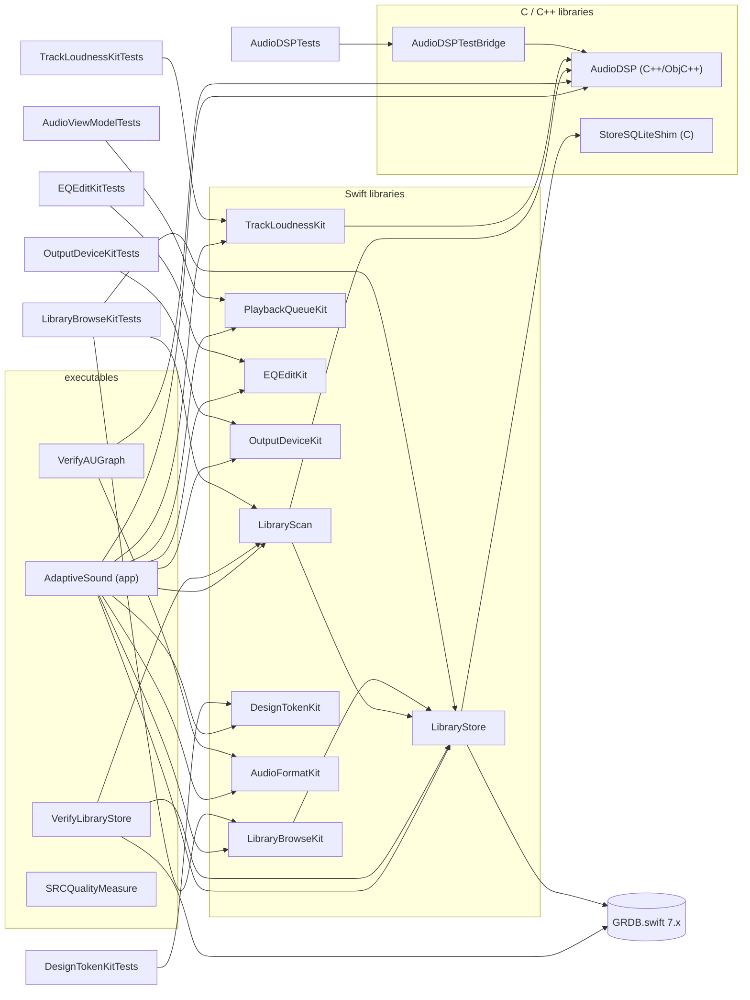

# 00 — Shared codebase map (AdaptiveSound)

**Snapshot:** `main` @ `a206107` (release: 1.0.0-alpha), 2026-10-13. Repo `/Users/ramith/code/sound-engineering`.
**Purpose:** the common, factual picture for the council's reviewers. It describes the code; it does not judge it.
LOC = `wc -l` (comments + blanks included). Paths are repo-relative. "app" = the `AdaptiveSound` executable target.

**Totals (tracked files):**

| Area | Files | LOC |
|---|---|---|
| `Sources/**/*.swift` | 494 | 54,782 |
| `Sources/**` C / C++ / ObjC++ (`.cpp .mm .h .c`) | 83 | 15,843 |
| `Tests/**/*.swift` | 113 | 12,582 |
| `Tests/**` C++ harness (`.cpp .mm .h .inc`) | 35 | 24,022 |
| `docs/**/*.md` | 147 | — |

Toolchain: swift-tools 6.2, Swift 6 language mode, macOS 26 minimum, C++ `gnucxx2b`. One external SwiftPM dependency: GRDB.swift `from: 7.0.0`. `Package.swift:413-419` makes every Swift warning an error in DEBUG (`treatAllWarnings(as: .error)`).

---

## 1. Modules (SwiftPM targets)

23 targets: 4 executables, 9 Swift libraries, 3 C/C++ libraries, 7 test targets. Plus non-SwiftPM C++ harnesses built by scripts (section 5).

### 1.1 Target table

| Target | Kind | Purpose (one line) | Files | LOC | Depends on | Depended on by | Key types / public surface |
|---|---|---|---|---|---|---|---|
| `AdaptiveSound` | executable (app) | The macOS app: SwiftUI UI, view models, the engine bridge, composition root | 303 swift + 1 h | 28,095 | AudioDSP, AudioFormatKit, LibraryStore, LibraryScan, PlaybackQueueKit, LibraryBrowseKit, DesignTokenKit, EQEditKit, TrackLoudnessKit, OutputDeviceKit | — (not importable by tests) | `AudioViewModel`, `AudioEngineBridge`, `AudioPlaybackEngine`, `EQViewModel`, `LibraryModel`, `LibraryBrowseModel`, `PlaylistsModel`, `NowPlayingController`, SwiftUI views. Imports `DeviceBridge.h` via `-import-objc-header` (`Package.swift:42-48`) |
| `AudioDSP` | C/C++/ObjC++ library | Real-time DSP kernel, the two AUs, the Realizer control plane, the Pure HAL engine, decode, device C-ABI | 23 cpp, 51 h, 4 mm | 15,664 | system frameworks only (CoreAudio, AudioToolbox, AVFoundation, Accelerate) | AdaptiveSound, VerifyAUGraph, LibraryScan, TrackLoudnessKit, AudioDSPTestBridge | Module map exports ONLY `include/DeviceBridge.h` (`include/module.modulemap`), which includes the pure-C bridges: `AudioUnitRegistrationBridge.h`, `PureModeBridge.h`, `MetadataBridge.h`, `EQDesignBridge.h`, `TrackLoudnessBridge.h` (~50 C functions). C++ classes: `DSPKernel`, `EQModule`, `GraphicEQDesigner`, `LoudnessModule`, `LimiterModule`, `CrossfeedModule`, `CausalLoudnessTap`, `Realizer`, `HALOutputEngine`, `FileDecodeSource`, `GaplessSource`, `PureModeSource`. Debug `-Werror`; release permissive (`Package.swift:363-389`) |
| `AudioDSPTestBridge` | C++ library | Pure-C wrapper over the production graphic EQ for Swift tests | 1 cpp + 1 h | 137 | AudioDSP | AudioDSPTests | `EQTestBridge.h` (`eqStreamC`, `eqPlayedCentresC`) |
| `StoreSQLiteShim` | C library | `sqlite3_db_config` (variadic; not Swift-importable) to disable checkpoint-on-close | 1 c + 1 h | 26 | system libsqlite3 | LibraryStore | `storeSQLiteDisableCheckpointOnClose` |
| `LibraryStore` | Swift library | Persistent library DB on GRDB (DatabasePool/DatabaseQueue, DatabaseMigrator v1–v7, FTS5) | 29 | 5,479 | GRDB, StoreSQLiteShim | AdaptiveSound, LibraryScan, LibraryBrowseKit, VerifyLibraryStore, LibraryBrowseKitTests | `LibraryStore` (`final class … Sendable` over `any DatabaseWriter`), `Schema`, `LibraryTrack`, `LibraryTrackDisplay`, `AlbumFacet`/`ArtistFacet`/`GenreFacet`, `Playlist`/`PlaylistEntry`/`PlaylistFolder`, `TrackSort`/`FacetSort`, `AlbumGrouping`, `PathNormalizer`, `StoreQuarantine`, `StoreBackup`, `SearchResults` |
| `LibraryScan` | Swift library | Folder walk, file signature, metadata/artwork extraction (AVFoundation + dlopen FFmpeg), FSEvents watcher, walk scheduling | 15 | 1,528 | LibraryStore, AudioDSP (MetadataBridge only) | AdaptiveSound, VerifyLibraryStore, LibraryBrowseKitTests | `LibraryScanner`, `MetadataScanner`, `MetadataExtractor`, `ArtworkCache`, `LibraryWatcher`, `FolderWalkSchedule`, `ScanResult`, `ScanProgress`, `NestedRootConflict`, `RootUnreachableError` |
| `LibraryBrowseKit` | Swift library | Pure browse/selection/layout decision logic extracted from the app | 35 | 1,997 | LibraryStore | AdaptiveSound, LibraryBrowseKitTests | `SongSortMapping`, `SearchEpoch`/`SearchQueryGate`, `SongsRowResolver`, `ListSelection`, `ListKeyboardCursor`, `GridKeyboardCursor`, `TypeSelectBuffer`, `GridLayoutMath`, `FillGridLayout`, `DetailTrackLayout`, `FacetAlbumGrouping`, `PlaylistDropRouter`, `CoalescingWriter` (`@MainActor`), `QueueToastDecision` |
| `PlaybackQueueKit` | Swift library | Pure queue / transport decision core extracted from `AudioViewModel` | 10 | 515 | — | AdaptiveSound, AudioViewModelTests | `QueueAdvance`, `PlaybackOrder`, `QueueInsert`, `PlayNextNowMove`, `QueueRestorePoint`, `ResumePoint`, `SeekRoute`, `TransportSnapshot` + `SnapshotChannel`, `PlayThroughTracker`, `NowPlayingSnapshot` |
| `EQEditKit` | Swift library | Pure EQ editing contract: band grid, curve/Tone maths, presets, session/slots, Master Gain law | 27 | 2,113 | — | AdaptiveSound, EQEditKitTests | `EQSession`, `EQStore`, `EQState`, `EQCurve`, `EQBands`, `EQToneRegion`, `EQBuiltInPreset`, `EQOutputPin`/`EQOutputKey`, `EQPlotMap`, `EQPlayed`, `MasterGainLaw` |
| `OutputDeviceKit` | Swift library | The one output-device rule (pin/follow, Enhanced/Pure, device loss) | 1 | 153 | — | AdaptiveSound, OutputDeviceKitTests | `OutputDevicePolicy.action(for:facts:)`, `.playbackMovesWithOutput`, `.resumeAfterDeviceLoss`; `OutputDeviceEvent`, `OutputDeviceFacts`, `OutputDeviceAction` |
| `TrackLoudnessKit` | Swift library | Second-decode track-loudness analyzer feeding the C++ profiler; jobs, cache, failure rules | 3 | 431 | AudioDSP | AdaptiveSound, TrackLoudnessKitTests | `TrackLoudnessAnalyzer` (AsyncStream inbox + private `actor Coordinator`), `TrackIdentity`, `TrackLoudnessProfileHandle`, `TrackLoudnessSink` |
| `DesignTokenKit` | Swift library | Design-token data + pure surface/contrast resolvers; zero SwiftUI/AppKit (gate-enforced) | 17 | 1,694 | — | AdaptiveSound, DesignTokenKitTests | `Palette`, `SurfaceResolver`/`ResolvedSurface`, `RGBAColor`, `TokenAppearance`, `PeakHoldTracker`, `SpectrumRamp`, `SampledGlow`, layout metric structs |
| `AudioFormatKit` | Swift library | Channel count → `AVAudioFormat` / layout tag; device-width format | 1 | 105 | — | AdaptiveSound, VerifyAUGraph | `multichannelFormat(for:sampleRate:)`, `multichannelLayoutTag(for:)`, `deviceWidthFormat(sourceFormat:…)` |
| `VerifyAUGraph` | executable (harness) | Headless AU-graph integration gate (M1/M2/M3/EQ1b/DEV-UID) | 7 | 1,374 | AudioDSP, AudioFormatKit | — | `swift run VerifyAUGraph` |
| `VerifyLibraryStore` | executable (harness) | Headless store/scan acceptance gate (~157 `CheckCase` registrations) | 44 | 10,791 | LibraryStore, LibraryScan, GRDB | — | `swift run VerifyLibraryStore` |
| `SRCQualityMeasure` | executable (tool) | Characterises `AVAudioConverter(.max)` imaging/aliasing on tones | 2 | 523 | — | — | `swift run SRCQualityMeasure` |
| `AudioViewModelTests` | test | Queue/transport kit tests + VM mirrors | 19 | 2,702 | PlaybackQueueKit | — | see §5 |
| `LibraryBrowseKitTests` | test | Browse kit + 3 LibraryScan suites | 40 | 3,918 | LibraryBrowseKit, LibraryStore, LibraryScan | — | see §5 |
| `EQEditKitTests` | test | EQ kit contract | 22 | 2,165 | EQEditKit | — | |
| `OutputDeviceKitTests` | test | Output-device rule | 1 | 299 | OutputDeviceKit | — | |
| `TrackLoudnessKitTests` | test | Analyzer end-to-end on generated WAVs | 1 | 276 | TrackLoudnessKit | — | |
| `DesignTokenKitTests` | test | Resolver cube, palette invariants, WCAG audit, SlotFit (AppKit allowed here) | 28 | 3,077 | DesignTokenKit | — | |
| `AudioDSPTests` | test | Production graphic EQ via the C bridge | 2 | 145 | AudioDSPTestBridge | — | |

### 1.2 Dependency graph

Facts about the graph:
- `AudioDSP` depends on no Swift target. `LibraryScan` → `AudioDSP` exists only for the header-only FFmpeg metadata C bridge (dlopen at runtime).
- No library depends on the app. The app is a leaf; the six `*Kit` libraries exist so their logic is testable (comments in `Package.swift:155-213` say so for each).
- `SRCQualityMeasure` has no dependencies; it replicates the Enhanced resampler setup rather than importing it (`Package.swift:145-153`).

---

## 2. Layers

### 2.1 Layer → files

| Layer | Where | Files / LOC | Notes |
|---|---|---|---|
| **UI (SwiftUI views)** | `Sources/AdaptiveSound/UI/**` | 175 / 13,325 | Library 57/4,480 · EQ 37/2,247 · Playlist 19/2,075 · Controls 22/1,301 · Shell 12/1,098 · NowPlaying 6/845 · Monitoring 8/414 · Settings 6/271 · Tabs 3/254 · Spectrum 2/146 · Loudness 1/111 · 2 root files |
| UI glue at app root | `ContentView`, `TabContentView`, `MenuBarView`, `DesignSystem*.swift`, `DesignSystemGlass*.swift`, `Color+Brand`, `TabSelection` | ~1,246 | `DesignSystemGlass.swift` bridges `DesignTokenKit` data into SwiftUI values |
| **Debug / sheet tooling** (DEBUG-only, all 32 files under `#if DEBUG`) | `Sources/AdaptiveSound/Debug/**` | 32 / 2,446 | Launch flags: `-ASRenderSheets` (offscreen PNG sheets of every tab: `SheetRenderer`, `SheetFixture*`, `SheetEngine` = a fake `AudioPlaybackEngine`), `-ASSongsPerf` (`SongsPerfRun`, 20k-song list perf), `-ASMainThreadStall <mode>` (`MainThreadStallSelfTest/Rig/Probe`), `-ASTestLibrary` (`TestLibrary`). Entry points called from `AdaptiveSound.init` (`AdaptiveSound.swift`) |
| **View models / app state** (`@MainActor @Observable`) | app root | see 2.2 | composition root `AdaptiveSound.swift` (204 LOC) wires them with closures |
| **Bridge** | `AudioEngineBridge.swift` + 22 `AudioEngineBridge+*.swift`, `AudioPlaybackEngine.swift`, `EngineSnapshot.swift`, `PureModeSession.swift`, `LoudnessMeterHandle.swift`, `SignalPathInfo.swift`, `AudioBridgeError.swift`, `Spectrum/*`, `Monitoring/MonitorTap.swift` | 29 / 4,643 (+ Spectrum 446) | `AudioEngineBridge` is `final class … @unchecked Sendable`, hand-rolled isolation by queues + one leaf lock (`AudioEngineBridge.swift:18-34`) |
| **Engines** | Enhanced: AVAudioEngine graph built in `AudioEngineBridge+Graph.swift` / `+Reconfigure.swift`; AUs in `AudioDSP/AudioEngine/AUAudioUnit.mm` (effects AU, 539) + `SpatialRendererAU.mm` (`'aspz'`, 362). Pure: `AudioDSP/AudioEngine/HALOutputEngine.mm` (1,044) + `PureModeBridge.cpp` (404) + `GaplessSource.cpp` (282) + `FileDecodeSource.cpp` (1,419) + `PureModeSource.cpp`/`PureModeFormat.cpp`/`PureModePolicy.cpp`/`PureModeBridgePolicy.cpp` | | Enhanced graph: `player → effectsAU (N→N) → spatialAU (N→M) → mainMixer → output`. Pure bypasses AVAudioEngine and all DSP |
| **Control plane (C++)** | `AudioDSP/AudioEngine/Realizer.h/.mm` (232 + 595) | | `shared_ptr`-owned, serial dispatch queue `com.adaptivesound.realizer`; sole publisher of `TargetState` to the kernel; designs the EQ off-RT |
| **DSP kernel (C++)** | `DSPKernel.cpp` (409), `EQ/*`, `Loudness/*`, `Limiting/*`, `Spatial/*`, `Clarity/ClarityModule.h`, `include/*` RT primitives | | Chain: EQ → Clarity (stub) → BRIR (stub) → Crossfeed → Loudness → Limiter; intensity = equal-power wet/dry blend (`DSPKernel.h:95-106`) |
| **Data** | `LibraryStore` (GRDB), `LibraryScan`, plus app-side `LibraryModel*`, `PlaylistsModel*`, `AppDataLocation.swift`, `EQViewModel+Persistence.swift` (UserDefaults), `AudioViewModel+QueueHydration/+QueueMirror` | | UserDefaults suite chosen once at launch (`AppDataLocation.atLaunch()`); semgrep `persist-one-location` enforces it |
| **Pure decision kits** | `PlaybackQueueKit`, `LibraryBrowseKit`, `EQEditKit`, `OutputDeviceKit`, `DesignTokenKit`, `AudioFormatKit`, `TrackLoudnessKit` | | All zero-UI; DesignTokenKit/EQEditKit/OutputDeviceKit purity is a strict-gate check |

### 2.2 View models / app state — what each owns

| Type (file, LOC incl. extensions) | Isolation | Owns | Collaborators |
|---|---|---|---|
| `AudioViewModel` (`AudioViewModel.swift` + 13 extensions, 14 files / 2,075) | `@MainActor @Observable` | Transport UI state (`isPlaying`, `playbackPosition`, `duration`, `resumePoint`, `transportEpoch`, `transportStopEpoch`), the queue (`queue: [QueueItem]`, `selectedTrackIndex`, `pendingNextIndex`, `lastTransitionCount`, `queueRestorePoint`, shuffle/repeat), devices (`availableDevices`, `selectedDevice`, `pinPlaybackToSelectedDevice`), DSP intents (`intensity`, `crossfeedEnabled/Strength`, `masterGain`, `pureModeEnabled`), readouts (`signalPath`, `loudness`, `spectrumBars`, `peakCaps`, `eqDesignRate`), two 20 Hz `Timer`s, play-through tracking, queue mirror/hydration flags, 3 outbound hooks (`onEngineReady`, `onNowPlayingRefresh`, `onOutputIdentityChanged`) | `engine: any AudioPlaybackEngine` (default `AudioEngineBridge()`), `weak var library: LibraryModel?` (only audio→library edge: play-count writes) |
| `EQViewModel` (3 files / 399) | `@MainActor @Observable` | `session: EQSession` (EQEditKit), output toast, highlighted Tone region, memoised played curve (`EQDesigner` = Swift wrapper over the C++ designer, `EQDesigner.swift` 49) | holds `AudioViewModel` (strong `let`); publishes via `audioViewModel.publishEQ`; persists to `UserDefaults` |
| `LibraryModel` (6 files / 796) | `@MainActor @Observable` | `store: LibraryStore?`, scan/metadata progress, `libraryRevision` (bump = "library changed"), `walkSchedule: FolderWalkSchedule`, walk/scan/add `Task`s, `LibraryWatcher` + its queue, watched roots, reconcile debounce + state, volume-monitor tokens | `onError`, `onStoreReady` hooks to `AudioViewModel` |
| `LibraryBrowseModel` (7 files / 868) | `@MainActor @Observable` | Browse navigation (`selectedCategory`, `path`), albums/artists/genres/songs/history arrays + `LoadState`s, sort, search query + `matchedIDs` + `visibleSongs`, toasts, roots, artwork store; 7 load epochs (`loadEpoch`, `songsLoadEpoch`, `loadRootsEpoch`, `artistsLoadEpoch`, `genresLoadEpoch`, `historyLoadEpoch`, `searchEpoch`) | `audio: AudioViewModel`, `library: LibraryModel` |
| `PlaylistsModel` (3 files / 580) | `@MainActor @Observable` | Playlist tree + detail rows + `LoadState`s, `treeEpoch`/`detailEpoch`, dialogs, coalesced order writer (`CoalescingWriter<Int64,[Int64]>`), order-failure state | `library`, `audio` |
| `NowPlayingController` (349) | `@MainActor @Observable` | MPNowPlayingInfoCenter + MPRemoteCommand registration, resolved metadata/artwork tokens | `weak audio`; closures `resolveMetadata`, `loadArtwork`, `resolveLooseMetadata` |
| `MonitoringViewModel` (`UI/Monitoring`) | `@MainActor @Observable` | per-channel before/after band arrays, a ~20 Hz polling `Task` (`Task.sleep(50 ms)`) | `engine: any AudioPlaybackEngine` |
| Small UI state | `@MainActor @Observable` | `BrowseNavigator`, `KeyboardTransportFocus`, `KeyboardFocusVisibility`, `ShellToastSlot`, `ArtworkGlowSampler` | |

12 `@Observable` classes in total, all `@MainActor`. Views read models via `@Environment(T.self)`: AudioViewModel in 24 files, LibraryBrowseModel 30, EQViewModel 14, PlaylistsModel 7, LibraryModel 3, NowPlayingController 3.

Composition root (`AdaptiveSound.swift` `init`): builds `AudioViewModel` → `LibraryModel` (sets `audio.library`, `lib.onError`, `lib.onStoreReady → audio.hydrateQueueOnLaunch`) → `EQViewModel(audioViewModel:)` (sets `audio.onOutputIdentityChanged → eq.outputDidChange`) → `LibraryBrowseModel(audio:library:)` → `PlaylistsModel(library:audio:)` → `NowPlayingController` (closures into store/browse). `onAppear` hands models to `AppDelegate` and calls `audioViewModel.initializeEngine()`.

### 2.3 The bridge

- **Protocol** `AudioPlaybackEngine` (`AudioPlaybackEngine.swift:58-212`): `AnyObject, Sendable`. Async: `initialize`, `shutdown`, `startAudio(fileURL:pureMode:startAt:epoch:)`, `stopAudio(epoch:)`, `seek(to:epoch:)`, `setNextTrack`, `enumerateOutputDevices`, `selectDevice`. Sync (main-thread-safe by contract, lines 16-22): `snapshot() -> EngineSnapshot`, `publishEQ`, `publishIntensity`, `publishOutputTransport`, `publishCrossfeed`, `publishMasterGain`, `requestDeviceVolume`, `currentOutputDeviceID`, `setPinPlaybackToSelectedDevice`, `readSpectrumBands`, `monitorChannelCount`, `readMonitorBands`, `onOutputDevicesChanged`. Default no-op implementations in a protocol extension (lines 23-56).
- **Conformers:** `AudioEngineBridge` (production), `Debug/SheetEngine` (fake for sheets). Tests use a separate `AudioPlaybackEngineMirror` protocol (`Tests/AudioViewModelTests/MockAudioEngine.swift:43`), not the real protocol.
- **`EngineSnapshot`** (`EngineSnapshot.swift`, 21 LOC): `transport: TransportSnapshot`, `signalPath: SignalPathInfo`, `loudness: LoudnessSnapshot`, `eqDesignRate: Double`.
- **`AudioEngineBridge` extensions (23 files / 4,130 LOC):**

| File | LOC | Concern |
|---|---|---|
| `AudioEngineBridge.swift` | 365 | 47 stored properties, queues, lock, `snapshot()`, spectrum/monitor reads |
| `+SharedState` | 317 | `withStateLock`, guarded accessors, `withPureEngine`, `withEffectsAU` (borrow count), `setAvEngine`/`setPlayerNode` |
| `+PureMode` | 362 | `evaluatePureViable`, `startPure`, `seek`, `stopEnhancedPlayback`, `tearDownPure`, `seekEnhancedBestEffort` |
| `+EnhancedResampler` | 316 | streaming `AVAudioConverter` session start/prime/seek/stop; `EnhancedResampleSession` |
| `+OutputDeviceMonitor` | 307 | HAL listeners, `reconcileOutputDevice` → `OutputDevicePolicy.action`, device-loss pause |
| `+Playback` | 297 | `startAudio`, `attemptPureStart`, `startEnhancedPlayback`, `playFile`, `stopAudio`, reference tone |
| `+GaplessRoll` | 278 | seam roll (resampler / passthrough), next-file open, fallbacks |
| `+Graph` | 233 | instantiate AUs + build graph, 3 taps |
| `+Gapless` | 229 | `setNextTrack`, Pure arm/clear, `bumpTransitionCount`, `makeConverter` |
| `+Reconfigure` | 214 | channel-count graph reconfigure |
| `+MasterGain` | 179 | player gain, Pure device volume (queue + HAL listener), `DeviceHardwareVolume` |
| `+EnhancedResamplerSeam` | 164 | read→convert→schedule iteration, generation check |
| `+Lifecycle` | 161 | `initialize`, `shutdown`, teardown |
| `+TransportClock` | 126 | 33 ms `DispatchSourceTimer` on engineQueue → `TransportSnapshot` |
| `+ConfigChange` | 121 | `AVAudioEngineConfigurationChange` observer, re-establish |
| `+Devices` | 121 | enumerate/select devices |
| `+ChannelLayout` | 76 | source layout tag, `configureGraphForSource` |
| `+ReferenceTone` | 63 | test tone buffer |
| `+TrackLoudness` | 58 | analyzer → AU loudness profile C-ABI |
| `+EQControl` | 54 | `publishEQ`, `eqSampleRate`, `publishOutputTransport` |
| `+CrossfeedControl` | 36 | crossfeed C-ABI |
| `+IntensityControl` | 27 | intensity C-ABI |
| `+Values` | 26 | `EffectsUnit`, `TapAnalysis` value types |

### 2.4 Engines

- **Enhanced (AVAudioEngine):** graph built on `engineQueue` (`+Graph.swift:18 instantiateAndBuildGraph`). Effects AU = `AdaptiveSoundAU` (`AUAudioUnit.mm:35`), render block pulls input in place then `kernel->process(out, frames)` (`AUAudioUnit.mm:88-108`). Spatial AU `'aspz'` is an identity route at M == N (`SpatialRendererAU.mm`). Decode: `AVAudioFile`; 48 kHz files `scheduleFile` passthrough; other rates stream through `AVAudioConverter(.max)` on `resampleQueue`.
- **Pure (HAL):** `HALOutputEngine` (`kAudioUnitSubType_HALOutput`, render callback `HALOutputEngine.mm:806 renderTrampoline` → `render` with a `RenderGate` try-enter, `:836`). Source chain: `GaplessSource` (atomic active/armedNext/retired track pointers) → `FileDecodeSource` (decode `std::thread` + `SpscRing<float>`; Apple `ExtAudioFile` default, dlopen FFmpeg fallback). C-ABI `PureModeBridge.h` (12 functions, e.g. `pureModeEngineCreate/Seek/Stop/PollTrackAdvance/ArmOpenedNextTrack`), owned in Swift by `PureModeSession` (RAII wrapper, `@unchecked Sendable`).

### 2.5 Main call paths

**Play a track (Enhanced or Pure)**
1. UI → `AudioViewModel.playTrack(at:)` / `play()` (`+Transport.swift:10,25`) → `startPlayback(resumeFrom:)` (`+Playback.swift:18`): resets play-through, `nextTransportEpoch()`, `refreshDuration` (`Task.detached` opens `AVAudioFile`), then `Task { await engine.startAudio(…) }`.
2. Bridge `startAudio` (`+Playback.swift:7`): `engineQueue.async` → `beginTransportOperation(epoch:)` (publishes a transitional `TransportSnapshot`) → `resampleQueue.sync` clears `gaplessPlaybackEnded`/`onDeckURL` → `attemptPureStart` (`evaluatePureViable` → `stopEnhancedPlayback` → `startPure` → `PureModeSession`/`pureModeEngineCreate` → `HALOutputEngine`) else `startEnhancedPlayback` (`tearDownPure` if needed, `alignOutputForEnhancedStart` → `OutputDevicePolicy`, `engine.start()`, `installSpectrumTap`, `applyMasterGain`, `playFile` → `configureGraphForSource` (reconfigure to N channels) → passthrough `scheduleFile` or `startEnhancedResampler`) → `startTransportClock()` → `sampleTransport()` → resume continuation.
3. VM after await: if not stopped meanwhile (`transportStopEpoch < epoch`), `primeGaplessPipeline` (`engine.snapshot()` baseline; `computeNextIndex` → `engine.setNextTrack(nextURL)`), `isPlaying = true`.
4. Every 50 ms on main: `tickTransport` (`+SpectrumTimer.swift:56`) reads `engine.snapshot()`, filters with `TransportSnapshot.isCurrent(for: transportEpoch)`, updates playhead, accrues play-through, handles `transitionCount` increase → `handleTrackTransition` (`+AutoAdvance.swift:12`) or `ended` → next `startPlayback` / `stopAtEndOfQueue`.

**Seek**
`AudioViewModel.seek(to:)` (`+Playback.swift:131`) → `SeekRoute.route(isPlaying:isPaused:)` → `.engine`: `nextTransportEpoch()` + `Task { try await engine.seek(to:epoch:) }`; `.resumePoint`: moves `resumePoint`; `.ignore`. Bridge `seek` (`+PureMode.swift:174`): `engineQueue.async` → `beginTransportOperation` → Pure: `withPureEngine { pureModeEngineSeek }` (failure → `AudioBridgeError.seekFailed`); Enhanced (only with `enhancedPlayIntent`): `setEnhancedPositionBaseSeconds`, `resampleQueue.sync` check → `seekEnhancedResampler` or `seekEnhancedBestEffort` → `sampleTransport()`.

**Change the EQ**
`UI/EQ/EQGraph+Input.swift` (drag) / preset UI → `EQViewModel.perform(verb)` (`EQViewModel.swift`) mutates `EQSession` (EQEditKit) → outcome `.send` → `publish()` → `AudioViewModel.publishEQ(points:isOn:)` (`AudioViewModel.swift:410`) → `AudioEngineBridge.publishEQ` (`+EQControl.swift:21`) → `withEffectsAU` borrow (stateLock + `effectsAUBorrows` atomic) → C-ABI `publishEQ` (`AUAudioUnit.mm:424`) → `Realizer::setPendingEq` (slot under `slotMutex_` + `dispatch_async` drain) → on the realizer queue `realizeEq` (`Realizer.mm:409`): `GraphicEQDesigner::design(points, sampleRate)` → `EQTargets::toParams` with per-band ramps → loudness-neutral `outputGainDb` → `publishCanonical` (`:580`) → `DSPKernel::publishTargetState` (`DoubleBufferSnapshot<TargetState>`) → RT `EQModule` glides to new coefficients. The drawn "played" curve is computed separately in Swift via `EQDesigner` → C `asEqDesigner*` at `eqDesignRate` (from the snapshot).

**Device change** (all events funnel through one path)
- Sources: HAL listeners for `kAudioHardwarePropertyDevices` and `…DefaultOutputDevice` (on `DispatchQueue.global(.userInitiated)`, `+OutputDeviceMonitor.swift:33`), `kAudioDevicePropertyDeviceIsAlive` on the app's device (`global(.userInteractive)`, `:86`), and `AVAudioEngineConfigurationChange` (`queue: nil`, `+ConfigChange.swift:14`).
- Each → `outputDeviceDidChange(event)` → `configChangeQueue.async` → `reconcileOutputDevice` (`:116`): `readOutputDeviceFacts` (HAL reads: alive, system default; `currentDeviceID`, `activePathKind`, `enhancedPlayIntent`, pin) → `OutputDevicePolicy.action(for:facts:)` → `pauseForDeviceLoss` (sets interrupted signal path, then `engineQueue.async stopPlaybackAfterDeviceLoss`) / `applyTargetChange` (adopt target or re-assert via `selectOutputDeviceC`) / `reestablishEnhancedAfterConfigChange` → `notifyOutputDevicesChanged` (`DispatchQueue.main.async` + `MainActor.assumeIsolated`) → `AudioViewModel.refreshDevices` (`+Devices.swift:43`) → `engine.enumerateOutputDevices` (engineQueue) → `adoptOutput` (sets `selectedDevice` → EQ per-output switch + `publishOutputTransport`; crossfeed auto-off; Pure → restart at playhead via `OutputDevicePolicy.playbackMovesWithOutput`).
- Main tick sees `signalPath.interrupted` → `OutputDevicePolicy.resumeAfterDeviceLoss` → pause with resume point (`+SpectrumTimer.swift`).
- User pick: `AudioViewModel.selectDevice` → bridge `selectDevice` (`+Devices.swift:91`, engineQueue: `setOutputTarget` + `selectOutputDeviceC` = set the **system default** output) → `adoptOutput`.

**Library scan → UI**
`LibraryBrowseModel.addFolder` → `LibraryModel.scanFolderIntoLibrary` (`+Scan.swift:104`, serialised `folderAddTask`) → `registerLibraryFolder`: `LibraryScanner.validateNewRoot` (nested-root conflict) → `store.addRoot(url, dev:, inode:)` → `refreshWatchedRoots` → `requestWalk(.add)` (`+Walks.swift:20`) → `FolderWalkSchedule.request` → `Task(priority: .utility)` per folder → `performAddWalk` (`+Scan.swift:189`) → `LibraryScanner().scan(root:folderID:into:progress:)` (walk + `FileSignature` + store upserts/move-match/sweep; progress hops to main) → `publishScanResult` → `startFullMetadataPass` → `runMetadataPass` (`+Metadata.swift:23`) → `MetadataScanner.run` (`withThrowingTaskGroup`, ≤ min(cores, 6) in flight; `MetadataExtractor` AVFoundation/FFmpeg + `ArtworkCache`; store writes) → `libraryRevision &+= 1` (`+Metadata.swift:37`) → views `.onChange(of: library.libraryRevision)` (`UI/Library/LibraryTabView.swift:52`) → `LibraryBrowseModel.reloadIfScanChanged()` (`LibraryBrowseModel.swift:376`: albums, songs, artists, genres, re-run filter) and `PlaylistsModel.reloadOnLibraryChange()`; `LibraryDetailPage` `.task(id: libraryRevision)`.
FS changes: `LibraryWatcher` (FSEvents on `com.adaptivesound.library-watcher`) → `handleWatcherBatch` → `scheduleReconcile` (1 s `Task.sleep` debounce, `+Reconcile.swift:112`) → walk `.reconcile` via the same schedule. Volume mount/unmount: `+VolumeMonitor.swift`.

---

## 3. Concurrency domains

### 3.1 Dispatch queues

| Queue (label) | Declared | Kind | What runs there |
|---|---|---|---|
| `com.adaptivesound.engine` (`engineQueue`) | `AudioEngineBridge.swift:293` | serial | start/stop/seek, graph build + reconfigure, initialize/shutdown, every Pure C-ABI call, transport clock timer (`+TransportClock.swift:34`, 33 ms), device enumerate/select, device-loss stop. May `.sync` onto `configChangeQueue` (listener bind/unbind, `+OutputDeviceMonitor.swift:46,59`) and `resampleQueue` (10 `resampleQueue.sync` call sites: `+Playback.swift:24,210,256`, `+PureMode.swift:227,341`, `+EnhancedResampler.swift:97,106,184,249`, `+ConfigChange.swift:103` — the last from `configChangeQueue`) |
| `com.adaptivesound.enhanced-resampler` (`resampleQueue`) | `:226` | serial | `AVAudioConverter` read→convert→schedule, gapless seam state (`onDeckURL`, `resampleSession`, `resampleGeneration`, `passthroughGeneration`, EOF hooks), completion handlers hop here |
| `com.adaptivesound.config-change` (`configChangeQueue`) | `:284` | serial | every output-device event + `OutputDevicePolicy` decision, re-establish, alive-listener binding, `isReestablishing` |
| `com.adaptivesound.device-volume` (`deviceVolumeQueue`) | `:247` | serial | Pure device volume set/read (HAL), the device-volume listener block |
| `com.adaptivesound.library-watcher` | `LibraryModel.swift:103` | serial, `.utility` | `LibraryWatcher` FSEvents stream (`FSEventStreamSetDispatchQueue`, `LibraryWatcher.swift:134`) |
| `com.adaptivesound.realizer` | `AudioDSP/AudioEngine/Realizer.mm:143` | serial (libdispatch, C++) | EQ design, intensity/crossfeed realise, track-loudness gain, kernel re-init (`dispatch_sync` barrier from `allocateRenderResources`), shutdown barrier (`dispatch_sync`, `:171,184,336,446`) |
| `DispatchQueue.global(qos: .userInitiated)` | `+OutputDeviceMonitor.swift:33` | concurrent | HAL listener blocks for device list + default output (hop to `configChangeQueue`) |
| `DispatchQueue.global(qos: .userInteractive)` | `+OutputDeviceMonitor.swift:86` | concurrent | `DeviceIsAlive` listener block |
| `DispatchQueue.global()` | `+Gapless.swift:103` | concurrent | Pure next-track decoder open (`pureModeOpenDecodeSource`), then hands the handle to `engineQueue` |
| `DispatchQueue.global()` | `+GaplessRoll.swift:161` | concurrent | gapless fallback when the next file can't open: calls `playFile` and reads `self.avEngine` from a global queue |
| `DispatchQueue.main` | `+OutputDeviceMonitor.swift:182` | main | `onOutputDevicesChanged` callback |
| `RunLoop.main` `Timer`s | `AudioViewModel+SpectrumTimer.swift:18,35` | main | `tickSpectrum` and `tickTransport`, each 20 Hz, `.common` modes |

Harness-only queues: `MainThreadStallSelfTest.swift:131` (`avfaudio-internal-stand-in`), `VerifyLibraryStore/ChecksFolderWatch.swift:33,73`.

### 3.2 Locks and atomics

| Primitive | Where | Guards |
|---|---|---|
| `os_unfair_lock` `stateLock` (heap pointer) | `AudioEngineBridge.swift:101`; `withStateLock` `+SharedState.swift:39` | Leaf lock (doc'd "no callouts", `+SharedState.swift:7-33`). Guards: `storedTapAnalysis`, `storedEffectsUnit`, `storedCurrentDeviceID`, `pureEngine`, `activePath`, `storedCachedSignalPath`, `storedLastFileURL`, `storedEnhancedPositionBaseSeconds`, `storedLastKnownEnhancedPositionSeconds`, `storedPinPlaybackToSelectedDevice`, `deviceVolumeWatch`, `pendingDeviceVolume`, `deviceVolumeDrainPosted`, writes of `avEngine`/`playerNode`. Note: `avEngine`/`playerNode` are written via `setAvEngine`/`setPlayerNode` but read both through `avEngineRef`/`playerNodeRef` (4 call sites) and directly by name (e.g. `+Graph.swift:128,181`, `+Playback.swift:90`, `+Gapless.swift:77`, `+GaplessRoll.swift:163`) |
| `Atomic<Int>` `effectsAUBorrows` | `AudioEngineBridge.swift:63` | borrow count of the effects AU; teardown waits for 0 |
| `Atomic<UInt64>` `gaplessTransitionCounter` | `:168` | seam count (writer resampleQueue, reader transport clock) |
| `Atomic<Bool>` `gaplessEndedFlag` | `:173` | end-of-queue flag |
| `Atomic<Bool>` `enhancedPlayIntentFlag` | `:207` | Enhanced play intent (read by device-loss decision without waiting on resampleQueue) |
| `Atomic<Int>` `publishedGeneration` | `Spectrum/SpectrumDoubleBuffer.swift:40` | tap-thread → main spectrum double buffer |
| `OSAllocatedUnfairLock<Value>` in `SnapshotChannel` | `PlaybackQueueKit/TransportSnapshot.swift:52` | latest `TransportSnapshot` (engineQueue publishes, main reads) |
| `Mutex(0)` `searchIndexWrites` | `LibraryStore/LibraryStore.swift:54` | search-index write accounting |
| C++ `std::mutex slotMutex_` | `Realizer.h:224` | pending-intent slots (EQ/intensity/crossfeed) |
| C++ `std::mutex sinkMutex_` | `Loudness/CausalLoudnessTap.h:131` | causal-estimate sink + weights |
| C++ `std::atomic` | `LoudnessModule.h` (10: makeup gain, target, measured LUFS, layout gen, enabled…), `GaplessSource.h:142-157` (7: active/armedNext/retired `Track*`, transitions, ended, reap count), `RtSwappableResource.h` (3 slots), `CausalLoudnessTap.h:124-130` (5), `LoudnessMeterBridge.cpp:33-36` (4 doubles), `DoubleBufferSnapshot.h:208` (packed control word), `SpscRing.h:160,164` (head/tail), `RenderGate.h:111` (state), `FileDecodeSource.cpp:1148-1149` (stop/finished), `HALOutputEngine.mm:991` (`source_`), `Realizer.h:217` (`designRate_`) | RT ↔ off-RT handoff |
| GRDB internals | `LibraryStore+Open.swift:141` `DatabasePool` (WAL; one writer, concurrent readers); `DatabaseQueue` for look-first/migration/backup (`:86,116`, `StoreBackup.swift:54`) | DB serialisation |
| Harness-only | `Mutex`, `Atomic`, `DispatchSemaphore` in `Debug/MainThreadStallRig.swift`, `VerifyAUGraph`, `VerifyLibraryStore` (`NSLock` in `ChecksFolderWatch.swift:15`, `Deadline.swift:44`) | |

`RtSwappableResource.h` is referenced only by tests (`Tests/DSPKernelNullTest.cpp`, `EqEngineTests.inc`, `TestSupport.h`), not by production sources.

### 3.3 Actors and isolation boundaries

- **`@MainActor`:** all 12 `@Observable` classes; 8 of the `AudioViewModel` extensions are annotated `@MainActor extension` (the rest inherit through the type); 4 `LibraryBrowseModel` extensions; `ArtworkThumbnailStore`; `CoalescingWriter` (LibraryBrowseKit). Counts of `@MainActor` tokens: app 93, LibraryScan 5 (comments/sink docs), LibraryBrowseKit 4, PlaybackQueueKit 2 (comments), AudioDSP 3 (comments).
- **The bridge is deliberately not an actor and not `@MainActor`** (`AudioEngineBridge.swift:18-33`; semgrep `bridge-not-main-actor`). Its async methods are `withCheckedContinuation` + `queue.async` wrappers.
- **Swift actors:** only `private actor Coordinator` (`TrackLoudnessKit/TrackLoudnessAnalyzer.swift:89`) in production; `private actor CallCounter` in `VerifyLibraryStore/ChecksMetadataPass.swift:31`.
- **`LibraryStore`** is a `final class … Sendable` (not an actor) over GRDB's `DatabaseWriter`.
- **Structured concurrency:** `MetadataScanner.run` uses `withThrowingTaskGroup` (`LibraryScan/MetadataScanner.swift:69`). `TrackLoudnessAnalyzer` uses an `AsyncStream` inbox + `Task.detached` (`:55-58`, `:166`).
- **`Task.detached`** in app: `AudioViewModel+PlayTracking.swift:67`, `+Playback.swift:90`, `PlaylistsModel+DeadFiles.swift:15`, `UI/Playlist/TrackInfoCard.swift:146`; ~69 `Task {` / `Task.detached` sites in the app target overall.
- **No `defaultIsolation(MainActor)`** setting in `Package.swift`; app types are nonisolated unless annotated.

### 3.4 "Trust me" escapes

| Escape | Count | Locations |
|---|---|---|
| `@unchecked Sendable` (production) | 8 | `AudioEngineBridge.swift:34`, `AudioEngineBridge+EnhancedResampler.swift:279` (`EnhancedResampleSession`), `LoudnessMeterHandle.swift:30`, `PureModeSession.swift:33`, `Spectrum/SpectrumAnalyzer.swift:54`, `Spectrum/SpectrumDoubleBuffer.swift:30`, `LibraryScan/LibraryWatcher.swift:54`, `TrackLoudnessKit/TrackLoudnessProfileHandle.swift:7` |
| `@unchecked Sendable` (harness / tests) | 5 + 3 | `SRCQualityMeasure/main.swift:114`, `VerifyAUGraph/main.swift:69`, `VerifyLibraryStore/ChecksConcurrency.swift:185`, `ChecksFolderWatch.swift:14`, `Deadline.swift:43`; `Tests/LibraryBrowseKitTests/LibraryScanRaceGTests.swift:21`, `Tests/TrackLoudnessKitTests/TrackLoudnessAnalyzerTests.swift:139,210` |
| `nonisolated(unsafe)` | 1 prod + 2 harness | `SingleInstanceGuard.swift:16` (`static var lockDescriptor`); `VerifyAUGraph/VerifyMultichannel.swift:36`, `VerifyAUGraph/main.swift:283` |
| `MainActor.assumeIsolated` | 5 | `AudioEngineBridge+OutputDeviceMonitor.swift:185`, `AudioViewModel+SpectrumTimer.swift:22,36`, `UI/Controls/KeyboardFocusVisibility.swift:38`, `UI/EQ/EQCompareEscape.swift:44` |
| `@preconcurrency import AVFoundation/AVFAudio` | 26 Sources files | all 23 `AudioEngineBridge*.swift`, `Spectrum/SpectrumAnalyzer.swift`, `TrackLoudnessKit/TrackLoudnessAnalyzer.swift`, 2 Debug files; + 7 harness files |
| `Unmanaged` / raw pointer handles | `Unmanaged` in `+SharedState.swift`, `LibraryWatcher.swift` (2); `UnsafeMutableRawPointer` C handles 16 uses in 8 bridge/handle files | C-ABI opaque handles |

### 3.5 Real-time and worker threads (what each touches)

| Thread | Entry | Touches |
|---|---|---|
| AVAudioEngine render thread (Enhanced) | effects AU block `AUAudioUnit.mm:88` | `enableFlushToZero`, `pull` (in place), `DSPKernel::process` → `DoubleBufferSnapshot<TargetState>` read, `EQModule`, Clarity/BRIR stubs, `CrossfeedModule`, `LoudnessModule` (push to `SpscRing` → measurement thread; read `makeupGainLinear_` atomic), `LimiterModule`, `CausalLoudnessTap` (SPSC push), `ParameterRamp` intensity blend |
| same, spatial AU | `SpatialRendererAU.mm:176` | `SpatialRenderKernel` identity route (M == N) |
| AVFAudio tap threads (not RT) | `+Graph.swift:136-215` | mixer tap: `SpectrumAnalyzer.processTapBuffer` + `loudnessMeterAddStereo` (C meter); player tap: before-analyzers; effects-AU tap: after-analyzers. Captures analyzers once at install |
| CoreAudio HAL IO thread (Pure) | `HALOutputEngine.mm:806` | `RenderGate::tryEnter`, `PureModeSource`/`GaplessSource` (atomic track pointers, seam), `FileDecodeSource` SPSC ring pop, format conversion into `ioData`, `scratch_` (pre-sized) |
| Pure decode thread | `std::thread` `FileDecodeSource.cpp:1094` | decoder (ExtAudioFile or FFmpeg), SPSC ring push; joined on destroy / reap |
| Loudness measurement thread | `std::jthread` `LoudnessModule.cpp:88` | BS.1770 gated loudness off-RT; publishes makeup gain + LUFS atomics |
| Causal loudness worker | `std::jthread` `CausalLoudnessTap.cpp:35` | causal track-loudness estimate → sink under `sinkMutex_` |
| Realizer queue | `Realizer.mm:143` | EQ design + target publishing (see 2.5) |
| Track-loudness analysis | `Task.detached` in `TrackLoudnessAnalyzer` | second `AVAudioFile` decode → C++ `TrackLoudnessProfiler` |

### 3.6 Threading rules in force

From `docs/architecture/architecture.md` §"Threading rules (app ↔ engine)" (Sprint G, 2026-10): main never calls AVFAudio/HAL/AU/Pure C-ABI and never `.sync`s onto a bridge queue; queue ownership table (as 3.1); one-way waits (`engineQueue → configChangeQueue → resampleQueue`; nothing `.sync`s onto `engineQueue`); numbered transport requests (`nextTransportEpoch`, `TransportSnapshot.isCurrent(for:)`); `stateLock` is a leaf; completion handlers only hop; device loss pauses first. Enforced by semgrep `main-thread-no-audio-hardware`, `coreaudio-listener-not-on-main`, `main-thread-no-concrete-bridge`, `bridge-not-main-actor`, and `make main-thread-stall` (each main-thread entry < 25 ms, ≤ 1 % over 5 ms, with the engine lock held 2.5 s). The audit `docs/architecture/main-thread-audio-audit-2026-10.md` lists the findings S1-A…S3 (fixed) and side findings; `accruePlayThrough` stall-accrual deferred past R1.

---

## 4. Size hot spots

SwiftLint runs `--strict` (warnings fail): `file_length` warning 500, `type_body_length` 250, `function_body_length` 60, `cyclomatic_complexity` 8 (`.swiftlint.yml`). The largest Swift file is 492 LOC; several files carry comments saying a split exists to stay under the budget (e.g. `AudioViewModel+Playback.swift:7-10`: "AudioViewModel.swift — which must hold all `@Observable` stored properties, since extensions cannot — under the file-length budget").

### 4.1 25 largest Swift files (`Sources/`)

| # | LOC | File | Target |
|---|---|---|---|
| 1 | 492 | `Sources/LibraryStore/Schema.swift` | LibraryStore |
| 2 | 479 | `Sources/VerifyLibraryStore/ChecksConcurrency.swift` | harness |
| 3 | 474 | `Sources/LibraryStore/LibraryTypes.swift` | LibraryStore |
| 4 | 471 | `Sources/AdaptiveSound/PlaylistsModel.swift` | app |
| 5 | 454 | `Sources/AdaptiveSound/UI/Shell/NowPlayingBar.swift` | app |
| 6 | 453 | `Sources/VerifyLibraryStore/ChecksSongsSort.swift` | harness |
| 7 | 452 | `Sources/AdaptiveSound/LibraryBrowseModel.swift` | app |
| 8 | 445 | `Sources/VerifyLibraryStore/ChecksGenreCovers.swift` | harness |
| 9 | 437 | `Sources/LibraryStore/LibraryStore+Playlists.swift` | LibraryStore |
| 10 | 433 | `Sources/AdaptiveSound/AudioViewModel.swift` | app |
| 11 | 414 | `Sources/LibraryStore/LibraryStore+BrowseReads.swift` | LibraryStore |
| 12 | 402 | `Sources/VerifyLibraryStore/Fixtures.swift` | harness |
| 13 | 400 | `Sources/VerifyLibraryStore/main.swift` | harness |
| 14 | 400 | `Sources/VerifyLibraryStore/ChecksBrowseReads.swift` | harness |
| 15 | 392 | `Sources/LibraryStore/LibraryStore+DAO.swift` | LibraryStore |
| 16 | 383 | `Sources/VerifyLibraryStore/ChecksScanEdge.swift` | harness |
| 17 | 383 | `Sources/AdaptiveSound/DesignSystem.swift` | app |
| 18 | 381 | `Sources/VerifyLibraryStore/ChecksPlaylists.swift` | harness |
| 19 | 380 | `Sources/VerifyLibraryStore/ChecksAlbumFixRound.swift` | harness |
| 20 | 370 | `Sources/VerifyLibraryStore/ChecksAlbumIdentity.swift` | harness |
| 21 | 369 | `Sources/VerifyLibraryStore/ChecksAlbumArtist.swift` | harness |
| 22 | 368 | `Sources/VerifyAUGraph/main.swift` | harness |
| 23 | 366 | `Sources/VerifyLibraryStore/ChecksSearch.swift` | harness |
| 24 | 366 | `Sources/AdaptiveSound/DesignSystemGlass.swift` | app |
| 25 | 365 | `Sources/AdaptiveSound/AudioEngineBridge.swift` | app |

Next production files: `AudioEngineBridge+PureMode.swift` 362, `TrackLoudnessAnalyzer.swift` 357, `LibraryStore.swift` 352, `NowPlayingController.swift` 349, `UI/Library/SongsListView.swift` 348. Largest test Swift files: `Tests/DesignTokenKitTests/ContrastAuditTests.swift` 485, `Tests/AudioViewModelTests/MockAdvanceController.swift` 345. (A design-reference `docs/design/now-playing-7a/NowPlayingView.swift`, 627, is outside `Sources/`.)

### 4.2 10 largest C/C++ files (`Sources/`)

| # | LOC | File |
|---|---|---|
| 1 | 1,419 | `Sources/AudioDSP/FileDecodeSource.cpp` |
| 2 | 1,044 | `Sources/AudioDSP/AudioEngine/HALOutputEngine.mm` |
| 3 | 595 | `Sources/AudioDSP/AudioEngine/Realizer.mm` |
| 4 | 554 | `Sources/AudioDSP/CoreAudioDevice.cpp` |
| 5 | 539 | `Sources/AudioDSP/AudioEngine/AUAudioUnit.mm` |
| 6 | 532 | `Sources/AudioDSP/Limiting/LimiterModule.h` (header-only) |
| 7 | 501 | `Sources/AudioDSP/Loudness/LufsMeter.h` (header-only) |
| 8 | 431 | `Sources/AudioDSP/EQ/EQModule.cpp` |
| 9 | 409 | `Sources/AudioDSP/DSPKernel.cpp` |
| 10 | 404 | `Sources/AudioDSP/PureModeBridge.cpp` |

C++ test sources are larger: `Tests/FileDecodeTests.inc` 2,264, `TrackLoudnessTests.inc` 2,204, `EqEngineBreakItMeasurements.inc` 1,734, `MultichannelTests.inc` 1,711, `EqDesignerTests.inc` 1,625.

### 4.3 Types split across many files

| Type | Files (base + extensions) | Total LOC | `extension` declarations |
|---|---|---|---|
| `AudioEngineBridge` | 23 (1 + 22) | 4,130 | 21 |
| `LibraryStore` | 18 (1 + 17) | 3,532 | 17 |
| `AudioViewModel` | 14 (1 + 13) | 2,075 | 14 |
| `LibraryBrowseModel` | 7 | 868 | 7 |
| `LibraryModel` | 6 | 796 | 5 |
| `SheetFixture` (Debug) | 7 | 723 | — |
| `Schema` | 2 | 625 | 2 |
| `PlaylistsModel` | 3 | 580 | 3 |
| `DesignSystem` | 3 | 473 | 2 |
| `LibrarySidebar` | 2 | 463 | 2 |
| `MetadataExtractor` | 3 | 449 | 3 |
| `AlbumGrouping`, `EQSession` | 3 each | 430 each | 4 / 2 |
| `PlaylistDetailView` | 3 | 428 | 3 |
| `EQViewModel` | 3 | 399 | 2 |

(`extension View` appears 17 times — modifiers, not a split type.)

### 4.4 Types with the most stored properties (heuristic count of non-static `var`/`let` in the primary declaration)

| Stored props | Type | File |
|---|---|---|
| 50 | `AudioViewModel` (class) | `Sources/AdaptiveSound/AudioViewModel.swift` |
| 47 | `AudioEngineBridge` (class) | `Sources/AdaptiveSound/AudioEngineBridge.swift` |
| 35 | `LibraryBrowseModel` (class) | `Sources/AdaptiveSound/LibraryBrowseModel.swift` |
| 22 | `LibraryTrackDisplay` (struct) | `Sources/LibraryStore/LibraryTypes.swift` |
| 21 | `LibraryModel` (class) | `Sources/AdaptiveSound/LibraryModel.swift` |
| 17 | `LibraryTrack` (struct) | `Sources/LibraryStore/LibraryTypes.swift` |
| 13 | `TrackMetadata`, `DetailTrackList` (view), `SpectrumAnalyzer`, `PlaylistsModel` | |
| 12 | `SignalPathInfo`, `NowPlayingController` | |
| 11 | `PlaylistItemRow`, `ListSelectionKeyboard`, `LibrarySidebar`, `DetailTrackRow`, `CarvedSlider`, `BrowseGridRoot` (views) | |

---

## 5. Tests

### 5.1 Swift test targets

| Target | Files | LOC | `@Test` / `@Suite` occurrences | Covers |
|---|---|---|---|---|
| `AudioViewModelTests` | 19 | 2,702 | 137 / 17 | **PlaybackQueueKit directly** in 9 files (`QueueAdvanceTests`, `PlaybackOrderTests`, `QueueInsertTests`, `QueueRestorePointTests`, `ResumePointTests`, `SeekRouteTests`, `TransportSnapshotTests`, `PlayThroughTrackerTests`, `NowPlayingSnapshotTests`). **VM mirrors** in the rest: `MockAudioEngine.swift` (a `AudioPlaybackEngineMirror` protocol + `SignalPathInfoMirror` etc.; header says it mirrors the protocol surface because the app can't be imported), `MockAdvanceController.swift` (mirrors the auto-advance state machine; delegates index maths to the kit), `AudioViewModelTests.swift` (`MockPlaylistController`: "exact copy of the fixed playTrack(at:) body"), `AudioEngineProtocolTests`, `AutoAdvance*Tests` (4 files), `QueueOpsTests` |
| `LibraryBrowseKitTests` | 40 | 3,918 | 301 / 41 | LibraryBrowseKit (selection, cursors, layout, sort mapping, search gate, playlists drop/dialog, coalescing writer…); **LibraryScan** via `FolderWalkScheduleTests`, `LibraryScanFormatsGTests`, `LibraryScanRaceGTests`; LibraryStore types in 5 files |
| `EQEditKitTests` | 22 | 2,165 | 137 / 21 | EQEditKit (`@testable`) |
| `DesignTokenKitTests` | 28 | 3,077 | 120 / 29 | DesignTokenKit (resolver cube, palette invariants, WCAG `ContrastAuditTests`, SlotFit truncation with AppKit font measurement) |
| `OutputDeviceKitTests` | 1 | 299 | 19 / 1 | `OutputDevicePolicy` |
| `TrackLoudnessKitTests` | 1 | 276 | 7 / 1 | `TrackLoudnessAnalyzer` on generated WAVs (`@testable`) |
| `AudioDSPTests` | 2 | 145 | 7 / 1 | production graphic EQ through `EQTestBridge.h` |

### 5.2 Harnesses

| Harness | How run | What it gates |
|---|---|---|
| C++ null test `Tests/DSPKernelNullTest.cpp` + 29 included `Tests/*.inc` suites + `TestSupport.h` (a 30th `.inc`, `EqEngineBreakItMeasurements.inc`, belongs to the ungated measurement harness) | `scripts/build-null-test.sh` (also `--sanitize` ASan/UBSan, `--tsan`) | 202 registered cases (`kTests`, `DSPKernelNullTest.cpp:92+`): bypass/golden master (`GoldenMaster_StereoN2_v1`), limiter, loudness (BS.1770 incl. oracle), EQ design/engine/transition/break-it, multichannel, spatial, Pure mode policy/format, file decode, gapless (Enhanced contract + Pure), round trip, Realizer, intensity, crossfeed, track loudness, RT-alloc soak, snapshot concurrency, device-list policy, render gate. Compiles the real sources listed in `build-null-test.sh:143-165` (DSPKernel, EQ, Loudness, Spatial, PureMode*, DeviceListPolicy, FileDecodeSource, GaplessSource, Realizer.mm) — **not** `AUAudioUnit.mm`, `HALOutputEngine.mm`, `SpatialRendererAU.mm`, `CoreAudioDevice.cpp`, `PureModeBridge.cpp` (a strict-gate "null-test source-coverage drift guard" stage exists, `strict-gate.sh:296`) |
| `VerifyAUGraph` | `swift run VerifyAUGraph` (in `make gate`) | AU registers/instantiates/renders in a live graph (M1), 2/6/8-ch width (M2-b), live reconfigure (M2-c), EQ survives re-allocation within 0.1 dB (EQ1b), spatial AU (M3-2/M3-3), device width (M2-d), device UIDs (DEV-UID) |
| `VerifyLibraryStore` | `swift run VerifyLibraryStore` (in `make gate`; ASan variant `make sanitize-library-store`) | ~157 `CheckCase`s across 40 `Checks*.swift` files: schema/migrations/convergence, corruption quarantine, store-open safety, CRUD, identity, move-match, FS divergence, scan/rescan/reconcile/edge, walk overlap, reachability, folder watch, metadata (store/pass/real files/FFmpeg bridge), artwork, album identity/artist/grouping, facets/genre covers, browse reads, songs sort, play tracking, frecency, search (+ filter, migration), query plan, playlists (+ folders, hardening, scan), concurrency |
| Main-thread stall self-test | `make main-thread-stall` (modes `stop`, `start`, `device-loss`, `ended-advance`) — runs the **real** bridge + VM in the app binary with `-ASMainThreadStall` on an offline engine | every main-thread entry probed (`Debug/MainThreadStallProbe.swift`: snapshot, ticks, publishes, setMasterGain, requestDeviceVolume, seek, pin, monitor reads…) returns within budget while the engine lock is held 2.5 s |
| Songs perf run | `make songs-perf` (`-ASSongsPerf`) | 20k-song list key navigation within 100 ms |
| Offscreen sheets | `make sheets` (`-ASRenderSheets`) | renders every tab/appearance to PNG for visual review (not an assertion gate) |
| Leak check | `scripts/build-leak-check.sh` (`Tests/HandleLeakHarness.mm` under `leaks --atExit` + plant-a-leak self-test) | C-ABI opaque-handle lifecycles (loudness meter, FileDecodeSource, PureModeSession, FFmpeg metadata) |
| LUFS oracle | `scripts/validate-lufs.sh` builds `Tests/lufs-tool.cpp` | cross-check against an external LUFS reference (manual) |
| EQ break-it measurement | `Tests/EqEngineBreakItMeasure.cpp` | measurement half of the break-it suite, "not gated" (`DSPKernelNullTest.cpp:45`) |
| `SRCQualityMeasure` | `swift run SRCQualityMeasure` | characterises `.max` SRC (tool, not in the gate) |

`scripts/build-eq-clamp-test.sh` compiles `Sources/AdaptiveSound/EQSafetyClamp.swift` + `Tests/EQSafetyClampTest.swift`; neither file exists any more (the script is not called by the Makefile or the gate).

### 5.3 What is untestable today, and why

- **The app target cannot be imported by tests.** SwiftPM does not allow `@testable import` of an executable target (stated in `Package.swift:155-158` and the headers of `MockAudioEngine.swift`, `MockAdvanceController.swift`, `AudioViewModelTests.swift`). So `AudioViewModel`, `EQViewModel`, `LibraryModel`, `LibraryBrowseModel`, `PlaylistsModel`, `NowPlayingController`, `AudioEngineBridge` (23 files) and all views have **no direct unit tests**.
- Coverage of that logic comes only through: (a) the extracted pure kits (`PlaybackQueueKit`, `LibraryBrowseKit`, `EQEditKit`, `OutputDeviceKit`, `DesignTokenKit`, `TrackLoudnessKit`); (b) hand-written mirrors in `AudioViewModelTests` (a parallel `AudioPlaybackEngineMirror` protocol and a mirrored advance state machine); (c) DEBUG-only harness modes inside the app binary (`make main-thread-stall`, `make songs-perf`, `make sheets`); (d) `VerifyAUGraph` for the AU graph (it re-builds a graph itself; it does not run `AudioEngineBridge`).
- Bridge-level behaviour with no automated test: gapless roll on the Enhanced path end to end (the C++ `GaplessContractTests` cover the contract shape, not `AudioEngineBridge+GaplessRoll.swift`), the streaming resampler (`+EnhancedResampler*.swift`), configuration-change re-establish, device-volume path, the effects-AU borrow/teardown, `NowPlayingController`.
- C++ not in the null test: the two AU wrappers (`AUAudioUnit.mm`, `SpatialRendererAU.mm`; exercised by `VerifyAUGraph`), `HALOutputEngine.mm` (needs a device; `PureModeTests`/`RoundTripTests` cover the policy/format/software chain), `CoreAudioDevice.cpp`, `PureModeBridge.cpp` (leak harness only).

---

## 6. Build and guard infrastructure

### 6.1 Makefile targets (`Makefile`, 28 phony targets)

`build`, `run`, `release`, `run-release`, `dist` (distribution artifact), `sheets`, `songs-perf`, `main-thread-stall`, `stress-library` (≈10k generated files outside the repo), `run-test-library`, `reset-test-library`, `clean`, `xcode`, `profile`, `test` (`swift test`), `format` (swiftformat + clang-format in place), `lint` (swiftformat --lint, swiftlint --strict, clang-format --dry-run --Werror, semgrep), `periphery`, `strict-gate` (= `scripts/strict-gate.sh`), `ci` (= strict-gate), `library-store-verify`, `gate` (null test && VerifyAUGraph && VerifyLibraryStore), `sanitize`, `tsan`, `sanitize-library-store`, `leak-check`, `regenerate-metadata-fixtures`, `help`.

### 6.2 `scripts/strict-gate.sh` (364 LOC) stages, in order (fail-fast)

1. Tool check + version pins (swiftformat 0.63.0, swiftlint 0.65.1, clang-tidy major via `scripts/lib/cxx-analysis-flags.sh`; `leaks`; optional cppcheck).
2. SwiftFormat lint. 3. SwiftLint strict. 4. clang-format dry-run. 5. Semgrep (`.semgrep.yml`). 6. Suppression policy (`scripts/check-suppressions.sh`: owner/reason/expiry).
7. Migrator posture guard (user data never erased on schema change: `eraseDatabaseOnSchemaChange = false`).
8. Playlist add/drop never moves or copies files (US-PLIST-04).
9. S10.7 layer-policy guards: Kit purity (DesignTokenKit / EQEditKit / OutputDeviceKit import no SwiftUI/AppKit) + fixed-band Dynamic Type clamp.
10. clang-tidy over AudioDSP + tests (+ cppcheck when present).
11. Periphery (`--strict`, `retain_public: false`, Tests excluded).
12. Swift build (debug; Swift 6 + C++ `-Werror`). 13. `swift test`.
14. `make gate` (null test + VerifyAUGraph + VerifyLibraryStore). 15. Main-thread stall self-test.
16. Null-test source-coverage drift guard. 17. Null test `-O2 -Werror` compile.
18. Sanitizers (ASan/UBSan + TSan null test + library-store ASan). 19. Leak detection (`leaks(1)`).

### 6.3 `.semgrep.yml` (342 LOC, 20 rules, all `ERROR`)

| Topic | Rules |
|---|---|
| Swift safety | `swift-no-force-try`, `swift-no-force-cast` |
| Threading / engine boundary | `main-thread-no-audio-hardware`, `coreaudio-listener-not-on-main`, `main-thread-no-concrete-bridge`, `bridge-not-main-actor` |
| Persistence | `persist-one-location` |
| C++ safety | `cpp-no-unsafe-string-fn`, `cpp-no-thread-detach` |
| macOS UI pitfalls | `swift-no-navigation-title`, `swift-no-keypress-delete` |
| Design-system / token layer | `ui-no-adhoc-material`, `no-liquid-glass-api`, `ui-no-color-literal`, `ui-no-appearance-branching`, `ui-no-bordered-prominent`, `ui-no-accent-as-text`, `ui-no-raw-text-field`, `selection-kit-no-columns` |
| Domain consistency | `library-one-unknown-artist-string` |

### 6.4 Style / static configs

- `.swiftlint.yml` (105 LOC): opt-in `force_unwrapping`, `implicitly_unwrapped_optional`, `sorted_imports`, `strict_fileprivate`, `weak_delegate`, …; force cast/try/unwrap = error; limits listed in §4; analyzer rules `unused_import`, `unused_declaration`; run with `--strict`.
- `.swiftformat` (11 LOC): excludes `docs`, `.claude`; disables `wrapMultilineStatementBraces`.
- `.periphery.yml`: `retain_public: false`, `retain_assign_only_properties: false`, `strict: true`, Tests excluded from reports.
- `.clang-tidy` (172 LOC), `.clang-format` (45 LOC), `Tests/.clang-tidy`, `Sources/AudioDSPTestBridge/.clang-tidy`.
- `.githooks/pre-commit`: formats staged files, swiftlint, clang-tidy; tools required (hard fail). Installed via `core.hooksPath`.

### 6.5 CI (`.github/workflows/`)

- `strict-ci.yml` (85 LOC): on `pull_request` and push to `main`; `concurrency` cancels in-progress runs per ref; `runs-on: macos-26`; checkout with submodules (`third_party/libebur128`); installs semgrep/cppcheck/clang-tidy/ffmpeg; runs `make strict-gate`.
- `release.yml` (77 LOC): on tags `v*`; `macos-26`; installs ffmpeg headers; checks tag == app version; `make dist`; `actions/attest-build-provenance@v2`; publishes the GitHub Release.

---

## 7. Recent churn (commits touching each file, `git log --since=60.days --name-only`)

328 commits in the window (`--since` filters on committer date; cherry-picked commits keep older author dates back to 2026-07-20).

| # | Commits | File |
|---|---|---|
| 1 | 37 | `docs/sprints/s10-8-sweep-ledger.md` |
| 2 | 26 | `Sources/AdaptiveSound/UI/Library/SongsListView.swift` |
| 3 | 26 | `Sources/AdaptiveSound/DesignSystem.swift` |
| 4 | 19 | `Sources/AdaptiveSound/Debug/SheetFixture.swift` |
| 5 | 19 | `Sources/AdaptiveSound/AudioViewModel.swift` |
| 6 | 18 | `Sources/AdaptiveSound/UI/Library/LibrarySidebar.swift` |
| 7 | 18 | `docs/sprints/s10-8-glass-sweep-plan.md` |
| 8 | 17 | `Sources/AdaptiveSound/UI/Playlist/PlaylistDetailView.swift` |
| 9 | 17 | `.semgrep.yml` |
| 10 | 16 | `Tests/DSPKernelNullTest.cpp` |
| 11 | 16 | `Sources/AdaptiveSound/Debug/SheetVariant.swift` |
| 12 | 15 | `Sources/AdaptiveSound/DesignSystemGlass.swift` |
| 13 | 15 | `docs/sprints/sprint-plan.md` |
| 14 | 14 | `Sources/DesignTokenKit/Palette.swift` |
| 15 | 13 | `Sources/AdaptiveSound/AudioPlaybackEngine.swift` |
| 16 | 12 | `Package.swift` |
| 17 | 12 | `Makefile` |
| 18 | 11 | `Sources/AdaptiveSound/LibraryBrowseModel.swift` |
| 19 | 11 | `Sources/AdaptiveSound/AudioEngineBridge.swift` |
| 20 | 11 | `Sources/AdaptiveSound/AdaptiveSound.swift` |

Next: `AudioViewModel+SpectrumTimer.swift` 10, `VerifyLibraryStore/main.swift` 9, `UI/Library/SongRow.swift` 9, `EQViewModel.swift` 9, `AudioEngineBridge+PureMode.swift` 9.
By lines changed (Sources + Tests): `Tests/TrackLoudnessTests.inc` 2,208, `EqEngineBreakItMeasurements.inc` 1,750, `EqDesignerTests.inc` 1,729, `EqEngineTests.inc` 1,230, `UI/Library/SongsListView.swift` 1,200, `EqEngineFixTests.inc` 1,142, `DSPKernelNullTest.cpp` 1,134, `LoudnessNeutralTests.inc` 1,059, `EqTransitionTests.inc` 873, `EQViewModel.swift` 806, `LibrarySidebar.swift` 681, `Realizer.mm` 644, `EQModule.cpp` 557.

---

## 8. Algorithm inventory (input for the algorithm-correctness panels)

How to read the coverage column:
- A C++ test ID is a name registered in `kTests` in `Tests/DSPKernelNullTest.cpp`; its body is in `Tests/<Suite>.inc` (run by `scripts/build-null-test.sh`, part of `make gate`).
- A Swift test is `<Suite file>` + the ID in the `@Test` title. "VerifyAUGraph X" / "VerifyLibraryStore X" = a harness check run by `make gate`.
- "mirror" = the test exercises a copy of the logic, not the production code.
- libebur128 (`third_party/libebur128`, submodule, v1.2.6 @ 67b33ab) is **test-only**: `scripts/build-null-test.sh:89-111` compiles it into the null test; nothing in `Sources/` or `Package.swift` links it. Oracle helpers: `ebur128Integrated` / `ebur128TruePeak` (`LoudnessOracleTests.inc` ~144-184), `tlEbur128Lufs` (`TrackLoudnessTests.inc` ~180-212). Other oracles: a pinned Python ACGE oracle (`geq.py`/`geq2.py` values) in `EqDesignerTests.inc`; an in-file BS.1770 oracle in `MultichannelTests.inc`; ffmpeg ebur128 via the manual `scripts/validate-lufs.sh`; Goertzel probes in `EqFrequencyResponseSweepTests.inc`; the stereo golden master hash `GoldenMaster_StereoN2_v1`.

### 8A. DSP / audio algorithms (84)

#### EQ — designer, real-time engine, editor maths (16)

| # | Algorithm | Location | What it computes (claimed reference) | Test / oracle coverage |
|---|---|---|---|---|
| D1 | 31-band grid | `Sources/AudioDSP/EQ/GraphicEQBands.h:60` (`centreHz`); `Sources/EQEditKit/EQBands.swift:22` | Base-10 third-octave centres f_m = 10^(1.3+0.1m), 19.95 Hz–19.95 kHz; UI labels use ISO 266 nominals (`EQBands.swift:14`) | EQ_Bands_MatchKit (EqDesignerTests); EQBandsTests BANDS-01/02/04 |
| D2 | Bell coefficient function | `GraphicEQBands.h:80` (`bellK0`), `:95` (`svfBell`), `:111` (`svfDamping`) | Bilinear peaking bell as Simper trapezoidal SVF: g=tan(ω/2), A=10^(G/40), k=k0/A, m1=k(A²−1), k0=2tan(0.2ω)/sin ω (RBJ/Zölzer cookbook, Simper SVF, Välimäki & Liski 2017) | EQ_SvfBell_Exact (centre gain, half-dB points, cut = inverse boost, SVF ≡ RBJ biquad, 0 dB identity) |
| D3 | Cancellation-free bell magnitude | `GraphicEQBands.h:120` (`bellPowerExcess`), `:128` (`bellDb`) | \|H\|²−1 in closed form; dB via log1p | EQ_SvfBell_Exact; EQ_Readback_MatchesIndependentEval |
| D4 | **ACGE weighted-least-squares EQ solver** | `Sources/AudioDSP/EQ/GraphicEQDesigner.cpp:180` (`design`); `:51` prepareRate, `:87` buildBasis, `:102` factorNormalMatrix, `:147` solveFactored | 61 design points (31 centres + 30 midpoints), weights 1/0.5; normal equations BᵀW²B by in-place 31×31 Cholesky (double); 17 dB prototype basis then 5 refinement passes; points clamped ±12 dB; rate domain 44–768 kHz (Välimäki & Liski 2017 ACGE) | EQ_Designer_MatchesOracle (Python oracle, ≤1e-6 dB, 6 rates); EQ_ACGE_Presets_Tone_Smooth / _Ramo1000 / _Hard / _SingleBand; EQ_Ultrasonic_Property; EQ_Design_FlatFinite; EQ_Design_Rejects_NonFinite; Designer_TwoThreads; Designer_Timing; Swift `Tests/AudioDSPTests/EQTests.swift` "EQModule signal path" via `EQTestBridge.cpp` |
| D5 | Played-response read-back | `GraphicEQDesigner.cpp:249` (`playedDb`), `:269` (`playedResponseDb`) | Σ bell dB as 10·log10 Π(1+excess); m1==0 bands skipped (flat = exactly 0 dB) | EQ_Readback_MatchesIndependentEval (independent RBJ product ≤1e-6 dB; time-domain SVF ≤0.01 dB); EQ_ReadbackEqualsEngine; EQ_ResponseIndependentOfIntensity; Swift EQTests singleBandGainMatchesReadback, jaggedCurveMatchesReadback; VerifyAUGraph EQ1b (≤0.1 dB) |
| D6 | Design C-ABI + Swift wrapper + plot grid | `Sources/AudioDSP/EQ/EQDesignBridge.cpp:31`; `Sources/AdaptiveSound/EQDesigner.swift:29`; `Sources/EQEditKit/EQPlayed.swift:12` | Design + read-back at 31 centres and a 256-point grid 20·1000^(i/255) Hz; writes nothing on failure | EQ_Design_Rejects_NonFinite; EQ_Readback_MatchesIndependentEval; EQPlayedTests PLAYED-01/02. `EQDesigner.swift` wrapper: none (app target) |
| D7 | Realizer EQ realisation | `Sources/AudioDSP/AudioEngine/Realizer.mm:409` (`realizeEq`), `:205` (`setPendingEq`) | Off → flat design; design failure → identity; else `toParams(design, rampsFor(prev, design))` + loudness-neutral gain; input finite-checked, clamped ±12 | EQ_ReadbackEqualsEngine; EQ_PublishRejectsNonFinite; EQ_Reallocate_KeepsCurve / _NewRate; Realizer_MultiSurfaceRMW_NoClobber_SeqMonotonic; VerifyAUGraph EQ1b |
| D8 | Per-band glide-time (τ) rule | `Sources/AudioDSP/EQ/EQTargets.h:113` (`rampsFor`); `:75` ownTau, `:92` allowedLogRatio | τ_band = 3.5 × ring time × min(1, Δgain/3 dB), neighbour-profile limited (up-sweep + down-sweep), clamped [10 ms, 300 ms]; gain τ = change-weighted mean | EQ_Transitions_Realistic / _Adversarial (EqTransitionTests); EQ_Transitions_SinglePoints; EQ_SinglePoint_SettlesFast (EqEngineFixTests); BreakIt_TauRule_SinglePointIsNotJagged; BreakIt_Transitions_LowBandGestures |
| D9 | Real-time SVF cascade | `Sources/AudioDSP/EQ/EQModule.cpp:166` (`runBandPairs`), `:368` (`process`) | 31 trapezoidal SVF bells per channel in double, two channels per `simd_double2` | EQ_FrequencyResponseAccuracy; EQ_CoefficientSwapNoClick (EqTests); EQ_Sweep31Bands_48k/_44k; EQ_SweepExtremes_PlusMinus12; EQ_NearNyquistBandsApplyGain; EQ_CombinedBands_CutRunAndMixedSign (Goertzel ±1 dB); EQ_FrequencyResponseAccuracy_N4; PerChannelIndependence_N4_6_8; Kernel_LargeBuffer_EQGainNoCutoff; GoldenMaster_StereoN2_v1; EQ_Cpu_7_1_192k; EQ_Cpu_7_1_AboveSupportedRates; Swift EQTests noiseStability, impulseDecays |
| D10 | Coefficient glide | `EQModule.cpp:73` (`adopt`), `:191-197`, `:65` (`onePoleAlpha`), `:276` (`settleIfConverged`) | Per-sample one-pole on (k, m1), α=1−exp(−1/(τ·fs)), τ ∈ [1 ms, 2 s]; snaps within 1e-9; bad snapshots ignored | EQ_CoefficientSwapNoClick(_N4); EQ_Transitions_*; EQ_RT_IgnoresBadSnapshot; EQ_SinglePoint_SettlesFast; EQ_Reallocate_KeepsCurve |
| D11 | Output (loudness-neutral) gain glide | `EQModule.cpp:246` (`applyOutputGain`) | One-pole in dB at `gainRampSeconds`; per-sample exp to linear | EQ_LoudnessNeutral_OnOff; Loudness_ProfileLate; Loudness_EditDebounce |
| D12 | Identity bypass + state guards | `EQModule.cpp:156` (`isIdentity`), `:351` (`statesFinite`), `:143` (`zeroStates`) | Settled identity skips the cascade (bit-exact); non-finite states zeroed per block | EQ_Off_BitExact; EQ_FlatIsBitTransparentBypass; EQModuleIdentityByDefault; EQ_NaNInput_Recovers; EQ_NoSubnormalStates; Swift EQTests flatIsBitExact |
| D13 | **Tone** weights (partition of unity) | `Sources/EQEditKit/EQToneRegion.swift:31` (`weight`), `:51` (`rise`), `:22` (`bandWeights`) | Raised-cosine one-octave steps at 150/500/2000/6000 Hz; region = step(lower) − step(upper), sums to 1 (cites McGrath, Baird & Jackson, AES 2004) | EQToneRegionTests TONE-01..05 |
| D14 | Curve composition (base + Tone) | `Sources/EQEditKit/EQCurve.swift:43` (`points`), `:50`, `:65` (`setPoint`), `:78` (`isLimited`) | points = clamp(base + Σ tone·weight, ±12); base ±24, tone ±12; setPoint inverts | EQCurveTests CURVE-01..09; EQCurveEditingTests EDIT-01..07; EQToneEditingTests TONE-EDIT-01..08; BANDS-03 |
| D15 | Drag-stroke interpolation | `Sources/EQEditKit/EQStroke.swift:40`, `:54` (`fillGap`), `:64` (`shaped`) | Pointer band takes the level; skipped bands linear; ±1/±2 neighbours move 0.75/0.25 | EQStrokeTests STROKE-01..07 |
| D16 | EQ plot coordinate map | `Sources/EQEditKit/EQPlotMap.swift:47`, `:57`, `:63`, `:74` | log10-f x-axis 20 Hz–20 kHz, linear ±15 dB y, nearest band in log space | EQPlotMapTests PLOT-01..03 |

#### Loudness (14)

| # | Algorithm | Location | What it computes | Coverage |
|---|---|---|---|---|
| D17 | K-weighting filter | `Sources/AudioDSP/Loudness/LufsMeter.h:174` (`makeKWeighting`), `:109` (`LufsBiquad`) | Stage-1 shelf + RLB high-pass, bilinear with per-rate prewarp, TDF-II double, manual double-subnormal flush (ITU-R BS.1770-5 Annex 1, libebur128 form) | Loudness_KWeightingLowCut; Loudness_Oracle_Integrated_vs_ebur128; Loudness_Profile_MatchesEbur128; Loudness_Multichannel_BS1770_Weights |
| D18 | Gated LUFS meter | `LufsMeter.h:202`; `:371` finishHop, `:392`, `:411` short-term, `:421` histogram, `:432` recomputeIntegrated | 100 ms hops / 400 ms blocks; abs gate −70 LUFS; relative −10 LU on an 800-bin 0.1-LU histogram (bin centres); momentary 400 ms, short-term 3 s (BS.1770-5, EBU Tech 3341, R128) | Loudness_IntegratedAccuracy / _AbsoluteGate / _RelativeGate / _MakeupRoundTrip; Loudness_Oracle_Integrated_vs_ebur128; LufsMeter_NonFiniteSample_IsSilence; Loudness_Multichannel_BS1770_Weights; Loudness_DecodedLayout_Weights; manual `validate-lufs.sh` (±0.1 LU vs ffmpeg) |
| D19 | BS.1770 channel weights / layout decode | `Sources/AudioDSP/Loudness/ChannelLayoutDecoder.cpp:143`, `:126` | Tag → per-slot G (L/R/C 1, LFE 0, surrounds 1.41253754); stereo, 5.1 A/B, 7.1 A/C; unknown → N from tag, weights 1 | ChannelLayout_Decode_GateD; Loudness_DecodedLayout_Weights; Loudness_Predictor_RatesAndLayouts |
| D20 | Auto-makeup normaliser | `Sources/AudioDSP/Loudness/LoudnessModule.cpp:264` (`updateMakeupGain`), `:92`, `:161`, `:195` | Off-RT meter from SPSC ring; after ≥3 gated blocks target = clamp(−16 LUFS − I, −20, +12) dB, slewed 0.1 dB/block; RT 50 ms one-pole, makeup^w | BreakIt_NonFiniteInput_NormaliserKeepsAdapting; Path_Switch_AfterNormaliserAdapted; Intensity_Zero_LevelGlide; Soak_DSPKernel_ZeroRtAlloc_FullChain. **No dedicated test of the clamp/slew law** |
| D21 | Track profiler (block spectra) | `Sources/AudioDSP/Loudness/TrackLoudnessProfiler.cpp:188` (`analyseBlock`); `:45`, `:64`, `:102`, `:136`, `:164` | Per hop: K-weighted 400 ms block ×√G, zero-padded, rectangular window, vDSP real DFT, summed into 1/24-octave bands so Σ bands = block energy (Parseval) | Loudness_Profile_MatchesEbur128 (≤0.01 LU); Loudness_Profile_NoWindow_ParsevalAndTonal; _PrefixVsFull; Loudness_Profiler_RejectsBadInput; Profiler_Timing |
| D22 | Profile decimation | `TrackLoudnessProfiler.cpp:268` | At 6000 blocks keep every 2nd, double the stride | Loudness_Profile_DecimationAndMemory |
| D23 | 1/24-octave band grid | `Sources/AudioDSP/Loudness/TrackLoudnessProfile.cpp:144`, `:149`, `:165` | Edges 20·2^(i/24); band 0 = [0, 20); last to Nyquist | Loudness_Profile_NoWindow_ParsevalAndTonal; Loudness_Predictor_Properties |
| D24 | Gated loudness-change predictor | `TrackLoudnessProfile.cpp:185`, `:227`, `:79` (`gatedLoudnessPair`) | z_j(H)=Σ P_j(b)\|H(f_b)\|²; two-stage gates (strict `>`) on plain and EQ'd sets; ΔL clamped to the response's dB range | Loudness_Predictor_Pink / _Tonal808 / _Orchestral / _LoudMaster / _RatesAndLayouts / _Properties / _PathologicalBounded; Loudness_Profile_SharedAcrossThreads (oracle: libebur128 on vDSP-filtered programmes); EQ_LoudnessNeutral_OnOff |
| D25 | Profile / block loudness | `TrackLoudnessProfile.cpp:256`, `:273` | Gated source loudness from band sums; ungated single-block loudness | Loudness_Profile_MatchesEbur128; block form only via Loudness_GaplessSeamStep |
| D26 | Pink-noise prior | `TrackLoudnessProfile.cpp:309`, `:292` | One-block profile ∝ ln(upper/lower)·\|K(f_c)\|², scaled to −23 LUFS | Loudness_ProfileLate; Loudness_AnalysisFails_CausalFallback; TrackLoudnessGain_Rules |
| D27 | Loudness-neutral gain state machine | `Sources/AudioDSP/Loudness/TrackLoudnessGain.cpp:104`, `:140`, `:152`, `:167`, `:214`, `:256` (`resolveSeam`), `:278`, `:65` (LRU) | gain = clamp(−ΔL, ±12); source order own profile → causal (≥3 s) → pink prior; edit decimation then 150 ms-idle full refresh; per-event τ; gapless-seam group gain; <0.005 dB moves suppressed | TrackLoudnessGain_Rules; EQ_LoudnessNeutral_OnOff; Loudness_ProfileLate; Loudness_GaplessSeamStep; Loudness_AnalysisFails_CausalFallback; Loudness_EditDebounce; Realizer_LoudnessCost |
| D28 | Causal loudness tap | `Sources/AudioDSP/Loudness/CausalLoudnessTap.cpp:75`, `:197`, `:219`, `:105` | RT all-or-nothing SPSC push (drop on full); worker profiler, one snapshot per second of audio | Loudness_AnalysisFails_CausalFallback; Soak_DSPKernel_ZeroRtAlloc_CausalTap |
| D29 | Swift analysis pipeline | `Sources/TrackLoudnessKit/TrackLoudnessAnalyzer.swift:36`, `:308`, `:201`; `TrackIdentity.swift:29` | AVAudioFile decode in 65536-frame chunks; prefix at 25 s; 64 MiB LRU; token = FNV-1a-64("path\|size\|mtime") | TrackLoudnessAnalyzerTests ANALYZER-01..06, IDENTITY-01 |
| D30 | Profiler C-ABI weight mapping | `Sources/AudioDSP/Loudness/TrackLoudnessBridge.cpp:33`, `:146` | Layout weights only when channel counts match, else 1.0 | Loudness_Abi_LifecycleAndGuards; Loudness_Predictor_RatesAndLayouts |

#### Limiter and true peak (6)

| # | Algorithm | Location | What it computes | Coverage |
|---|---|---|---|---|
| D31 | 8× polyphase true-peak kernel | `Sources/AudioDSP/include/TruePeakKernel.h:61`, `:41` (`kaiserI0`), `:89` (`phasePeak`) | 192-tap Kaiser(β=8) windowed sinc, 8 phases × 24 taps, max \|Σh·x\| (BS.1770-5 Annex 2, libebur128, x42 dpl) | Loudness_TruePeakKernel_InterSample; Loudness_Oracle_TruePeak_vs_ebur128; Limiter_IspDetector_Accuracy_vs_ebur128 |
| D32 | Look-ahead limiter core | `Sources/AudioDSP/Limiting/LimiterModule.h:119`, `:135`, `:193` | 3 ms look-ahead (cap 576 frames), linked gain from max ISP, working ceiling ×0.96939 (−0.27 dB), bypass at ceiling ≥ 1 | Limiter_BypassIsIdentity / _CeilingEnforcement / _GRResponseWithin2ms / _NearNyquistCeiling / _HotNoiseSoak; _LinkedGainLockstep; _HotNoiseSoak_N8; Kernel_LargeBuffer_*; Limiter_TruePeak_CeilingGuarantee_vs_ebur128 (48 / 44.1 kHz only); Limiter_NonFiniteInput_StaysFinite; BreakIt_InfInput_KernelRecovers; GoldenMaster_StereoN2_v1 |
| D33 | Sliding-window maximum | `LimiterModule.h:428` (`updatePeakDeque`) | Monotonic deque, amortised O(1), capacity 577 | indirect only |
| D34 | Gain computer + ballistics | `LimiterModule.h:384`, `:396`, `:349` | Attack 0.5 ms; release fast 100 ms / slow 500 ms (deeper wins); 50 ms LF hold at GR ≥ 0.5 dB (cites Giannoulis/Massberg/Reiss JAES 2012) | attack: Limiter_GRResponseWithin2ms; **release τ and LF hold: no dedicated test** |
| D35 | Prime + detector re-seed after P0 | `LimiterModule.h:301`, `:322` | Ring kept warm in bypass; on resume replay the window's ISP values through the deque | EQ_BitPerfect_P0; Kernel_PathSwitch_NoGlitch; BreakIt_InfInput_KernelRecovers; Limiter_NonFiniteInput_StaysFinite |
| D36 | EQ-only ceiling per transport | `Sources/AudioDSP/Limiting/OutputCeiling.h:24`; `DSPKernel.cpp:239-242` | −0.1 dBTP for wired/built-in transports, −1 dBTP otherwise (Bluetooth) | Limiter_EqOnlyCeiling; Kernel_P0Switch_LoudMasterStep |

#### Resampling (2)

| # | Algorithm | Location | What it computes | Coverage |
|---|---|---|---|---|
| D37 | Enhanced streaming resampler | `Sources/AdaptiveSound/AudioEngineBridge+EnhancedResampler.swift:67`, `:133`, `:178`, `:258`; `+EnhancedResamplerSeam.swift:38`, `:101`, `:146` | Only when file rate ≠ 48 kHz graph rate: `AVAudioConverter(.max)`, 8192-frame chunks, prime 3 buffers, `.dataConsumed` chaining, generation cancel, seek = `converter.reset()` + truncated frame | **No automated test** (app target). `SRCQualityMeasure` replicates the converter config with a one-shot convert |
| D38 | SRC quality measurement | `Sources/SRCQualityMeasure/main.swift:244`, `:118`, `:191`; `Spectrum.swift:26` (Blackman-Harris), `:39`, `:110`, `:124` | Tones 1–20 kHz, 44.1↔48 kHz; imaging < −60 dB, aliasing < −80 dB | It is the oracle; manual, not in `make gate` |

#### Gapless seams (5)

| # | Algorithm | Location | What it computes | Coverage |
|---|---|---|---|---|
| D39 | Enhanced gapless roll | `AudioEngineBridge+Gapless.swift:52`, `:151`, `:161`; `+GaplessRoll.swift:34`, `:72`, `:193`, `:224` | Next file scheduled behind current on a running player; passthrough `scheduleFile` chain or new converter session; fallback restart; epochs drop stale completions; encoder delay left to AVAudioFile | **No engine-level test.** `AutoAdvanceGaplessSeamTests` VM-AA-14..19 on `MockAudioEngine` (mirror) |
| D40 | Enhanced seam position re-base | `AudioEngineBridge+Gapless.swift:184` (`bumpTransitionCount`) | base = −sampleTime/rate at the seam | VM-AA-15 (mirror only) |
| D41 | Pure `GaplessSource` seam | `Sources/AudioDSP/GaplessSource.cpp:229` (`pullFloat`), `:118`, `:145`, `:159` | On exhausted source: acq_rel exchange of armed next, retire old, pull next into the same buffer at the offset (sample-accurate), count, end flag | PureGapless_SeamSampleAccurate / _ExhaustedPredicate / _PlaylistEndNoNext; GaplessContract_TransitionCountPerSeam / _ClearCancelsOnDeck / _EndOfQueueSignals / _PositionRezeroesAtSeam / _PollReapsRetiredSource; Soak_GaplessSource_ZeroRtAlloc_Pull; Gapless_* (GaplessTests) |
| D42 | Same-format seam predicate | `GaplessSource.cpp:67` | \|Δrate\| ≤ 1 Hz, same channels, float flag, bit depth | PureGapless_SameRateCompatible |
| D43 | Pure position + seek re-base | `Sources/AudioDSP/PureModeBridge.cpp:209`, `:298`; `GaplessSource.cpp:197` | base = llround(s·rate); position = (base+rendered)/rate, per track | GaplessContract_PositionRezeroesAtSeam; `pureModeEngineSeek` itself: none (needs HAL) |

#### Spatial, crossfeed, channel routing (5)

| # | Algorithm | Location | What it computes | Coverage |
|---|---|---|---|---|
| D44 | Crossfeed DSP | `Sources/AudioDSP/Spatial/CrossfeedModule.cpp:36` | Stereo: L' = gD·L + gC·LPF(z^−D·R) and symmetric; one-pole LPF; ITD delay ≤ 64; 32 ms mix ramp; off / non-stereo bit-exact | Crossfeed_Bypass_BitExact_GoldenMaster; _NonStereo_PassThrough; _Mono_LevelNeutral; _ChannelSeparation; _LpfCharacteristic; _NoNaNInf; _ClickFreeEnableDisable; _CoeffRecomputeAcrossRates; _ReadBothWriteBoth; Crossfeed_ebur128_LevelNeutral; Soak_DSPKernel_ZeroRtAlloc_CrossfeedBlend |
| D45 | Crossfeed coefficients | `Realizer.mm:74` (`deriveCrossfeedParams`), presets `:39-41`; `CrossfeedModule.h:22` | α preset (0.335/0.355/0.501) × level; gD=1/(1+α), gC=α/(1+α); p=exp(−2π·fc/fs), fc 650/700/700 Hz; D=round(0.0003178·fs) ∈ [0, 63] ("bs2b-inspired") | Crossfeed_ChannelSeparation; _CoeffRecomputeAcrossRates; Crossfeed_RederivedOnRateChange; Realizer_Crossfeed_4SurfaceRMW_Clamp |
| D46 | Spatial render N→M | `Sources/AudioDSP/Spatial/SpatialRenderKernel.cpp:137`, `:31`, `:75` | out ≥ in: copy + zero extra; out < in: first M channels kept, rest discarded (documented stub; no HRIR, no downmix) | SpatialRender_PassthroughRoute (in == out, in < out only; **no out < in case**); VerifyAUGraph M3-2, M3-3 |
| D47 | Device-width format resolution | `Sources/AudioFormatKit/MultichannelFormat.swift:33`, `:58`, `:89` | M = min(N, device); 6 → MPEG_5_1_A, 8 → MPEG_7_1_A | VerifyAUGraph M2-b, M2-c, M2-d, M3-3 |
| D48 | BRIR / Clarity modules | `Sources/AudioDSP/Spatial/BRIRModule.h:26`; `Sources/AudioDSP/Clarity/ClarityModule.h:26` | Pass-through stubs | implicit (golden master, bypass suites) |

#### Intensity, blend, kernel paths — `Sources/AudioDSP/DSPKernel.cpp` (4)

| # | Algorithm | Location | What it computes | Coverage |
|---|---|---|---|---|
| D49 | Path selection P0–P3 with hysteresis | `DSPKernel.cpp:145`, `:227` | P0 bit-perfect when intensity settled at 0, normaliser contribution 0 and EQ identity ≥ 2 s; P1 EQ→limiter; P2 full chain; P3 blend | IntensityZero_BitExactPassthrough; IntensityZero_MultiChunkBitExact; EQ_BitPerfect_P0; Kernel_PathSwitch_NoGlitch; Intensity_EndpointsBitExact_Settled; Intensity_SettledRampConvergesToHardBranch |
| D50 | Equal-power wet/dry blend | `DSPKernel.cpp:256` (`runBlendPath`) | 32 ms ramp r; out = wet·sin(rπ/2) + dry·cos(rπ/2); dry = EQ'd signal | Intensity_EqualPowerAtHalf; Intensity_LevelPeakSafetyIntermediate; Intensity_NoNaNAndFastStepSettles; Soak_DSPKernel_ZeroRtAlloc_Blend |
| D51 | Normaliser contribution fade | `DSPKernel.cpp:318`, `:276-281` | goal min(1, r/0.1), slew ≤ 1/(2 s·fs) per sample | Path_Switch_AfterNormaliserAdapted; Intensity_Zero_LevelGlide |
| D52 | Correlation-compensated bypass crossfade | `DSPKernel.cpp:350`, `:323` | 5 ms fade; ρ measured at fade start; in gain sin(wπ/2), processed gain −ρ·in + √(1−in²(1−ρ²)) | Kernel_P0Fade_KeepsPower; Kernel_P0Switch_LoudMasterStep; Kernel_PathSwitch_NoGlitch |

#### Spectrum and metering (7)

| # | Algorithm | Location | What it computes | Coverage |
|---|---|---|---|---|
| D53 | Spectrum FFT + magnitude | `Sources/AdaptiveSound/Spectrum/SpectrumAnalyzer.swift:210`, `:133`, `:192` | Mono 0.5(L+R) or one channel, N=4096, Hann, `vDSP_fft_zrip`, max bin per band, dB floor −80, normalised | **none** (app target) |
| D54 | Spectrum band mapping | `SpectrumAnalyzer.swift:306`; `Spectrum/SpectrumConstants.swift:18` | 44 bands f_k = 40·2^(k/6) (top ≈ 5.7 kHz), ±1/12-octave edges → bins | **none** |
| D55 | Analyzer release ballistics | `SpectrumAnalyzer.swift:280-286` | y = max(x, 0.85·y_prev) per tap buffer | **none** |
| D56 | Spectrum handoff buffer | `Sources/AdaptiveSound/Spectrum/SpectrumDoubleBuffer.swift:58`, `:75` | Two slots + release/acquire generation (no reader claim) | **none** |
| D57 | Peak-hold caps | `Sources/DesignTokenKit/PeakHoldTracker.swift:42` | 0.6 s hold (fed time), then 1.25 FS/s decay floored at the bar | PeakHoldTrackerTests PH-01..09 |
| D58 | Spectrum colour ramp | `Sources/DesignTokenKit/SpectrumRamp.swift:69` | Piecewise-linear sRGB over 6 stops | SpectrumRampAuditTests R4-SPEC-01/02 |
| D59 | UI meter bridge (LUFS + true peak) | `Sources/AudioDSP/Loudness/LoudnessMeterBridge.cpp:67` | LufsMeter (stereo) + TruePeakKernel on a 24-sample register; peak decays ×0.85/buffer; fed from the mixer tap | Loudness_MeterBridge_TruePeak; `HandleLeakHarness.mm` leg 1 |

#### Real-time infrastructure (11)

| # | Algorithm | Location | What it computes | Coverage |
|---|---|---|---|---|
| D60 | ParameterRamp | `Sources/AudioDSP/include/ParameterRamp.h:26` | One-pole y += α(target−y) | indirect (Intensity_*, Crossfeed_ClickFreeEnableDisable) |
| D61 | DoubleBufferSnapshot (triple buffer) | `include/DoubleBufferSnapshot.h:105`, `:145`, `:171` | Wait-free SPSC triple buffer, one atomic word (index + fresh bit), acq_rel exchanges | Snapshot_Seqlock_ConcurrentNoTear_RACE1; Snapshot_TripleBuffer_WholePayloadNoTear (also under `make tsan`) |
| D62 | SpscRing | `include/SpscRing.h:30`, `:48`, `:77`, `:99` | rigtorp-style lock-free ring with cached indices; producer drops on full | indirect (FileDecode_RingWraparound, FileDecode_FinishedFlagRingTail, Soak_*) |
| D63 | RenderGate | `include/RenderGate.h:37` | Atomic Open/Rendering/Closed via CAS; `close()` polls every 50 µs up to a timeout | RenderGate_ClosedGateTurnsRenderAway; _CloseWaitsForRenderInside; _ConcurrentNeverOverlaps |
| D64 | RtSwappableResource | `include/RtSwappableResource.h:47` | Three `atomic<T*>` slots exchanged; **no production users** | RtSwappableResource_Lifecycle |
| D65 | MultichannelView | `include/MultichannelView.h:22` | Planar view over an AudioBufferList, ≤ 8 channels | MultichannelView_Decode |
| D66 | PerChannel\<T\> | `include/PerChannel.h:14` | Fixed array of 8 per-channel states; **no production users** (comments only) | none direct |
| D67 | FlushToZero | `include/FlushToZero.h:32` | Sets FPCR.FZ on AArch64 (kernel, AU render, loudness and causal workers) | EQ_FZ_Set_OnRenderThread; EQ_NoSubnormalStates |
| D68 | Non-finite scrub | `include/FiniteSamples.h:34`, `:47`, `:26`; `DSPKernel.cpp:160-166` | NaN/±Inf → 0 | Kernel_NonFiniteInput_PlaysAsSilence; BreakIt_InfInput_KernelRecovers; Limiter_NonFiniteInput_StaysFinite; LufsMeter_NonFiniteSample_IsSilence |
| D69 | Realizer intent coalescing | `Realizer.mm:196` (`writeSlot`), `:363` (`drain`) | Latest-wins slots under a mutex, ≤ 1 queued drain, monotonic sequence number | Realizer_MultiSurfaceRMW_NoClobber_SeqMonotonic; Realizer_Crossfeed_4SurfaceRMW_Clamp; Realizer_ReinitDuringDrain |
| D70 | Layout-weight generation-parity buffer | `LoudnessModule.cpp:33` (`publishChannelLayout`); `CausalLoudnessTap.cpp:57` | Two slots, write (gen+1)&1 then release-store | **`publishChannelLayout` not referenced by any test** |

#### Decode and Pure-mode format (11)

| # | Algorithm | Location | What it computes | Coverage |
|---|---|---|---|---|
| D71 | Pure-mode decision policy | `Sources/AudioDSP/PureModePolicy.cpp:85`, `:25`, `:67` | virtual/aggregate → Enhanced; lossy wireless → Enhanced; unsupported rate → Enhanced (target = smallest rate ≥ file, else max); else hog, change rate if \|Δ\| > 1 Hz, FullBitPerfect if integer-capable else RateMatchedFloat | PureMode_HdmiBitPerfect / _HdmiRateUnsupported / _BluetoothLossy / _BuiltInRateMatchedFloat / _BuiltInRateUnsupported / _VirtualDevice / _RateEpsilonAndMax |
| D72 | Device capability derivation | `Sources/AudioDSP/CoreAudioDevice.cpp:474` (`queryCapability`) | integer-capable, lossy (BT/BT-LE/AirPlay), virtual (Virtual/Aggregate/AutoAggregate) | **none** (needs HAL) |
| D73 | Policy C-ABI marshal | `Sources/AudioDSP/PureModeBridgePolicy.cpp:19` | isFloat = !integerCapable; virtual mirrors physical | PureModeBridge_TranslatesAllDecisionBranches; _NullArgsAreNoOp; _RateArrayCopiedFaithfully |
| D74 | Float → native PCM | `Sources/AudioDSP/PureModeFormat.cpp:215`, `:69`/`:85`/`:100`, `:197` | Clamp, ×2^(N−1) in double, truncate, saturate; float32 memcpy; 24-in-32 alignment; unsupported → zeros | Convert_Int16Saturation / _Int32Saturation / _24In32Alignment / _FloatPassthrough / _UnsupportedWritesSilence; RoundTrip_BitExact_16bit / _24bit |
| D75 | HAL integer format selection | `Sources/AudioDSP/AudioEngine/HALOutputEngine.mm:515`, `:251`, `:605`, `:720` | Non-float LPCM physical format at rate/channels, highest bit depth; AU input = output scope; float fallback | **none automated** (needs a device) |
| D76 | HAL render callback | `HALOutputEngine.mm:814` (`render`) | Gate → zeros; else pull float, zero-pad, convert; frames clamped by mDataByteSize/(⌈bits/8⌉·ch) | RenderGate suite (gate only); no HAL render test |
| D77 | Nominal-rate change with poll | `HALOutputEngine.mm:895` (`setRateAndWait`) | Set rate, poll until within ε or timeout | **none** |
| D78 | File decode source | `Sources/AudioDSP/FileDecodeSource.cpp:914`, `:152`/`:296` (Apple), `:501`/`:575` (FFmpeg + swr), `:1107`, `:1125`, `:1004`, `:1077` | ExtAudioFile first, dlopen FFmpeg fallback (major-version check); interleaved float32 at native rate; decode thread → 2^18 SPSC ring; RT pull carries partial frames | FileDecode_BitExact_Auto / _Apple / _24bit / _Float32; _NativeRates; _Mono_BitExact; _Multichannel_4ch; _PullChannelMismatchSilence; _EofAndFinishedFlag; _FinishedFlagRingTail; _PullBeforeDecodeZeroPads; _BackendEquivalence; _RingWraparound; RoundTrip_*; leak harness leg 2. Partial-frame carry: no dedicated test |
| D79 | Sample-accurate seek (decoder) | `FileDecodeSource.cpp:988`, `:208`, `:630`, `:765` (`computeSeekDiscard`), `:818` | target = llround(s·rate); FFmpeg backward seek + flush + front-drop | FileDecode_Seek_SampleAccurateWav16 / _ToZeroReproducesFromOpen / _PastEofLandsAtEnd / _BackendEquivalenceAfterSeek / _RepeatedRapidNoStaleNoLeak / _MidStreamDistinctChannels |
| D80 | Pure test tone | `Sources/AudioDSP/PureModeSource.cpp:31` | Double phase accumulator wrapped at 2π | ToneSource_FillsBuffer |
| D81 | Enhanced reference tone | `Sources/AdaptiveSound/AudioEngineBridge+ReferenceTone.swift:12` | Float angle 2πf/fs·i (no wrap), `vForce.sin`, gain 0.3 | **none** |

#### Gain laws (3)

| # | Algorithm | Location | What it computes | Coverage |
|---|---|---|---|---|
| D82 | **Master Gain law** | `Sources/EQEditKit/MasterGainLaw.swift:30`, `:38`, `:45` | dB = −60(1−p) for p ∈ (0, 1], p = 0 → −∞; linear = min(10^(dB/20), 1); 1 dB steps (cites Dr. Lex, "Programming Volume Controls") | MasterGainLawTests MASTER-GAIN-01..06 |
| D83 | Enhanced master gain applied | `Sources/AdaptiveSound/AudioEngineBridge+MasterGain.swift:32` | `AVAudioPlayerNode.volume = linearGain(dB)` (after the DSP AUs) | **none** at engine level |
| D84 | Pure device volume | `AudioEngineBridge+MasterGain.swift:157`, `:140`, `:44` | `kAudioDevicePropertyVolumeDecibels` clamped to [min, min(max, 0 dB)]; latest-wins drain | **none** (needs HAL) |

**DSP facts noticed while reading (descriptive, for the panels):**
1. `LufsMeter.h:123-128` says AArch64 FPCR.FZ does not flush double subnormals (so it flushes manually); the double-precision `EQModule` relies on FZ, and `EQ_NoSubnormalStates` asserts no double subnormals under FZ. The two claims disagree.
2. `HALOutputEngine.mm:866-874` bounds writes with ⌈bits/8⌉ bytes per sample; the 24-bit path of `convertFloatToNative` (`PureModeFormat.cpp:197`) writes 4-byte words.
3. Limiter look-ahead is capped at 576 frames (3 ms at 192 kHz, `AudioConstants.h:33`) while the EQ designer and CPU tests extend to 768 kHz; the limiter ceiling oracle tests run at 48 and 44.1 kHz only.
4. Gate comparisons differ: `LufsMeter` absolute gate `l >= −70` (`:403`) and relative gate on 0.1-LU bin centres (`:456`); the predictor uses strict `>` energy comparisons (`TrackLoudnessProfile.cpp:91,114`).
5. Seek rounding differs: Enhanced truncates (`AVAudioFramePosition(target*fileRate)`, `+EnhancedResampler.swift:200`); Pure uses `llround` (`PureModeBridge.cpp:209`, `FileDecodeSource.cpp:988`).
6. **No automated coverage:** `SpectrumAnalyzer` + `SpectrumDoubleBuffer`, Enhanced streaming resampler and Enhanced gapless roll (mock-level VM tests only), reference tone, HAL format negotiation + render + rate change, device capability derivation, device volume, `publishChannelLayout`, limiter release / LF-hold timing, `PerChannel`.

### 8B. Non-DSP algorithms and decision rules (124 rows; ≈135 counted individually)

"MIRROR" = the test calls a copy, not the production code. VLS = `Sources/VerifyLibraryStore`, check named by file + `CheckCase` label.

#### Queue / transport (24)

| # | Algorithm | Location | What it computes | Coverage |
|---|---|---|---|---|
| N1 | `QueueAdvance.nextIndex` | `Sources/PlaybackQueueKit/QueueAdvance.swift:26` | count 0 → nil; repeat-one (no manual skip) → current; shuffle (count > 1) → injected `randomPick`; else current+1, wrap under repeat-all, else nil | `QueueAdvanceTests` VM-QA-01..05, 07; via `MockAdvanceController.computeNextIndex` (calls the real function, `MockAdvanceController.swift:188`) in VM-AA-01..05, 09, 13, 14, 16 |
| N2 | `QueueAdvance.previousIndex` | `QueueAdvance.swift:52` | shuffle → randomPick (no history); else current−1, wrap under repeat-all, else nil | VM-QA-05..07; VM-AA-15, 16 |
| N3 | **Shuffle pick** `uniformRandomExcluding` | `QueueAdvance.swift:89` | `Int.random(0..<count−1)`, skip over current; O(1); traps when count ≤ 1 | VM-QA-08 |
| N4 | `appendArmIndex` | `QueueAdvance.swift:77` | re-arm on-deck to `oldCount` only when nothing pending, shuffle off, repeat off, current is last | VM-QA-09; QueueOpsTests VM-Q-02..05 via MIRROR calling the real function |
| N5 | `PlaybackOrder.onDeck` (re-arm after shuffle/repeat toggle) | `Sources/PlaybackQueueKit/PlaybackOrder.swift:29`; caller `AudioViewModel+Playlist.swift:159` | keep armed pick when shuffle on in both orders and neither is repeat-one; else `nextIndex` under the new order | PlaybackOrderTests VM-PO-01..10; caller: none |
| N6 | `QueueInsert.playNextNow` | `Sources/PlaybackQueueKit/QueueInsert.swift:28`; caller `AudioViewModel+Queue.swift:143` | restart in place / remove + insert at 0 / insert at min(adjustedCurrent+1, postCount) | QueueInsertTests VM-QI-01..06 |
| N7 | `QueueRestorePoint.afterReplace` (one-level undo) | `Sources/PlaybackQueueKit/QueueRestorePoint.swift:34`; callers `AudioViewModel+Queue.swift:54,73` | keep held point if the replaced queue is its own untouched install; else capture | QueueRestorePointTests VM-QR-01..07; callers: none |
| N8 | `ResumePoint` (slot-keyed paused offset) | `Sources/PlaybackQueueKit/ResumePoint.swift:12,23`; VM `AudioViewModel.swift:281` (didSet), `:321` | offset returned only for its own slot; scrub-while-paused moves it | ResumePointTests VM-RP-01..06; VM didSet: none |
| N9 | `SeekRoute.route` | `Sources/PlaybackQueueKit/SeekRoute.swift:18`; caller `AudioViewModel+Playback.swift:131` | paused → move resume point (paused wins); playing → engine seek; else ignore | SeekRouteTests VM-SR-01..04 |
| N10 | **Transport epoch** `TransportSnapshot.isCurrent` | `Sources/PlaybackQueueKit/TransportSnapshot.swift:42` | `epoch >= requested` (cites the SFBAudioEngine sequence-number pattern) | TransportSnapshotTests VM-TS-04; MIRROR gate in AutoAdvanceReconfigureGapTests VM-AA-RGAP-2 |
| N11 | `SnapshotChannel` | `TransportSnapshot.swift:51` (read `:59`, publish `:64`) | latest-value channel behind `OSAllocatedUnfairLock` (copy only under the lock) | VM-TS-01..03 |
| N12 | VM epoch numbering + stop gate | `AudioViewModel.swift:302` (`nextTransportEpoch`), `:309` (`nextStopEpoch`); `AudioViewModel+Playback.swift:56-68` | every start/seek/stop/pause numbered; a start primes + sets playing only while `transportStopEpoch < epoch` | **none** for production (MIRROR `requestedEpoch` in MockAdvanceController) |
| N13 | Engine epoch stamping + sampler | `AudioEngineBridge+TransportClock.swift:55`, `:65`, `:74` (`liveTransport`), `:110` | epoch = max(old, new); transitional sample keeps last transitionCount, ended=false; Enhanced reads count→position→count and drops position if a seam intervened; 33 ms clock | **none** (app target) |
| N14 | Gapless auto-advance tick | `AudioViewModel+SpectrumTimer.swift:56`, advance poll `:92-130` | ignore stale snapshot; count rose → advance exactly one track; ended → start pending (reconfigure gap) or `stopAtEndOfQueue` (`+AutoAdvance.swift:70`) | MIRROR only: `MockAdvanceController.tick` (`:119`) in VM-AA-14..19, VM-AA-RGAP-1/2, VM-AA-RTR-1, VM-AA-10 (mirror checks isPlaying before the epoch; omits device-loss branch + play counting) |
| N15 | `handleTrackTransition` | `AudioViewModel+AutoAdvance.swift:12` | count outgoing, select, reset tracking, zero position/duration, arm the new next | MIRROR `MockAdvanceController.swift:160` (no play counting) |
| N16 | `pollPlayhead` | `AudioViewModel+SpectrumTimer.swift:138` | paused → resume offset; playing → snapshot position (or keep); else 0 | **none** |
| N17 | `startPlayback` / `primeGaplessPipeline` | `AudioViewModel+Playback.swift:18`, `:110` | baseline from snapshot; next = computeNextIndex(startIndex ?? selected ?? 0); tracking reset only when `resumeFrom == nil` | MIRROR `MockAdvanceController.swift:66`: VM-AA-08, VM-AA-17 |
| N18 | Queue-edit re-indexing | `AudioViewModel+Playlist.swift:8` (re-anchor by `QueueItem.id`), `:45`, `:55` (`moveByDrop`), `:63` (`removeTrack`), `:96` | pending/selection adjustment after remove/move | remove: MIRROR `MockAdvanceController.swift:215` (VM-AA-06, 07, 18); move/drop: **none** |
| N19 | Queue verbs | `AudioViewModel+Queue.swift:94` (`playNow`), `:110` (`playNext`), `:173` (`appendToQueue`), `:37` (`shufflePlay`), `:195` (`armOnDeck`) | array edits + on-deck arming; return tracks.count | MIRROR QueueOpsTests VM-Q-01..15 — **the mirror still dedupes on add** (`MockAdvanceController.swift:323`); production retired dedupe in S10.2 (`AudioViewModel+Queue.swift:17-19`), so VM-Q-11 and VM-Q-13..15 assert behaviour the app no longer has |
| N20 | Press-Play start choice | `AudioViewModel+Transport.swift:25` (`play`), `:10` (`playTrack`) | resume offset if any; no selection → 0 or `Int.random` under shuffle | MIRROR "AudioViewModel - playTrack(at:)" (8 tests) copies a two-line body; production has a third line `resumePoint = nil`. `play()`: none |
| N21 | `canGoNext` / `canGoPrevious` | `AudioViewModel.swift:327` | `computeNextIndex(manualSkip: true) != nil` (draws a random index under shuffle) | **none** |
| N22 | Queue cursor restore | `AudioViewModel+QueueHydration.swift:84`, `:65`, `:35` | exact (position, trackID) → first trackID → legacy cursor → nil; offset clamped to duration; skipped if user edited first | **none** |
| N23 | Queue → "current" playlist mirror | `AudioViewModel+QueueMirror.swift:25` (250 ms debounce), `:38`; store `LibraryStore+Playlists.swift:392` (`replaceEntries`) | debounced full-snapshot write | store: VLS `ChecksPlaylistsHardening` pl-replace-entries, pl-replace-skips-gone, pl-gate1-queue-not-kept; VM debounce: **none** |
| N24 | `NowPlayingSnapshot` / refresh plan | `Sources/PlaybackQueueKit/NowPlayingSnapshot.swift:33`, `:59`, `:86` | empty artist/album → nil; rate; "stopped" rule; push only when not stopped | NowPlayingSnapshotTests NP-01..10 |

#### Play stats (5)

| # | Algorithm | Location | What it computes | Coverage |
|---|---|---|---|---|
| N25 | `PlayThroughTracker` (≥ 60 % heard) | `Sources/PlaybackQueueKit/PlayThroughTracker.swift:34`, `:41`, `:52` | threshold nil if < 30 s else min(0.6·duration, 240 s) ("Last.fm-style"); deltas clamped to 10 s; fires once | PlayThroughTrackerTests PT-01..12 |
| N26 | Monotonic accrual driver | `AudioViewModel+PlayTracking.swift:14`, `:29`, `:47`; natural-end sites `+AutoAdvance.swift:27,37`, `+SpectrumTimer.swift:113,126` | delta of `DispatchTime.now().uptimeNanoseconds`; first tick seeds; accrues while playing and duration > 0 | **none** (app target). Known: a stalled tick counts as heard (`main-thread-audio-audit-2026-10.md` §4, deferred past R1) |
| N27 | **Frecency** `frecencyAfterPlay` | `Sources/LibraryStore/LibraryStore.swift:340` (H = 7 days, `:330`) | score = prev·2^(−max(0, now−lp)/H) + 1; rank = now + (H/ln 2)·ln(score) (Mozilla Places projected rank) | VLS `ChecksFrecency` fr1-first-play, fr2-decay-accumulation, fr3-burst-vs-spread, fr4-recency-outweighs-count, fr7-backward-clock-clamp (expected values partly from the production function itself, partly pinned literals) |
| N28 | `incrementPlayCount` (id / url) | `LibraryStore.swift:228`, `:211` | one write: play_count+1, last_played, score, rank; missing row = silent no-op | VLS ss5-increment-play-count, pl-playcount-by-id, fr1..fr7 |
| N29 | Recently-Played read | `Sources/LibraryStore/LibraryStore+BrowseReads.swift:209` | `ORDER BY frecency_rank DESC, id DESC` where play_count > 0 | VLS fr5-never-played-excluded, fr6-order-equivalence (recomputes from stored rank), fr8-read-indexed (EXPLAIN) |

#### Library scan / identity (19)

| # | Algorithm | Location | What it computes | Coverage |
|---|---|---|---|---|
| N30 | **Folder-walk schedule** `FolderWalkSchedule` | `Sources/LibraryScan/FolderWalkSchedule.swift:60` (`request`), `:74`, `:81` (`finish`), `:92`, `:110`, `:128`; driver `LibraryModel+Walks.swift:20,45,71` | one walk per folder; one add at a time; waiting request coalesces (add overrides reconcile); FIFO start; a cancelled walk is owed a reconcile unless removing/stopping | `Tests/LibraryBrowseKitTests/FolderWalkScheduleTests.swift` (11 tests); driver: **none** |
| N31 | Watcher routing + debounce | `LibraryModel+Reconcile.swift:88`, `:109` (1 s per folder); FSEvents latency 1.0 s `LibraryWatcher.swift:66`; flag decode `:31` | event path → root (component boundary) → reconcile | flag decode: VLS al-watcher-ingest; routing/debounce: **none** |
| N32 | Reachability precheck | `Sources/LibraryScan/RootUnreachableError.swift:35`; used `LibraryModel+Reconcile.swift:126` | unreachable root → paused, no walk | VLS am-root-reachability |
| N33 | Empty-walk guard + end sweep | `Sources/LibraryScan/LibraryScanner.swift:75` | filesSeen == 0 with stored rows → throw, skip sweep; cancellation skips sweep | VLS p-vanished-root, m-cancellation-skips-sweep, n-throw-skips-sweep |
| N34 | File admission + batching | `LibraryScanner.swift:175`, `:38`; batch 256 | regular file, lower-cased supported extension, symlinks skipped | VLS g-scan-core, q-scan-edge-perm-symlink; LibraryScanFormatsGTests G-LIB-02 |
| N35 | Scan generation / stamp / sweep | `Sources/LibraryStore/LibraryStore+DAO.swift:173`, `:337`, `:267` (`sweepOrphans`) | gen = max(last_seen)+1; stamp never lowered; delete unseen in walked folders (loose never swept) | VLS wo1-stamp-never-lowered, i-, j-, f-, h- checks; LibraryBreakItGTests G-LIB-01; LibraryScanRaceGTests G-LIB-01b |
| N36 | `FileSignature` | `Sources/LibraryScan/FileSignature.swift:45`, `:63` | (dev, inode, size, mtime-seconds) via one resourceValues fetch + `lstat` | VLS g-scan-core |
| N37 | classify new/unchanged/modified | `LibraryStore+DAO.swift:186` | compares (size, mtime) at the normalized url | VLS e-idempotency-identity |
| N38 | Idempotent upsert | `LibraryStore+DAO.swift:298`, SQL `:70` | `ON CONFLICT(url)` updates only on field change, then resets metadata_scanned; FTS seeded for new rows only | VLS e-idempotency-identity; fts-noop-rescan-zero-writes |
| N39 | **Move-match** (id-preserving reconcile) | `Sources/LibraryStore/LibraryStore+MoveMatch.swift:50`, `:80`, `:106` | candidate matches (dev, inode, size, mtime, format), unseen this gen, other url; exactly one match counts (LIMIT 2); URLConflict → plain upsert | VLS ad-, ae-, af-, ag-, ah-move-*; o-cross-dir-move; pl-move-membership-survives |
| N40 | `moveTrack` | `LibraryStore+DAO.swift:240` | id-keyed relocation; URL held elsewhere → URLConflict | VLS e-idempotency-identity, ag-move-url-collision |
| N41 | `PathNormalizer` | `Sources/LibraryStore/PathNormalizer.swift:24`, `:36`, `:56`, `:64` | absolute, standardized, NFC, symlinks not resolved; component-boundary prefix | **no direct test** of NFD / `..` / `~` inputs; indirect via url-keyed checks |
| N42 | `RelativePathResolver` | `Sources/LibraryScan/RelativePathResolver.swift:31` | path under root, trailing "/" | VLS g-scan-core |
| N43 | Nested-root validation | `Sources/LibraryScan/RootValidation.swift:58`; caller `LibraryModel+Scan.swift:119` | descendant / ancestor of a root → `NestedRootConflict` | VLS k-reject-nested-roots |
| N44 | Root identity dedup / restamp | `LibraryStore+DAO.swift:106`; `LibraryStore+Roots.swift:18`; `LibraryModel+VolumeMonitor.swift:46` | same dir under two spellings → one root (path, else dev+inode) | VLS r-root-identity-dedup, an-restamp-root |
| N45 | `removeRoot` | `LibraryStore+DAO.swift:150`, `:376`; app `LibraryModel+Scan.swift:152` | tracks detach to loose; unreferenced tracks deleted; regroup + facet sweep in one transaction | VLS pl-gate1-*; G-LIB-04; fts-sweep-removeroot; app side: **none** |
| N46 | Metadata pass | `Sources/LibraryScan/MetadataScanner.swift:61` | sliding window min(cores, 6); unreadable marked, offline pending, gone skipped; end-of-pass steps only on clean finish | VLS x-metadata-pass, ab-metadata-pass-cancellation, alb07, alb09 |
| N47 | Pass supersession / launch resume | `LibraryModel+Scan.swift:82`, `:227` | which pass runs at launch / on add; prior pass cancelled + awaited | **none** |
| N48 | Derived-data version bump | `Sources/LibraryStore/LibraryStore+DerivedData.swift:36` | stored version < 1 → reset metadata_scanned + stamp, one write | VLS alb03-reread-keeps-user-data |

#### Store / search / sort / migration (23)

| # | Algorithm | Location | What it computes | Coverage |
|---|---|---|---|---|
| N49 | Album identity `AlbumGrouping.keys` | `Sources/LibraryStore/AlbumGrouping.swift:124` | key = (title, album-artist or adopted tag, folderKey, editionYear) ("the way Apple Music groups") | VLS alb01..alb05, alb11..alb17 (literal); fixture expectations `Fixtures.swift:376-397` call the production function (self-oracle) |
| N50 | Tag adoption | `AlbumGrouping+Years.swift:91` | adopt the one tag folder-mates of the same title agree on | VLS alb13 |
| N51 | Year split | `AlbumGrouping+Years.swift:44` | compilation/VA no split; tagged split by per-folder dominant years; untagged split on ≥ 2 years + various credit | VLS alb17, alb11 |
| N52 | `dominantYear` | `AlbumGrouping+Years.swift:25` | most common non-zero year, **tie → latest** | VLS alb11, alb17, aa-album-cover-deterministic |
| N53 | `derivedArtist` | `AlbumGrouping.swift:165` | compilation → various; one key → shared; one primary → shared; else various; none → unknown | VLS alb02, alb04, alb14, alb16 |
| N54 | Name normalization | `AlbumGrouping+Names.swift:14`, `:25`, `:33`, `:40` (feat./ft./featuring cut) | trim + NFC; "Unknown Artist" = missing; lowercase key | VLS alb15, alb14, alb16 |
| N55 | Album-folder / disc-folder grammar | `AlbumGrouping+Names.swift:52`, `:68`, `:76`, `:90`, `:104` | fold disc/bonus subfolders into the album folder; parse disc number | VLS alb12, alb02; DetailPageBreakItTests (real store) |
| N56 | Album display (year + cover) | `AlbumGrouping.swift:182`, `:190` | year = dominantYear; cover = first song with art by (disc, track, id) | VLS aa-album-cover-deterministic |
| N57 | Store regroup | `LibraryStore+AlbumGrouping.swift:98`, `:132`, `:147`, `:173`, `:211` | applies N49–N56; `regroup_owed` survives an interrupted pass | VLS alb06..alb10 |
| N58 | Facet orphan sweep | `LibraryStore+FacetSweep.swift:41` | delete trackless albums, unreferenced artists (never id 0), empty genres | VLS ai-, aj-, ak-facet-sweep-* |
| N59 | Orphan artwork sweep | `LibraryStore+MetadataWrite.swift:61` | artwork referenced by no track/album | VLS u-meta-artwork-orphan; ak |
| N60 | Genre cover ranking | `LibraryStore+GenreCovers.swift:60` (SQL `:33`) | `ROW_NUMBER` by songs DESC, artwork_key ASC, capped per genre | VLS gc01..gc06 |
| N61 | **Search** FTS query sanitizer | `Sources/LibraryStore/LibraryStore+Search.swift:42` | split on non letters/digits → quoted prefix terms, implicit AND; empty → nil | VLS fts-query-safety, fts-query-matching |
| N62 | `search()` / `searchMatchingIDs` | `LibraryStore+Search.swift:80`, `:119` | bm25 order, LIMIT 400, albums/artists deduped first-hit; rowid set for the Songs filter | VLS fts-ranking-shape, fts-read-during-write, fts-matching-ids |
| N63 | **Search index** maintenance | `LibraryStore+SearchIndex.swift:57`, `:88`; v1→v2 backfill in `Schema.swift` | delete + insert per track write; sweep deletes FTS rows first | VLS fts-sync-write / -rename / -genre, fts-delete-move, fts-sweep-removeroot, fts-mig-backfill / -idempotent / -rollback, fts-cap-probe |
| N64 | Track sort orders | `Sources/LibraryStore/LibrarySortOrders.swift:21`; `LibraryStore+BrowseReads.swift:282,300,326` | id tiebreak in same direction; NULL-last leads; default artist→album→disc→track→id | VLS ss1-sort-order-tiebreak (literal table — discNo*, fileSize*, playCount*, lastPlayed*, albumArtist* **not covered**), ss2-sort-explain-plan, br4-pagination |
| N65 | Facet orders | `LibraryStore+FacetDrilldown.swift:40-51` | NOCASE title/name then id; year variant year→title→id | VLS c-facets, br2-artist-drilldown, br2b-genre-drilldown |
| N66 | Playlist store rules | `LibraryStore+Playlists.swift:198` (lowest unused "New Playlist N"), `:173`, `:367` (`reorderPlaylist`); `LibraryStore+PlaylistFolders.swift:155` (cycle guard, recursive CTE) | naming, validation, dense reorder, folder tree | VLS pl-untitled-lowest-unused, pl-name-validation, pl-dup-name-rejected, pl-reorder, pl-reorder-partial, pl-reorder-isolation, pl-folder-reparent-cycle-reject; G-LIB-03 |
| N67 | Migrator | `LibraryStore.swift:289` (`eraseDatabaseOnSchemaChange = false` `:308`; v1–v7; deferred FK off from v7) | additive data-preserving migrations | VLS schema1..4, additive-preserve-schema-bump, foreign-schema-refused, additive-migration-convergence (staged vs fresh + FNV-1a golden) |
| N68 | Open / refuse / repair | `Sources/LibraryStore/LibraryStore+Open.swift:83`, `:115`, `:148` | read-only integrity check; newer → refuse; pending → backup then migrate; corrupt → quarantine + rebuild | VLS open01..open06, schema5-corrupt, schema5b-autorepair, schema6-downgrade |
| N69 | `StoreQuarantine` | `Sources/LibraryStore/StoreQuarantine.swift:30`, `:58`, `:84` | rename main + -wal/-shm to `stem.corrupt-<stamp>` | VLS schema5-corrupt, open05 |
| N70 | `StoreBackup` | `Sources/LibraryStore/StoreBackup.swift:49`, `:31`, `:67` | online backup to `.partial` then rename; keep newest 2 | VLS open02, open03, open04 |
| N71 | v6→v7 migration guards | `Sources/LibraryStore/Schema+AlbumArtists.swift:84`, `:125`, `:108` | scoped FK check; refuse half-migrated stores | VLS alb06-v7-scoped-reference-check, open06 |

#### Browse UI logic (LibraryBrowseKit unless noted) (20)

| # | Algorithm | Location | What it computes | Coverage |
|---|---|---|---|---|
| N72 | `SearchEpoch` (newest wins) | `Sources/LibraryBrowseKit/SearchFilterDecisions.swift:19,24`; caller `LibraryBrowseModel.swift:109-116,361-366` | counter per edit; a read publishes only if still current | SearchFilterDecisionsTests (4) |
| N73 | `SearchQueryGate` | `SearchFilterDecisions.swift:35` | query at ≥ 2 trimmed chars | (2 tests) |
| N74 | `SongSortMapping` | `SongSortMapping.swift:23` | comparator keypath → `TrackSort`; else `.artistAlbumTrack` | SongSortMappingTests (5) |
| N75 | `AlbumTrackOrder` | `AlbumTrackOrder.swift:18,30,48` | disc (tag → folder disc → 1 → nil last), track, title (`localizedStandardCompare`), read order | DetailAlbumOrderTests, DetailTrackLayoutTests, DetailPageBreakItTests |
| N76 | `FacetAlbumGrouping` | `FacetAlbumGrouping.swift:61`, `:101` (album year, **tie → earliest**), `:85` (page order) | facet page sections | FacetAlbumGroupingTests (5); DetailAlbumOrderTests; DetailPageBreakItTests |
| N77 | `DetailTrackLayout` | `DetailTrackLayout.swift:60`, `:120`, `:157`, `:168` | numbering, disc headers, row spans, page rows | DetailTrackLayoutTests; DetailTrackLayoutPlacementTests |
| N78 | `ListOrder.applying` | `ListOrder.swift:10` | listed IDs first (deduped), then the rest in order; doc says "keep in step" with N66 `reorderPlaylist` | ListOrderTests (7); **no test compares it with the store rule** |
| N79 | `ListMove` | `ListMove.swift:23,37,49` | block move, disabled at edges | ListMoveTests (15, incl. exhaustive permutation property) |
| N80 | `CoalescingWriter` | `CoalescingWriter.swift:31,41,49,55`; caller `PlaylistsModel.swift:274,411,424` | newest per key, FIFO turns, one write at a time, flush loops | CoalescingWriterTests (7) |
| N81 | `TypeSelectBuffer` | `TypeSelectBuffer.swift:22,39` | > 1 s gap resets; anchored, case/diacritic/width-insensitive | TypeSelectBufferTests (7); SEL-06; GridCursorStateTests |
| N82 | `ListKeyboardCursor` | `ListKeyboardCursor.swift:33..106` | cursor, step, page, Return, Delete | ListKeyboardCursorTests (23) |
| N83 | `ListSelection` | `ListSelection.swift:56..219` | click / ⇧ / ⌘ selection, ⌘A, reload, action + menu targets | ListSelection*Tests (SEL-01..08 etc.) |
| N84 | Grid cursor / state | `GridKeyboardCursor.swift:50,87,100`; `GridCursorState.swift:22,33,44` | 2-D moves over a ragged grid | GridKeyboardCursorTests (24); GridCursorStateTests (6) |
| N85 | `GridLayoutMath` | `GridLayoutMath.swift:11,18,25` | columns = floor((w+s)/(m+s)) clamped 1..1000 (SwiftUI adaptive GridItem rule); rows/page; pitch | GridLayoutMathTests (7) |
| N86 | `FillGridLayout` | `FillGridLayout.swift:17` | columns and tile width | FillGridLayoutTests (6) |
| N87 | `ScrollPlacement` / `FixedRowReveal` | `ScrollPlacement.swift:29,39,53`; `FixedRowReveal.swift:15,23` | scroll anchors, minimal reveal | ScrollPlacementTests (12); FixedRowRevealTests (7) |
| N88 | `ThumbnailUpgrade` | `ThumbnailUpgrade.swift:11,17,22` | serve when ≥ 0.9·request; replace only when bigger | ThumbnailUpgradeTests (4) |
| N89 | `PlaylistDropRouter` / `PlaylistAddDecision` | `PlaylistDropRouter.swift:16`; `PlaylistAddDecision.swift:13` | drop → add-only of first-seen-deduped IDs | (2) + (3) tests |
| N90 | Small browse decisions | `QueueToastDecision.swift:16`, `FacetTextFilter.swift:13`, `FacetDecisions.swift`, `CoverArrangement.swift:16`, `SongsRowResolver.swift`, `PlaylistBrowseVisibility.swift`, `PlaylistDialogLatch.swift`, `SongColumnConfig.swift` | toast, filter, count labels, cover mosaic, row resolution, built-in hiding, dialog latch, column config | each has a matching `*Tests.swift` |
| N91 | `PlaylistsModel` glue | `PlaylistsModel.swift:245` (epochs `:266,277`, overlay `:274`); `PlaylistsModel+DeadFiles.swift:13`; `PlaylistsModel+Play.swift:22` | app wiring of N78–N80 | **none** (app target) |

#### Device / output policy (9)

| # | Algorithm | Location | What it computes | Coverage |
|---|---|---|---|---|
| N92 | **Output-device policy** `OutputDevicePolicy.action` | `Sources/OutputDeviceKit/OutputDevicePolicy.swift:105` (`defaultElsewhere` `:150`) | target dead → pause (unless idle/starting) + adopt default; default elsewhere: pinned → re-assert only while Enhanced plays, follow → adopt; re-establish Enhanced on reconfigure/adopt, never while starting | OutputDevicePolicyTests OUTDEV-01..14, 16 |
| N93 | `playbackMovesWithOutput` / `resumeAfterDeviceLoss` | `OutputDevicePolicy.swift:135,143`; VM `+SpectrumTimer.swift:78-89` | move only when playing on Pure and not interrupted; resume = clamp(playhead, 0…duration), non-finite → 0 | OUTDEV-15, 17..19; VM branch: only VM-AA-13 (mirror fields set by hand) |
| N94 | Output monitor reconcile | `AudioEngineBridge+OutputDeviceMonitor.swift:116,137,163,199,243` | facts → action → effects on `configChangeQueue`; idempotent via interrupted flag | **none** (app target) |
| N95 | **Device-list policy** `deviceListVerdict` | `Sources/AudioDSP/DeviceListPolicy.cpp:35` (prefix rule `:26-31`) | no output stream → hidden → private aggregate → `CADefaultDeviceAggregate-` prefix (cites eqMac) → listed | `DeviceListPolicyTests.inc` DeviceList_KeepsRealOutputs / _KeepsVirtualAndUserAggregates / _HidesInternalDevices / _RuleOrder / _VerdictStrings |
| N96 | `aggregatePrivacyFromComposition` | `DeviceListPolicy.cpp:63` | CF composition dict → Public / Private / Unknown | DeviceList_CompositionDecode |
| N97 | Device menu sort | `AudioEngineBridge+Devices.swift:47` | builtin < wireless < usb < unknown, then name | MIRROR comparator in `AudioEngineProtocolTests` "device sort order contract" (3) |
| N98 | Pure viability `evaluatePureMode` | `Sources/AudioDSP/PureModePolicy.cpp:85` (= D71) | see D71; `exclusiveCapable` is marshalled but never read; flags derived at `CoreAudioDevice.cpp:497-507` | PureMode_* (7); flag derivation: none |
| N99 | `pureModeEvaluate` C bridge | `Sources/AudioDSP/PureModeBridgePolicy.cpp:19` (= D73) | marshal + call + copy out | PureModeBridge_* (3) |
| N100 | **Render gate** `RenderGate` | `Sources/AudioDSP/include/RenderGate.h:42` (`tryEnter`), `:50`, `:58` (`close`, 50 µs poll to deadline), `:88`; used `HALOutputEngine.mm:993` | quiet the HAL render callback without stopping the device | RenderGate_ClosedGateTurnsRenderAway / _CloseWaitsForRenderInside / _ConcurrentNeverOverlaps (also `make tsan`) |

#### Gain / EQ session logic (14)

| # | Algorithm | Location | What it computes | Coverage |
|---|---|---|---|---|
| N101 | **Master Gain law** `MasterGainLaw` | `Sources/EQEditKit/MasterGainLaw.swift:30,38,45,61` (= D82) | dB(p) = −60(1−min(p,1)), p ≤ 0 → −∞; inverse clamp; linear = min(10^(dB/20), 1); step 1/60 (1 dB); NaN reads silent (Dr. Lex) | MasterGainLawTests MASTER-GAIN-01..06 |
| N102 | EQ slot resolution | `Sources/EQEditKit/EQStore.swift:49,62,67` | unpinnable → shared; exact UID; else one pin with same model UID; else shared | EQStoreTests STORE-01..04, 10 |
| N103 | Pin / unpin | `EQStore.swift:91,102,112`; `EQOutputKey.swift:38` (`isPinnable`; same `CADefaultDeviceAggregate-` prefix as N95, duplicated at `EQOutputKey.swift:33` / `DeviceListPolicy.cpp:26`) | per-output memory without an audible jump | EQPinTests PIN-01..07; EQOutputKeyTests OUTKEY-01..05 |
| N104 | EQStore codec | `EQStore.swift:147,165` | version 2; unreadable pin kept opaque; unreadable state plays Flat | STORE-07..09; BRK-01 |
| N105 | EQState canonical form / edited rule | `Sources/EQEditKit/EQState.swift:30..119` | built-in within 0.05 dB and no Tone collapses to reference; edited = differs from preset | STATE-01..10; BRK-02, BRK-03 |
| N106 | Bring back edits | `Sources/EQEditKit/EQBringBack.swift:19,32` | set edited slot aside; audition keeps edits | BRING-01..04; SESSION-07; MINE-09 |
| N107 | EQSession verbs | `Sources/EQEditKit/EQSession.swift:102..175` | one verb per action → send/save/log/toast outcome | SESSION-01..11 |
| N108 | Stroke lifecycle | `EQSession+Stroke.swift:32..116` | drag, key-step, Tone editing; Esc restores | SESSION-06..09 |
| N109 | EQStroke (= D15) | `EQStroke.swift:40,54,64,83` | neighbours-follow drag | STROKE-01..07 |
| N110 | Output switch | `EQSession+Slots.swift:103`; `EQOutputSwitch.swift:23`; `EQOutputKey.swift:27` | send when sound changes; toast rule; output change = UID differs | SESSION-01..05, 09; OUTKEY-01..04 |
| N111 | Slot changes from pin / preset edits | `EQSession+Slots.swift:71,87` | release Compare only if what plays changed; always send | SESSION-10, 11 |
| N112 | My Presets + naming | `EQMyPresets.swift:11,26,39`; `EQPresetName.swift:45` | save/rename/delete; reserved names; deleted preset's slots keep their sound | MINE-01..09 |
| N113 | EQ v1→v2 migration | `Sources/EQEditKit/EQMigration.swift:33,46,64,84` (FNV-1a 64) | upgrade + downgrade-then-upgrade catch-up | MIGRATE-01..10 |
| N114 | `EQAudibleState` precedence | `EQAudibleState.swift:20` | Off → no engine → Pure → Compare → playing | HEAR-01..04 |

#### Design tokens (10)

| # | Algorithm | Location | What it computes | Coverage |
|---|---|---|---|---|
| N115 | Source-over compositing | `Sources/DesignTokenKit/TokenColor.swift:46` | straight-alpha source-over in sRGB gamma space | TokenInvariantTests TOK-05; all audit suites |
| N116 | **WCAG** luminance / contrast | `TokenColor.swift:60,66,75,80` | Rec.709 weights; linearize threshold 0.03928 (WCAG 2.x text; sRGB spec 0.04045); (L1+0.05)/(L2+0.05) | **no pinned known-value vector** (e.g. black/white = 21); exercised by R4 audits (`ContrastAuditTests`, `AccentTokenAuditTests`, `AppGlowContrastAuditTests` …); `SampledGlowTests.swift:91` has its own `linear()` oracle |
| N117 | `AppearancePair.value` | `TokenColor.swift:109` | light/dark + high-contrast variant | TOK-03 |
| N118 | `resolveSurface` | `Sources/DesignTokenKit/SurfaceResolver.swift:64,94,124` | overlay → material; fill roles → translucent, opaque under Reduce Transparency or Increase Contrast | SurfaceResolverTests RES-OV-01, RES-01/02/05/06, PG-01..04 |
| N119 | Glow visibility / falloff | `Sources/DesignTokenKit/GlowFieldSpec.swift:72,149` | visible only without RT/IC; piecewise-linear falloff | GlowFieldTests RES-04, GLOW-01..03 |
| N120 | SampledGlow clamp | `Sources/DesignTokenKit/SampledGlow.swift:40` | hue-preserving scale to channel ceilings; reject dull/flat samples | D8-CLAMP-01..04 |
| N121 | SampledGlow light pair | `SampledGlow.swift:70,87,92` | linear-light mix toward white to the brand pastel's luminance | D8-LIGHT-01..03; R4-GLOW-LIGHT-01/02 |
| N122 | Dominant cover colours | `SampledGlow.swift:117,151` | 12 hue buckets, S·V-weighted votes, top 3 | D8-SEL-01/02 |
| N123 | Audit corner palette | `SampledGlow.swift:103` | per-slot ceiling gray | ContrastAuditTests "sampled glow corner (R4-GLOW-D8)" |
| N124 | PeakHoldTracker (= D57) | `Sources/DesignTokenKit/PeakHoldTracker.swift:42,68` | 0.6 s hold, 1.25/s decay, fed time | PH-01..09 |

**Non-DSP facts noticed while reading (descriptive):**
- **Mirror drift:** `MockAdvanceController` dedupes on add (`:323`); production retired dedupe in S10.2 (`AudioViewModel+Queue.swift:17-19`), so QueueOpsTests VM-Q-11, VM-Q-13..15 assert old behaviour. The "playTrack(at:)" mirror copies a body missing `resumePoint = nil`. VM-AA-13 sets mirror fields by hand. The device sort tests re-implement the comparator.
- **Self-oracles:** the fixture-wide album expectations (`Fixtures.swift:376-397`) and frecency checks fr2–fr7 derive expected values from the production functions; the ALB checks use literals.
- **Two album-year tie rules:** `AlbumGrouping.dominantYear` → latest (`AlbumGrouping+Years.swift:30`); `FacetAlbumGrouping` album year → earliest (`FacetAlbumGrouping.swift:60,101`).
- **Two reorder rules meant to agree:** `ListOrder.applying` (kit) and `reorderPlaylist` (store), no test comparing them.
- **Duplicated constant:** `"CADefaultDeviceAggregate-"` in `DeviceListPolicy.cpp:26` and `EQOutputKey.swift:33`.
- `exclusiveCapable` is marshalled across the Pure C bridge but never read by `evaluatePureMode`.
- `QueueInsert` doc still says the queue forbids duplicate URLs "until S10"; the caller passes the first slot whose `file.id` matches.
- **No production test found:** epoch numbering + engine sampler (N12–N13), cursor restore (N22), queue-mirror debounce (N23), watcher routing/debounce (N31), output monitor (N94), PathNormalizer NFD/`..`/`~` (N41), WCAG reference values (N116), move/drop re-indexing (N18), `canGoNext` (N21).

### 8C. Algorithm totals

| Group | Count |
|---|---|
| DSP / audio (8A) | 84 |
| Non-DSP decision rules (8B) | 124 rows (≈135 individually) |
| Overlap counted in both (D57=N124, D71=N98, D73=N99, D82=N101, D15=N109; D63 RenderGate ≈ N100) | 6 |
| **Distinct algorithms** | **≈202 rows** (84 + 124 − 6) |

Charter-named algorithms → rows: EQ solver D4 (+D2–D10); loudness/LUFS D17–D30; limiter D31–D36; resampling D37–D38; gapless seams D39–D43; crossfeed D44–D45; Tone D13–D14; spectrum/FFT D53–D58; frecency N27–N29; folder-walk schedule N30; identity/move-match N36–N40, N44; transport epochs/snapshots N10–N13; render gate N100/D63; device-list policy N95–N96; output-device policy N92–N94; Master Gain law N101/D82; queue order/shuffle N1–N5; search index N61–N63, N72–N73.

---

## 9. Doc ↔ code pointers that no longer resolve (noticed while mapping; for the docs-reconciliation stage)

- `docs/architecture/architecture.md:100` names `FrequencyResponseCanvas.swift`, `commitCustomBandEdits`/`dispatchAllBands`, `AudioViewModel.publishEQGains`, `engine.publishEQGains`, the `publishEQBandGains` C-ABI, `Realizer::setPendingEqGains` and `EQSafetyClamp`. None exist in `Sources/` (the live path is `publishEQ(points:isOn:)` → `Realizer::setPendingEq`, §2.5).
- `architecture.md` cites `DSPKernel.mm` and `Loudness/LoudnessModule.mm`; the files are `DSPKernel.cpp` and `LoudnessModule.cpp`.
- `architecture.md` §"Validation gate" gives the null test as "120 tests, including … plus later additions"; `kTests` registers 202 today.
- `scripts/build-eq-clamp-test.sh` points at two deleted files (§5.2).
