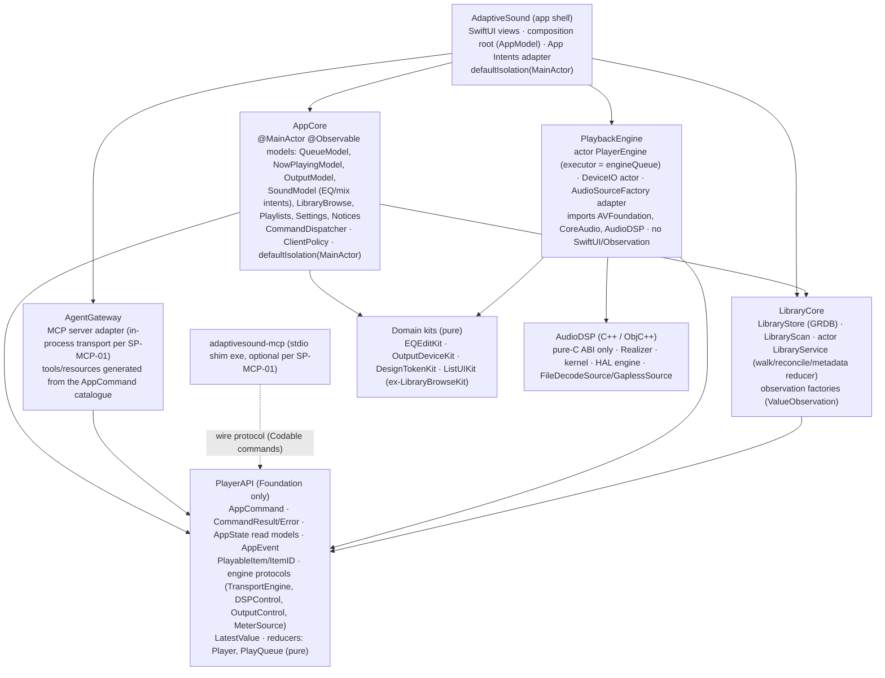

# Council Stage 2: architecture review (macro)

Reviewer: architect-reviewer (with the-fool pre-mortem and dialectic). Repo `main` @ a206107, read-only.
Scope: module boundaries, layering, state ownership, the concurrency model, testability as architecture, macro patterns,
error handling and observability, extension sprawl, the Kit pattern, R2 readiness, and the founder's new **EP-MCP**
requirement (backlog on `docs/council-recon-product` @ 28683e7, FR-AGENT-01).

**Stays macro.** The area reports cover the details, and this report builds on them by ID: `area-viewmodels.md` (VM-n),
`area-bridge.md` (BR-n), `area-library.md` (LIB-n), `area-build-test.md` (BT-n). Known items (the main-thread audit,
`rev-arch.md`/`rev-sota.md` in the freeze evidence, the G break-it reports, the ledger's post-R1 lists) are referenced,
not re-derived.

**Experiments** (`scratchpad/council/exp-arch/`, README there; never touched the main checkout):
- **E1** (standalone, `swiftc -swift-version 6`): an `actor` whose executor is an existing `DispatchSerialQueue`.
  - GCD blocks already on that queue reach isolated state with `assumeIsolated`, with no hop.
  - The `otherQueue → queue.sync { assumeIsolated }` shape the bridge uses still works.
  - A `DispatchSourceTimer` on the queue reaches isolated state.
  - 20 concurrent `await`ed synchronous steps never overlapped.
  - An off-queue `assumeIsolated` **traps**: the type now carries today's `dispatchPrecondition`.
  - Output: `overlaps=0 … wrong-queue access: TRAP … E1 OK`.
- **E2** (worktree `.claude/worktrees/rev-arch`): a **library** target that depends only on `AudioDSP` reaches one
  symbol from every C sub-header through `import AudioDSP`, with **no `-import-objc-header`**. It also hosts a
  `@MainActor @Observable` model and a queue-backed actor. A swift-testing target `@testable import`s it. Build 33 s;
  2/2 tests pass.
- **Taken as given, not redone:** BT-1's E1 (`@testable import AdaptiveSound` of the real executable works; 151 s cold
  build) and VM-8's toy-package result.

**Sources opened in this session:**
- the macOS 26 SDK: `Dispatch.swiftinterface:187-195` (`_DispatchSerialExecutorQueue: SerialExecutor`,
  `checkIsolated` = `dispatchPrecondition`); `_Concurrency.swiftinterface:2012` (`Actor.assumeIsolated`);
- the toolchain's `PackageDescription.swiftinterface:88` (`SwiftSetting.defaultIsolation(MainActor.Type?)`, Swift 6.2);
- GRDB 7.11.1 checkout: `ValueObservation.swift:350` (`values(in:)` async sequence) and `DatabaseWriter.swift:131`
  (async access throws `CancellationError` when cancelled);
- SFBAudioEngine `AudioPlayer.h`/`.mm` and Cog `PlaybackEngine.swift`/`Timeline.swift` (downloaded earlier in this session to
  `scratchpad/src/`; upstream https://github.com/sbooth/SFBAudioEngine, https://github.com/losnoco/Cog).

No web tool was available, so Swift Evolution numbers are cited from knowledge and marked "(not re-opened)". Their
APIs were verified in the SDK interfaces listed above.

---

## 0. Verdict

The code below the app shell is better than the shell:
- a stable pure-C ABI over C++;
- a real-time control plane (Realizer → triple buffer → kernel) that matches the field;
- pure, tested decision kits;
- a careful store.

The **app target is the problem**. It is 28 k LOC in one module: UI, view models, services, the engine bridge and
in-binary test rigs. Five structural facts follow from that, and they reinforce each other:

1. **The transport has two owners.** The view model and the bridge each hold half of one state machine, each with its
   own epochs. Two area reviewers (VM-2, BR-3) each propose a reducer. There must be one.
2. **Layering and threading rules are enforced by regex and comments, not by types or module boundaries.** The concurrency
   design is hand-rolled GCD everywhere except one actor.
3. **The engine API has no command catalogue.** A command is sometimes a method, sometimes a `didSet` behind a SwiftUI
   binding, sometimes an EQ verb closure. Media keys already form a second, hand-wired control path. **EP-MCP cannot be
   built honestly on this.**
4. **The file URL is the identity of a playable thing at every layer.** That blocks CUE and any virtual track.
5. **Decode and EQ are not abstractions but single implementations threaded vertically through all layers.** This is
   what makes S11–S14 harder than the sprint plan assumes.

None of this is urgent for R1.1. All of it is in the way of R2 and EP-MCP. The fix is a sequence of waves, each shippable,
tests-first, and each paid for by a feature it unblocks (§3).

**Counts: STRUCTURAL 5 (ARCH-1…5) · SIGNIFICANT 5 (ARCH-6…10) · LOCAL 2 (ARCH-11, ARCH-12).**

---

## 1. Findings

### ARCH-1 One transport, two owners: the play state machine is split between the view model and the bridge, STRUCTURAL. Criteria: 1, 2, 3, 4
- **Evidence (the split, which neither area report states as such):**
  - **The view model decides engine-level transitions:**
    - Pause is "stop plus a resume point" (`AudioViewModel+Transport.swift:42-52`; "the engine has no suspend primitive").
    - The Pure cross-rate "reconfigure gap" advance is driven from the 20 Hz tick on `ended` plus `pendingNextIndex`
      (`+SpectrumTimer.swift:103-121`).
    - The Pure device-move restart lives in `adoptOutput` (`+Devices.swift:90-94`).
    - Device-loss becomes a resume point by reading a flag stored inside the display struct (`+SpectrumTimer.swift:78-89`).
  - **The bridge decides the rest:** gapless seams, the device-loss pause (`signalPath.interrupted`), the Enhanced
    re-establish, and end-of-queue.
  - **Epochs on both sides:**
    - view model: `transportEpoch`, `transportStopEpoch` (`AudioViewModel.swift:70-74`);
    - bridge: `transportEpoch` (`AudioEngineBridge.swift:78`), `resampleGeneration`, `passthroughGeneration`.
    - The protocol between them is "numbered requests + polled snapshot" (`AudioPlaybackEngine.swift:58-212`).
  - **Two reducers proposed for one machine:** VM-2 puts `TransportState` in the view model's kit; BR-3 puts
    `TransportState` with `reestablishing`/`interrupted` in the bridge. Both are right about their half.
- **Root cause:** the engine API was drawn at the AVFAudio call level ("start this URL at X", "arm this URL"). It was not
  drawn at the player level ("play this item, here is how to get the next one"). Every behaviour the engine could not
  express (pause, a format change at a seam, a device move) was built in the view model on top of it.
- **Why it matters:**
  - Every G break-it transport blocker (B1, B2, B6, B7, G-RACE-1/2) sits on this seam.
  - Every R2 transport feature (CUE, crossfade, adaptive per-track gain) and every new control client (EP-MCP, App
    Intents) multiplies the cross-owner interleavings.
- **State of the art (opened):**
  - **SFBAudioEngine** owns the decoder queue (`AudioPlayer.h:135-138`, `queuedDecoders_`). It handles a non-gapless
    format change *inside the player*: it waits for active decoders, reconfigures and logs "Non-gapless join"
    (`AudioPlayer.mm:1427-1480`). It has one transport epoch (`playbackGeneration_`, `.mm:1176,1234,2106`).
  - **Cog's new engine** has an explicit `Phase` enum (`PlaybackEngine.swift:82-90`).
    - It *pulls* the next track from its host: `playbackEngineNextTrack(after:)` (`:15`, called at `:1259`).
    - It *pushes* events: `didBeginTrack`, `reportPlayCount` (`:18,21`, fired at `:1115,1136`).
    - It counts plays from heard frames (`scrobbleListened`, `:116-119`). AdaptiveSound counts them from main-thread
      wall time, the known stalled-tick bug.
- **Structural remedy: split by responsibility, not by layer.**
  - **`Player`**, in the engine domain (ARCH-2): owns *what is audible*.
    - States: `idle / starting / playing / pausing / paused / interrupted / ended`, keyed by **item id**, not index.
    - Owns pause, seek, start-at, the format-change restart, the device-move restart, end-of-queue and play-heard
      accounting.
    - Pulls the next item from a `NextItemProvider` (the Cog shape) and emits `PlayerEvent`s.
    - Its transition function is a pure reducer in a Kit (BR-3's design), hosted by the engine actor.
  - **`QueueModel`**, `@MainActor`: owns *what the user wants*.
    - The `PlayQueue` value type of VM-7 (slot ids, shuffle and repeat order); it answers `next(after:)`.
    - The view-model-side reducer of VM-2 shrinks to queue edits plus intents. It no longer numbers engine requests,
      because the player assigns epochs inside its own reducer, so call order equals epoch order by construction
      (VM-2's asymmetry disappears).
  - The two meet through commands (§2.4) and events. The 20 Hz tick stops being a control loop (VM-3).
- **Effort:** L. **Risk:** high (the founder's most-used code). Mitigated: build the reducer beside the current code;
  replay the G break-it scenarios as table tests against the real code (Wave 0 makes that possible); switch over one event
  family at a time. **Depends on:** ARCH-3 Wave 0, ARCH-2.

### ARCH-2 No compiler-checked concurrency domains: the app's isolation model is GCD by convention, with escapes as the design, STRUCTURAL. Criteria: 1, 5, 6
- **Evidence (app-wide; BR-1/5/6/11 cover the bridge's internals):**
  - **One production actor** (`TrackLoudnessKit` `Coordinator`), against:
    - 4 bridge queues, 1 watcher queue, 5 `DispatchQueue.global` uses and 9 `withCheckedContinuation` wrappers in the
      bridge;
    - 34 unstructured `Task {}`/`Task.detached` sites in the model layer (`AudioViewModel*`, `EQViewModel*`,
      `LibraryModel*`, `LibraryBrowseModel*`, `PlaylistsModel*`, `NowPlayingController`).
  - **Isolation by comment:** "Confined to `engineQueue`" or "guarded by `stateLock`" on about 30 stored properties of
    `AudioEngineBridge.swift`. BR-1 shows four places where the comments are false.
  - **Three lock idioms** for one job: a raw `os_unfair_lock_t` (`AudioEngineBridge.swift:101`),
    `OSAllocatedUnfairLock` (`SnapshotChannel`) and `Mutex` (`LibraryStore.swift:54`).
  - **Four periodic-sampling mechanisms:** two `Timer`s with `MainActor.assumeIsolated`, a `Task.sleep` loop
    (`MonitoringViewModel.swift:48-54`), and a `DispatchSourceTimer` (`+TransportClock.swift:34`).
  - **About 12 hand-rolled "newest wins" counters across three layers:**
    - 9 loader epochs (LIB-01);
    - 2 view-model epochs;
    - 2 bridge generations;
    - Realizer `causalGeneration_`/`refreshGeneration_` (`Realizer.h:220-221`);
    - `SearchEpoch`.
  - **`LibraryModel` is a service** (scan scheduling, the FSEvents watcher, the volume monitor, the store lifecycle)
    living on `@MainActor` in the untestable app target (`LibraryModel.swift:30-121`; LIB-06).
  - **No `defaultIsolation`** is set (map §3.3). Every app type is nonisolated unless annotated, and Swift 6 errors are
    met with `@unchecked` (8 in production) and `@preconcurrency import AVFoundation` (26 files).
- **Root cause:** isolation was designed in Swift 5 / GCD terms. Strict concurrency was then satisfied file by file.
  The bridge's own justification for "no actor" ("executor hops on the control path, cannot express the tap/render
  boundary", `AudioEngineBridge.swift:32-33`) assumes an actor means a new thread. E1 shows that is false: an actor
  over the **same** serial queue changes no thread, adds no hop, and keeps every GCD callback working.
- **Why it matters:**
  - The freeze class (main waits on audio) and the zombie/wrong-song class (two domains drive one player) are
    *ownership* bugs that the compiler could reject. Today they are found by a human with hardware.
  - A multi-client future (EP-MCP, App Intents, media keys and the UI at once) multiplies concurrent entry points.
- **Structural remedy:** the target concurrency model in §2.3. Its rules in short:
  - **(a) one engine domain:** `actor PlayerEngine` with `unownedExecutor = engineQueue` (SE-0392, not re-opened;
    API verified in the SDK; E1). Transport steps are *synchronous* actor methods, so there is no reentrancy. GCD
    callbacks enter through `assumeIsolated` (E1), listeners and notifications *enqueue commands*, and slow IO goes to
    worker domains that reply with messages (BR-6).
  - **(b) one library domain:** `actor LibraryService` owns walks, the watcher, reconcile and metadata passes (LIB-06's
    reducer inside it). Reads go through GRDB `ValueObservation` (LIB-01).
  - **(c) `@MainActor` by default** for the UI and view-model modules (`.defaultIsolation(MainActor.self)`, verified in
    `PackageDescription.swiftinterface:88`). Kits stay nonisolated.
  - **(d) one synchronisation family:** `Mutex<T>` / `Atomic<T>` / one `LatestValue<T>` (today's `SnapshotChannel`,
    rebuilt on `Mutex`). The raw lock and `OSAllocatedUnfairLock` are retired.
  - **(e) "newest wins" is structured cancellation in Swift:** one `Task` handle per slot, cancelled on supersede (GRDB
    async access honours cancellation, `DatabaseWriter.swift:131`). Epochs survive only at the engine boundary, where
    they are the SFB pattern, and in C++.
  - **(f) an `@unchecked Sendable` budget:** only the C-handle wrappers, each with a stated invariant in the existing
    suppression policy (`scripts/check-suppressions.sh`).
  - **(g)** `NonisolatedNonsendingByDefault` (SE-0461, not re-opened) may be enabled only *after* (a), because then the
    engine's async methods are actor-isolated and the audit's R11 hazard is gone.
- **Effort:** L in total, staged (§3). **Risk:** med. E1 removes the main technical doubt. **Depends on:** ARCH-3 (tests
  first).

### ARCH-3 The app target is a 28 k-LOC monolith; testability, layering and the main-thread rule are enforced by mirrors and regex instead of module boundaries, STRUCTURAL. Criteria: 1, 6, 3
- **Evidence:**
  - **The app holds every layer:**

    | Part | Size |
    |---|---|
    | views | 175 files / 13.3 k LOC |
    | view models and models | ≈5.2 k |
    | bridge | 5.1 k |
    | root glue | 1.7 k |
    | DEBUG test rigs | 2.4 k |
  - **"Not importable" is false** (BT-1 E1). The real structural gap is enforcement: the main-thread rule rests on semgrep
    (`main-thread-no-audio-hardware` `.semgrep.yml:72`, `main-thread-no-concrete-bridge` `:110`,
    `bridge-not-main-actor` `:130`). The freeze review's sidestep probe shows these are bypassable (`rev-arch.md`
    MAJOR-2), and BT-5 makes the same point.
  - **Inverted or concrete dependencies:**
    - the view model defaults its own engine, `engine: any AudioPlaybackEngine = AudioEngineBridge()`
      (`AudioViewModel.swift:390`);
    - a view builds a view model from `viewModel.engine` (`MonitoringTabView.swift:43`);
    - `weak var library: LibraryModel?` couples audio to the library model for play counts (`AudioViewModel.swift:348`);
    - `selectedTab` lives in the audio view model (VM-1).
  - **The view-model layer hardly needs AVFoundation.** In non-engine files the only real uses are `AVAudioFile` in
    `refreshDuration` (`+Playback.swift:92`), `TrackInfoCard.swift:199` and `EmbeddedMetadataReader.swift:20`. The other
    `import AVFoundation` lines in view-model files (`+AutoAdvance`, `+Lifecycle`, `+SpectrumTimer`,
    `AudioPlaybackEngine.swift`) are vestigial. A boundary is therefore cheap.
  - **Three C-import mechanisms** (ARCH-11). E2 shows the module map alone is enough.
- **Root cause:** "extract pure logic to a Kit so it can be tested" became the only modularisation move (ARCH-10). The
  stateful layers never got a home outside the app target.
- **Why it matters:**
  - Mirrors already lie (VM-8, BT-1).
  - The next freeze would come through a path the regexes do not match.
  - EP-MCP needs a control/state API that is *structurally* the only way in (§2.4). A monolith cannot guarantee that.
- **Structural remedy:**
  - **Wave 0 (S):** test the executable as it is (BT-1) and delete the mirrors.
  - **Wave 3 (M), the module split of §2.1:**
    - `PlayerAPI`: Foundation only; commands, events, read models, the engine protocols, item identity.
    - `PlaybackEngine`: AVFoundation + AudioDSP; implements the protocols; never imports SwiftUI or Observation.
    - `LibraryCore`: Store + Scan + `LibraryService`.
    - `AppCore`: `@MainActor` models; depends on `PlayerAPI` and `LibraryCore`, **not** on `PlaybackEngine` or
      AVFoundation.
    - `AgentGateway`: depends on `PlayerAPI` only.
    - The app: views plus the composition root.
  - The main-thread rule then becomes a compile fact: `AppCore` cannot name `AVAudioPlayerNode` or `AudioEngineBridge`.
    The three semgrep layering rules retire.
  - Use Swift's `package` access (SE-0386, not re-opened; 0 uses today) for cross-module API instead of `public`, so
    the split does not inflate the API surface.
  - The DEBUG rigs move to a test-support target (BT-2).
- **Effort:** S (Wave 0) + M (Wave 3). **Risk:** low then med; the split is mechanical once ARCH-1 has settled.
  **Depends on:** none for Wave 0.

### ARCH-4 The file URL is the identity of a playable thing at every layer, which blocks CUE (S11) and any virtual track, STRUCTURAL. Criteria: 1, 2
- **Evidence:**
  - **View model:** `AudioFile.id` *is* `absoluteURL` (`Models/AudioFile.swift`); `QueueItem` wraps one file.
  - **Store:** `tracks.url … UNIQUE(url)` (`Schema.swift:159,187`); upsert is `ON CONFLICT(url)` (map N38);
    `incrementPlayCount(url:)` (N28).
  - **Engine API:** `startAudio(fileURL:…)`, `setNextTrack(_ fileURL: URL?)` (`AudioPlaybackEngine.swift:75,117`);
    `lastFileURL` restart (`AudioEngineBridge.swift:140`).
  - **Pure C-ABI:** `pureModeEngineStart(engine, deviceID, path, startAt)` with no end bound; `FileDecodeSource` has no
    end-frame limit (`include/FileDecodeSource.h`).
  - **Loudness:** `TrackIdentity` = FNV("path|size|mtime") (`TrackIdentity.swift:28`). Two CUE tracks of one file share
    one loudness profile and one token.
  - **Enhanced seams** fire on whole-file EOF completions (BR-2), not at a frame boundary inside a file.
- **Root cause:** "track = file" was never named as an assumption. No type stands between the URL and the things keyed
  by it.
- **Why it matters:**
  - S11's "CUE → virtual tracks (reuse gapless)" (`sprint-plan.md:59`) assumes the gapless machinery can seam *inside*
    a file. Neither path can today.
  - Store identity, play counts, frecency, playlists, loudness and MCP resource ids (US-MCP-03) all need an id that is
    not a URL.
- **Structural remedy:**
  - **`PlayableItem { id: ItemID, source: URL, range: FrameRange? }`** in `PlayerAPI`. Items are addressed by id
    everywhere above the decoder.
  - The store gains a per-item key (a `cue_index` or a virtual-track table, the library reviewer's call).
  - Sources become **bounded** (start and end frames). A seam is "source exhausted", which `GaplessSource` already
    implements; ARCH-6/BR-2's unified source model makes it hold on Enhanced too.
  - The loudness token becomes `(file identity, range)`.
- **Effort:** M for the identity type and API (Wave 1); the bounded sources ride on Wave 4. **Risk:** med (a store
  migration, additive). **Depends on:** ARCH-6 for seams.

### ARCH-5 There is no command catalogue: control is methods, `didSet`s behind bindings and verb closures, with media keys already a second hand-wired path. EP-MCP needs one, STRUCTURAL. Criteria: 1, 2, 3
- **Evidence:**
  - **Commands take three forms:**
    - (1) methods: `togglePlayPause`, `seek`, `nextTrack`, `playNow`, `setMasterGain(position:)`, …; 11 queue/device
      verbs in `AudioViewModel*`;
    - (2) **property writes whose `didSet` is the command**, through SwiftUI bindings: `$bvm.intensity`
      (`InspectorColumn.swift:109`), `$bvm.crossfeedEnabled` (`:166`), `$audioViewModel.pureModeEnabled`,
      `$audioViewModel.pinPlaybackToSelectedDevice`; the `didSet` bodies publish to the engine
      (`AudioViewModel.swift:106,132,143`);
    - (3) EQ verbs as closures over `EQSession`: `EQViewModel.perform(_:)`, the good one.
  - **Five entry surfaces call these directly, each wired by hand:**
    - footer and views;
    - the Controls menu (`AdaptiveSound.swift:153-193`);
    - `MenuBarView`;
    - media keys / Control Center (`NowPlayingController.swift:91-101` calls `audio?.togglePlayPause()` and the like);
    - library and playlist models calling audio verbs (VM-11).
  - **No surface-independent result or error.** Results are `errorMessage` strings (VM-9) or nothing.
  - **No state query API apart from the observable objects,** and no subscribable events (VM-3).
- **Root cause:** the UI was the only client, so "the API" is whatever the views can reach.
- **Why it matters:**
  - **EP-MCP** (FR-AGENT-01: "every MCP tool maps 1:1 onto a UI command; the coverage table is generated from the
    command catalogue"). Today an MCP tool for "set intensity" would have to write a property and rely on its `didSet`.
    That is a second control path by construction, the exact outcome the founder's requirement forbids.
  - **App Intents** have the same need.
  - The media-key path shows the drift risk: it copies the verbs and owns its own refresh rules (VM-6).
- **Structural remedy:** **one command / state / event API** (§2.4).
  - **`AppCommand`:** a Codable, Sendable enum catalogue in `PlayerAPI`, grouped (transport, queue, library, playlist,
    sound, output, settings), with `CommandResult` and typed `CommandError`.
  - **One `CommandDispatcher`** (`@MainActor`) that every surface uses: views, menus, media keys, App Intents, MCP.
    Transport commands *are* the `Player` reducer's inputs (ARCH-1), so the catalogue doubles as the reducer's event
    vocabulary and as the generated tool list.
  - **`AppState`:** read models as `Sendable` snapshots (now playing, queue, signal path, loudness, outputs, EQ).
  - **`AppEvent`:** a broadcast `AsyncSequence` (track changed, play state, device, library changed).
  - **A `ClientPolicy`** (scopes read / control / library-modify, confirmation for destructive commands, rate limits)
    checked in the dispatcher for non-UI clients. **Hearing-safety limits stay below the dispatcher**, in the domain and
    engine layers (§2.5), so every client inherits them.
  - Views keep `@Observable` bindings for display. Their *writes* become `dispatch(.sound(.setIntensity(x)))`, not
    property sets.
- **Effort:** M for the catalogue and dispatcher over today's view models (Wave 1); the event and state halves complete
  with Wave 2. **Risk:** low-med (mechanical, and testable through Wave 0). **Depends on:** ARCH-3 Wave 0; completes
  with ARCH-1.

### ARCH-6 Decode is not a strategy: five decode/probe paths with different capability sets, so the FFmpeg playback fallback is unreachable from a normal start, SIGNIFICANT. Criteria: 1, 3, 4
- **Evidence:**
  - The C++ side has a proper strategy. `FileDecodeSource` uses a pluggable `DecodeBackend` (Apple `ExtAudioFile` first,
    dlopen FFmpeg fallback) (`FileDecodeSource.cpp:1-23`). Only Pure uses it.
  - **Enhanced playback** opens `AVAudioFile` only and throws `unsupportedFormat` (`+Playback.swift:157-162`).
  - **Pure viability** opens `AVAudioFile` *before* Pure starts (`+PureMode.swift:47`) and rejects the file if that
    fails. So a file only FFmpeg can open fails the Pure gate, then fails Enhanced. FFmpeg decode is reached **only** as a
    Pure *gapless successor* (`pureModeOpenDecodeSource`, `+Gapless.swift:103-110`).
  - **The other paths open files themselves:**
    - duration: `AVAudioFile` (`AudioViewModel+Playback.swift:92`);
    - track info: `AVAudioFile` (`TrackInfoCard.swift:199`);
    - the Enhanced seek fallback (`+PureMode.swift:324`) and the next-file open (`+GaplessRoll.swift:154`);
    - loudness analysis: `AVAudioFile` (`TrackLoudnessAnalyzer.swift:291`), so no profile and the causal fallback;
    - metadata: `AVURLAsset` then the FFmpeg metadata bridge (`MetadataExtractor+FFmpeg.swift:18`);
    - loose-file tags: `AVURLAsset` (`EmbeddedMetadataReader.swift:20`).
  - The scan's admit list is a third, separate truth (`LibraryScanner.swift:38-39`).
- **Root cause:** decode was solved per path. The Pure path got the design; everything else calls Apple directly.
- **Why it matters:**
  - A format that only FFmpeg reads can be scanned (with FFmpeg tags), but it can't start playing (a user-visible bug
    the product report did not list).
  - S11's "enable WavPack/APE if free via FFmpeg" and "lossy encoder-delay trim" are **not free**: they need
    Enhanced, the analyzer and duration on one decode path.
- **Structural remedy:**
  - **One `AudioSourceFactory`** (C-ABI over `FileDecodeSource`): `probe(url) -> SourceFormat` (rate, channels,
    depth, duration, backend) and `open(item) -> Source`. Viability, duration, track info, the analyzer and both
    playback paths all use it.
  - The scan's admit list derives from what the factory can open.
  - With BR-2's unified source model, Enhanced plays from the same sources through an `AVAudioSourceNode`. That stays
    inside the founder's "Apple-native for playback / output" rule: the graph, the node and `ExtAudioFile` are all Apple.
  - Interim (S): replace the `AVAudioFile` viability probe with the factory's `probe`, so Pure at least reaches FFmpeg.
- **Effort:** S interim / L with BR-2 (Wave 4). **Risk:** med. **Depends on:** BR-2, ARCH-4.

### ARCH-7 The EQ is a vertically integrated 31-band contract with no intent abstraction; S12–S14 need layered EQ programs, SIGNIFICANT. Criteria: 1, 2
- **Evidence (one shape, every layer):**
  - `EQBands.count = 31` (`EQEditKit/EQBands.swift:10`).
  - `publishEQ(points: [Float], isOn:)` (`AudioPlaybackEngine.swift:156`).
  - The C-ABI rejects `count != kEqBandCount` (`Realizer.mm:207`).
  - `EqIntent { points[31] }` (`Realizer.h:89-93`).
  - `EQParams { k[31], m1[31] }` with no frequency or filter type (`TargetState.h:28-49`). The RT module precomputes
    `prewarp_` from the *fixed* graphic centres (`EQModule.h:135`, `EQModule.cpp:46`).
  - `TargetState` size is locked by `static_assert` to 768 B and tied to the golden master (`TargetState.h:158-162`).
  - **One EQ layer:** one slot in the Realizer. The loudness-neutral gain is computed over *the whole curve*
    (`Realizer.mm:430`, `canonical_.eq.outputGainDb = loudness_.onDesign(design, …)`).
- **Root cause:** Sprint EQ fixed "the EQ plays what it shows" by integrating vertically. That was right for one graphic
  EQ, and it left no type between "what the user asked for" and "the coefficients".
- **Why it matters:** see §4.
  - S12 (PEQ / AutoEq) needs per-band frequency and filter types.
  - S13 needs a correction layer *and* the user's taste on one graph.
  - S14 needs a level-dependent layer that is **exempt from loudness neutrality**. Folded into today's single intent,
    the neutral gain would cancel the loudness-compensation tilt it exists to add.
- **Structural remedy:**
  - An **`EQProgram`** intent: ordered layers `[correction, taste, compensation]`, each a `FilterSpec` list (type, f, Q,
    gain) or a graphic curve, plus a per-layer neutrality policy.
  - The Realizer designs each layer (ACGE for graphic, closed form for parametric) into one RT cascade with per-band
    `(g, k, m1)`. The SVF supports shelves and pass filters through the same mixing (DSP reviewer to confirm).
  - The played-curve read-back composes the layers, which gives "one graph".
  - `TargetState` grows once, re-measured against the golden master (its own documented procedure).
  - Design this **before** S12. The DSP panel owns the details.
- **Effort:** M-L. **Risk:** med (RT path; the existing EQ break-it suite is the oracle). **Depends on:** none.

### ARCH-8 Engine and library state reach the app through five kinds of channel, none of them a typed event stream, SIGNIFICANT. Criteria: 1, 2, 3
- **Evidence:**
  1. polled snapshots (`snapshot()`, 20 Hz);
  2. single-slot closures (`onOutputDevicesChanged`, `onEngineReady`, `onNowPlayingRefresh`, `onError`,
     `onStoreReady`; VM-6);
  3. `async throws` results;
  4. **control facts inside display structs** (`SignalPathInfo.interrupted`, `fellBackToEnhanced`; BR-9);
  5. revision counters bumped by hand (`libraryRevision`, `playCountRevision`; LIB-01).

  Readouts that bypass even these: `readSpectrumBands` and `readMonitorBands` pulled by two different loops.
- **Root cause:** each consumer solved "tell me when X changes" locally. VM-3, VM-6, LIB-01 and BR-9 each found one
  instance.
- **Why it matters:** EP-MCP's US-MCP-07 ("subscribe to changes") has nothing to subscribe to. Every new consumer (a
  widget, an App Intent, an agent) means editing the producer.
- **Structural remedy: one rule app-wide, "commands in; state and events out".**
  - **State** = `Sendable` read-model snapshots through `LatestValue<T>` (high-rate readouts) or `@Observable` mirrors
    (UI).
  - **Events** = typed `AsyncSequence`s with multicast: `PlayerEvent`, `OutputEvent`, `LibraryEvent`. The last comes
    from GRDB `ValueObservation`/`DatabaseRegionObservation` (`ValueObservation.swift:350`).
  - **Control facts are never stored in display structs.**

  The UI, NowPlaying, App Intents and MCP all subscribe to the same streams.
- **Effort:** M. **Risk:** low-med. **Depends on:** ARCH-1 (player events), LIB-01 (library events).

### ARCH-9 Error handling and observability have no architecture: int codes, Bools, untyped throws, `try?`, one string slot and `NSLog`, SIGNIFICANT. Criteria: 6, 5
- **Evidence:**
  - **C-ABI:** results are 0/1/2 ints and bools (`pureModeEngineArmOpenedNextTrack`: "2 armed / 1 reconfigure / 0 error",
    `+Gapless.swift:136-142`) plus stderr lines (`AsLog.h`, 68 call sites).
  - **Swift:** `AudioBridgeError` has 3 cases. Methods marked `async throws` never throw (BR-11). There are 34 `try?`
    in the app outside Debug, which swallow store and IO errors into "empty" (LIB-14), and one `errorMessage` slot
    where the last writer wins (VM-9).
  - **Logging:** `logUX` = unconditional `NSLog("[UX] …")` (`UXLog.swift:7-9`), 117 call sites. There is **no
    `os.Logger` or `os_signpost` anywhere** in `Sources/`. The team's own memory records that `NSLog` from an
    `open`-launched app does not reach `log show`, so field diagnostics are lost exactly when the founder runs the real
    app.
  - SFB uses `os_log_t` per subsystem (`AudioPlayer.h:112`, `.mm:1468` `os_log_debug`).
- **Root cause:** errors were handled at the call site that first hit them. Nobody decided the taxonomy or the
  recovery owner.
- **Why it matters:**
  - EP-MCP needs typed results per tool.
  - Recovery (retry, fall back, tell the user) is decided ad hoc.
  - Device-change bugs are diagnosed by "run the binary directly, stderr to a file".
- **Structural remedy:**
  - **A layered taxonomy:**
    - C-ABI status enums (named, not magic ints);
    - `PlayerError` / `LibraryError` with typed throws at the `PlayerAPI` boundary (SE-0413, not re-opened);
    - `CommandError` for clients;
    - `AppNotice` per source (VM-9) for the UI.
    Each error type names its **recovery owner**.
  - **Observability:** `os.Logger(subsystem: "…adaptivesound", category: <module>)` behind `logUX`, with levels and
    privacy. A C log sink callback lets C++ `AsLog` write to `os_log` as well. Signposts go on start, seek and seam, for
    Instruments.
- **Effort:** M. **Risk:** low. **Depends on:** ARCH-5 for the client-facing half.

### ARCH-10 Lint-driven extension sprawl splits god objects across files and widens their access, SIGNIFICANT. Criteria: 1, 6
- **Evidence:**
  - `AudioEngineBridge` 23 files, `LibraryStore` 18, `AudioViewModel` 14, `LibraryBrowseModel` 7, `LibraryModel` 6
    (map §4.3).
  - About 50 comments justify a split by `file_length` / `type_body_length` / `function_body_length`
    (`+Playback.swift:7-10`, `+ChannelLayout.swift:8-9`, `+Reconfigure.swift:8`, `PlaylistsModel+Play.swift:1`, …).
  - **13 comments say "Internal (not private) so the extension in another file can reach it"**
    (`AudioViewModel.swift:39,210`; `+EnhancedResampler.swift:40,50`; …), and 49 of 50 view-model properties are
    internal `var` (VM-1).
  - SwiftLint's `type_body_length` counts only the primary declaration, so moving code into `extension` files satisfies
    the rule while the type keeps growing.
- **Root cause:** the lint limits are honoured, per the "never fight lint" rule, and the fix of choice was mechanical (a
  new file), not structural (a new type). The metric is gamed without intent.
- **Why it matters:**
  - State lives in one file and its rules in thirteen others, which is BR-3's and VM-2's "implicit machine".
  - Encapsulation is traded for the line budget.
  - The next feature adds a 15th file.
- **Structural remedy:**
  - Decompose by responsibility (VM-1's sub-models; BR-3's reducer and edge protocols; LIB-06's library reducer).
    Small types with `private` state need no splits.
  - Add a **fitness function** to the strict gate: total LOC per type across its extensions, at most N files per type
    in one module, and "no new `extension T` file for a type already over budget". The suppression policy grandfathers
    today's three, with an expiry.
  - Keep SwiftLint's limits; they are fine as a smell detector.
- **Effort:** S (the gate check) + it rides on ARCH-1/VM-1. **Risk:** low.

### ARCH-11 Three ways to import the same C surface, one of them dead, LOCAL. Criteria: 3
- **Evidence:**
  - LibraryScan and TrackLoudnessKit use `import AudioDSP` (the module map exports `DeviceBridge.h`, which re-exports
    every C sub-header).
  - The app and VerifyAUGraph pass `-import-objc-header Sources/AudioDSP/include/DeviceBridge.h`
    (`Package.swift:43-50,68-75`), so the same declarations come in twice.
  - `Sources/AdaptiveSound/AdaptiveSound-Bridging-Header.h` is referenced by nothing.
  - E2 proves `import AudioDSP` alone reaches the whole surface from a library.
- **Remedy:** `import AudioDSP` everywhere; drop both `unsafeFlags` blocks and the dead header. This is a precondition
  for moving the bridge into a library (Wave 3). **Effort:** S. **Risk:** low.

### ARCH-12 The Kit pattern is a functional core without a stateful core: right idea, partly applied, named for testability rather than domain, LOCAL. Criteria: 2, 1
- **Evidence:**
  - **Good:**
    - `EQEditKit` (`EQSession` reducer with effects; VM's "copy this");
    - `OutputDeviceKit` (one pure rule used by both bridge and view model);
    - `FolderWalkSchedule`;
    - `MasterGainLaw`.
  - **Partial:**
    - `PlaybackQueueKit` is stateless helpers (`QueueAdvance`, `SeekRoute`) whose callers must invoke them in the right
      order (VM-7). It also hosts a concurrency primitive (`SnapshotChannel`, `TransportSnapshot.swift:51`).
    - `DesignTokenKit` hosts meter ballistics (`PeakHoldTracker`).
    - `LibraryBrowseKit` is the app's generic list/grid/keyboard logic, used by the queue and playlists too.
    - `TrackLoudnessKit` is a stateful AVFoundation *service*, not a pure kit.
    - The purity gate covers 3 of 7 kits (`strict-gate.sh` stage 9).
  - Each `Package.swift` comment explains a kit as "extracted from the non-importable app target" (`:155-213`).
- **Verdict:** keep the pattern (pure decision core, table-tested). Complete it with the missing *stateful core*: the
  `Player`, `QueueModel` and `LibraryService` reducers of ARCH-1/LIB-06, hosted by actors. Once Wave 0 makes the app
  testable, regroup kits by domain (`PlayerAPI` absorbs `TransportSnapshot`/`SnapshotChannel`), not by "what was
  extractable". Extend the purity gate to every kit that claims purity.
- **Effort:** S-M, folded into Waves 1 and 3. **Risk:** low.

---

## 2. Target architecture sketch

### 2.1 Modules and dependency direction



**Dependency rules, each enforced by the module graph, not by regex:**
- `AppCore` never depends on `PlaybackEngine`, AVFoundation or AudioDSP. Main-thread code therefore cannot name
  AVFAudio, which replaces the semgrep rules `main-thread-no-audio-hardware`, `main-thread-no-concrete-bridge` and
  `bridge-not-main-actor`.
- `AgentGateway` depends **only** on `PlayerAPI`. It cannot reach a view model, the engine or the store except through
  `AppCommand`/`AppState`/`AppEvent`, so there is no second control path, by construction.
- `PlaybackEngine` never imports SwiftUI or Observation.
- The app shell is the only module that sees concrete implementations. It is the composition root (VM-6/VM-13's
  `AppModel`).
- Cross-module API uses `package` access. `@testable import` stays available to tests of every module.

The net target count stays close to today's 23. Six kit and test-bucket targets consolidate into `PlayerAPI`, `AppCore`
and `ListUIKit`, and the `Verify*` executables become test targets (BT-2).

### 2.2 State ownership

| State | Owner (one) | Isolation | Readers |
|---|---|---|---|
| What is audible: player phase, current item, position, seam, epochs, device-loss | `Player` reducer in `PlayerEngine` | engine actor | `AppState.nowPlaying` via `LatestValue`; `PlayerEvent` |
| What the user wants next: queue items, slot ids, order, shuffle/repeat, restore point | `PlayQueue` value in `QueueModel` | MainActor | UI; `NextItemProvider` to the player |
| Sound intents: EQ program, master gain, intensity, crossfeed | `SoundModel` (`EQSession` + mix) → `DSPControl` | MainActor → Realizer queue | UI; read-back via `AppState.sound` |
| Outputs: device list, selection, pin, Pure intent | `OutputModel` + `OutputDevicePolicy` (rule) | MainActor (intent), DeviceIO actor (facts) | UI; `OutputEvent` |
| Readouts: signal path, loudness, spectrum, monitor bands | `PlaybackEngine` | `LatestValue` / lock-free buffers | UI at display rate only (VM-4) |
| Library content | `LibraryStore` | GRDB pool | `ValueObservation` → models; `LibraryEvent` |
| Library activity: walks, reconcile, passes, per-root status | `LibraryService` reducer | library actor | `LibraryEvent`, progress `LatestValue` |
| Settings (versioned, typed) | `SettingsStore` (VM-5) | MainActor | models at init; write-through |
| Navigation (`selectedTab`, browse path) | `ShellNavigation` | MainActor | views only |

### 2.3 Concurrency domains

| Domain | Executor | Owns | Entry from outside | Rule |
|---|---|---|---|---|
| **Main** | `MainActor` (default isolation in app and `AppCore`) | UI, models, `CommandDispatcher` | `await`, or `dispatch(_:)` from UI | Never blocks: reads only `LatestValue`/observables; never awaits for a readout |
| **Engine** | `actor PlayerEngine`, `unownedExecutor = engineQueue` (E1) | `AVAudioEngine`, the source node / player, `PureModeSession`, graph, `Player` reducer | `await engine.send(cmd)`; GCD callbacks via `assumeIsolated` on the same queue | Transport steps are **synchronous** inside the actor (no `await` in a step, so no reentrancy); slow IO goes to workers and comes back as a command |
| **Device IO** | actor over its own serial queue (today's `deviceVolumeQueue`, extended; BR-6) | HAL queries: enumerate, select, volume, alive | `await` | May block on coreaudiod; never holds the engine |
| **Decode / convert workers** | C++ `std::jthread`s (`FileDecodeSource`) | decoders, SRC | ring buffers | Producers only |
| **Realizer** | C++ serial dispatch queue (as today) | EQ design, `TargetState` | C-ABI slots | Unchanged: the right design |
| **Render** | CoreAudio / AVFAudio RT threads | kernel, `GaplessSource` pull | triple buffer, SPSC | No Swift, no locks (as today) |
| **Library** | `actor LibraryService` + GRDB's writer and readers | walks, watcher events, reconcile, metadata pass | `await`; FSEvents queue → `assumeIsolated` or enqueue | Store access through GRDB only |
| **Analysis** | `TrackLoudnessAnalyzer` actor (as today) | second decode, profiles | `await` | Unchanged |
| **Agent transport** | the MCP server's IO queue / `Task`s | sessions, JSON-RPC | → `await dispatcher.perform` (hops to Main) | Never touches models directly |

**Types that enforce the rules:**
- the module graph (§2.1);
- `actor PlayerEngine` with a queue executor;
- `Mutex<Shared>` instead of `stateLock` + accessor comments (BR-5);
- `LatestValue<T>` (no closure API, so no callouts under the lock: today's `SnapshotChannel` property);
- `AppCommand` (exhaustive `switch` in the dispatcher and the reducers, so a new command that no surface or reducer
  handles is a compile error);
- `PlayableItem`/`ItemID` (no index-keyed state survives an edit, VM-7);
- bounded `Source`s.

### 2.4 One command / state / event API (EP-MCP, FR-AGENT-01)

```
PlayerAPI
  enum AppCommand: Codable, Sendable {           // the catalogue: one case per user-facing action
    case transport(Transport)   // play, pause, toggle, stop, next, previous, seek(seconds), playItem(ItemID)
    case queue(Queue)           // playNow([ItemID]), playNext, append, remove(slot), move, clear, shuffle, repeat
    case library(Library)       // search(query) -> results, browse(facet), play(facetRef)
    case playlist(Playlist)     // create, rename, delete(confirmed), add, remove, reorder
    case sound(Sound)           // eqPreset, eqPoints, eqTone, eqOn, masterGain(dB), intensity, crossfeed
    case output(Output)         // select(deviceUID), pin, pureMode(on)
    case settings(Settings)
  }
  struct CommandContext { client: ClientID; scopes: Set<Scope>; confirmed: Bool }  // UI = .ui, all scopes
  protocol CommandDispatching { @MainActor func perform(_ c: AppCommand, _ ctx: CommandContext) async throws(CommandError) -> CommandResult }
  struct AppState: Sendable { nowPlaying, queue, outputs, signalPath, loudness, sound, library summary }
  enum AppEvent: Sendable { trackChanged(ItemID?), playState(PlayerPhase), queueChanged, outputChanged,
                            soundChanged, libraryChanged(region), notice(AppNotice) }
  protocol AppStateSource { var current: AppState { get }; func events() -> AsyncStream<AppEvent> }  // multicast
```

How each surface uses it:
- **SwiftUI** reads `@Observable` models (which are fed by the same state) and writes through `dispatch`.
- **Media keys / Control Center** (`NowPlayingController`) become an adapter: `MPRemoteCommand` maps to `AppCommand`,
  and Now Playing comes from `AppState` + `AppEvent`, ending VM-6's "remember to refresh".
- **App Intents:** each intent's `perform()` dispatches the same case. Spike: whether SwiftPM's build plus
  `bundle-app.py` produces the App Intents metadata. I did not verify this; it is an open risk for SP-MCP-01.
- **MCP:**
  - **Tools** are generated from `AppCommand`. Its `Codable` schema becomes each tool's input schema, and the
    coverage check is "every case has a tool, every tool a case" (US-MCP-08).
  - **Resources** are `ItemID`/playlist/album ids (ARCH-4).
  - **Subscriptions** are `AppEvent` (US-MCP-07).
  - **Transport:** SP-MCP-01 decides between an in-process localhost server and a stdio shim with XPC. Either way the
    shim links only `PlayerAPI` (Foundation-only, so it is cheap to ship as a second executable).
- **Ordering:** every client's commands enter one serial dispatcher on Main. Transport commands become `Player` events
  whose epochs are assigned in the reducer, so a user key press and an agent call cannot interleave halfway (the
  G-RACE class).

### 2.5 Where the safety limits live (below the API, so every client gets them)

| Limit | Where today | Target |
|---|---|---|
| Master Gain ≤ 0 dB (turn-down only) | `MasterGainLaw.linearGain` = `min(10^(dB/20), 1)` (EQEditKit) | Unchanged: the domain law, applied by `SoundModel` and the engine |
| Pure device volume ≤ 0 dB | bridge clamp `[min, min(max, 0 dB)]` (`+MasterGain.swift`) | `DeviceIO` actor (unchanged rule) |
| EQ points ±12 dB, finite | Realizer trust boundary (`Realizer.h:121-124`) + `EQCurve` clamp | Realizer, per `EQProgram` layer (ARCH-7) |
| Output ceiling / true-peak limiter | DSP kernel limiter, ceiling by output transport | Unchanged |
| Intensity [0, 1], crossfeed level | view-model local clamp **and** Realizer | Realizer only (drop the duplicate) |
| **New for agents** | none | `ClientPolicy` in the dispatcher: scopes, confirmation for destructive commands, **rate limit and maximum per-command step for gain increases** (founder question Q7). This is per-client policy, not safety; the hearing-safety floor stays in the domain |

Good news: the hearing-safety clamps already sit below the view model (law, Realizer, bridge, limiter). The only
UI-side limits are slider ranges, which an agent bypasses harmlessly because the domain clamps again.

---

## 3. Migration path in waves

Each wave ships alone, keeps `make strict-gate` green, and is gated by the G break-it scenarios replayed as tests.

| Wave | Content | Unblocks | Effort | Risk | Reference findings |
|---|---|---|---|---|---|
| **W0: test the real code** | Test target on the app executable (BT-1 E1); delete the mirrors; a scripted fake engine conforming to the live protocol; manual clock (BT-8); `import AudioDSP` everywhere (ARCH-11, E2); the type-size fitness check (ARCH-10); semgrep stays for now | Every later wave is test-first; G scenarios become regression tests | **S** | low | ARCH-3, -10, -11; VM-8; BT-1 |
| **W1: seams and vocabulary** (pair with R1.1) | `AppCommand` catalogue + `CommandDispatcher` over *today's* view models; views, menus and media keys routed through it; `didSet`-commands become intent methods (ARCH-5). `PlayableItem`/`ItemID` + `PlayQueue` by slot id (ARCH-4, VM-7). `SettingsStore` (VM-5: the R1.1 "settings forgotten" fix lands here). Engine protocol split by role, no default no-ops (VM-12/BR-15). `Mutex`/`LatestValue`/`os.Logger`/`AppNotice` (ARCH-2d, ARCH-9, VM-9) | One control path exists; R1.1 fixes land structurally; EP-MCP's catalogue exists (not yet exposed) | M | low-med | ARCH-4, -5, -9; VM-5, -7, -9, -12 |
| **W2: one transport owner + events** (the parked concurrency cleanup, scoped) | `Player` reducer (pure, in `PlayerAPI`) hosted by `actor PlayerEngine` on `engineQueue` (E1); config-change and listeners *enqueue commands* (BR-1, cheap step first); the view model keeps only `QueueModel` + intents; `PlayerEvent`/`OutputEvent` streams; 20 Hz tick reduced to display (VM-3/VM-4); play counts from heard frames. Parallel lane: `LibraryService` actor + `ValueObservation` (LIB-01/06) → `LibraryEvent` | The G-RACE class closed by construction; `AppState` + `AppEvent` complete; Now Playing / App Intents adapters trivial | **L** | **high** (mitigated by W0 tests, beside-and-switch) | ARCH-1, -2, -8; VM-2/3/10; BR-1/3/9/10; LIB-01/06 |
| **W3: module boundaries** | Split per §2.1 (`PlayerAPI`, `PlaybackEngine`, `AppCore`, `LibraryCore`, `AgentGateway` shell); `defaultIsolation(MainActor)` in app and `AppCore`; retire 3 semgrep layering rules; DEBUG rigs to a test-support target (BT-2). **EP-MCP lands here:** `AgentGateway` over the catalogue, scopes/consent (US-MCP-01), tools generated, contract tests per tool | **EP-MCP becomes cheap** (adapter + policy + transport only); compile-time main-thread rule | M | med (mechanical; `package` access) | ARCH-3, -12; BT-2, BT-5 |
| **W4: one source model** (before S11) | `AudioSourceFactory` (probe/open, Apple → FFmpeg) for every decode/probe path; bounded sources; Enhanced via `AVAudioSourceNode` on the shared ring (BR-2), SRC on the decode thread (panel: quality/CPU vs `AVAudioConverter(.max)`); delete epochs/hooks/base/lastKnown; gapless arm compatibility (BR-7) | S11 CUE (virtual items seam inside a file), WavPack/APE via FFmpeg on both paths, the encoder-delay trim; one position/seek model | **L** | high (audio path; offline harness + gapless contract tests + by-ear) | ARCH-4, -6; BR-2/6/7/8 |
| **W5: EQ program** (before S14/S12/S13; can run parallel to W2-W4) | `EQProgram` layers + `FilterSpec`; RT cascade with per-band `(g, k, m1)`; per-layer neutrality; playback-level fact from `DeviceIO` into the Realizer; composed read-back | S14 (compensation layer exempt from neutrality), S12 (PEQ/AutoEq), S13 (correction + taste on one graph) | M-L | med (RT; golden master re-baseline) | ARCH-7 |

**Ordering against the product's recommended R2 order** (R1.1 → S14 → S12 → S13 → S11; product.md §2c):
- W0 + W1 go *with* R1.1. They are its structural form: settings, the click model, the cursor and play stats all touch
  those seams.
- W5 must precede S14, and W2 should precede S14 too. S14 is "adaptive": it reacts to level *events*, and the level is
  only modelled once the engine owns it.
- W4 precedes S11.
- EP-MCP is placed at the end of W3. **The earliest honest landing is right after W2.** A read-only MCP (state +
  events) could ship then, and controlling tools at W3. Before W2, an agent is one more concurrent client on the
  transport that break-it already showed racing (G-RACE-1/2). SP-MCP-01, the connection spike, is independent and can
  run any time.

**Pre-mortem (the-fool, applied to this plan): "it is 2027-03 and the restructure failed."**
1. **"The rewrite ate R2"** (likelihood high, impact high). W2 and W4 grow into a quarter, and the daily-driver gaps
   wait.
   - Early signs: W2 has no switched event family after 2 weeks; G scenarios are not yet ported.
   - Mitigation: each wave is feature-funded (W1 = R1.1, W4 = S11, W5 = S14). W2 is time-boxed: build beside, switch
     per event family, and stop at any family boundary with a shippable state.
2. **"Actor reentrancy brought the races back"** (medium). Someone adds an `await` inside a `PlayerEngine` transport
   step.
   - Mitigation: the reducer is synchronous by type (it returns effects); only the effect runner is async. A strict-gate
     check: no `await` inside `PlayerEngine` methods in the transport files (a secondary guard). The E1 pattern itself
     keeps steps on one queue.
3. **"It froze again"** (low-medium). A readout was made actor-isolated, so main `await`s it, or a synchronous read
   reached the actor.
   - Mitigation: readouts are only `LatestValue` (rule §2.3 "never awaits for a readout"). `AppCore` cannot import the
     engine module.
4. **"The source node sounds worse or costs more"** (medium, W4).
   - Mitigation: a measurement gate (extend `SRCQualityMeasure`; the DSP panel) before switching. The current path
     stays selectable until parity.
5. **"MCP became a second control path anyway"** (medium if W3 is skipped). A gateway written inside the app target
   calls view-model methods directly.
   - Mitigation: `AgentGateway` is its own module depending only on `PlayerAPI`. The coverage test is generated from
     the catalogue.

**Inversion check, "what would guarantee failure":**
- (a) starting W2 without W0 (no tests of the real code): **not present** if W0 is first;
- (b) doing W2 and W4 at once (two high-risk changes to one path): the plan forbids it;
- (c) letting EP-MCP start before the catalogue exists: the plan places it after W2/W3.

**Dialectic, "keep GCD and add discipline; SFB and Cog use no actors"** (BR-11 notes this).
- **Steelman:** the GCD design works after PR #86, and actors add a learning cost.
- **Synthesis:** E1 shows the actor is a *type* over the *same* queue. No thread changes, no hop, the GCD callbacks
  stay, and wrong-queue access traps as `dispatchPrecondition` does today. The cost is annotations. The benefit is that
  BR-1's four false-confinement sites become compile errors. Adopt the actor as an annotation, not as a redesign.

---

## 4. Which R2 features the current architecture makes HARD, and why

| Feature | Verdict | Why (evidence) | Unblocked by |
|---|---|---|---|
| **S11 CUE → virtual tracks** | **Hard** | URL is identity in the store (`UNIQUE(url)`), the view model (`AudioFile.id`), the engine API, the loudness token and play counts (ARCH-4). Sources have no end bound (`FileDecodeSource`, `pureModeEngineStart`). Enhanced seams fire on whole-file EOF completions (BR-2), so "reuse gapless" does not hold inside a file | W1 (`ItemID`) + W4 (bounded sources, one seam model) + an additive store migration |
| **S11 WavPack/APE "if free via FFmpeg"** | **Not free** | Enhanced, Pure viability, duration, track info and the analyzer all open `AVAudioFile`; FFmpeg is reachable only as a Pure gapless successor (ARCH-6) | W4 (interim: S fix to the viability probe) |
| **S11 gapless 2b (lossy trim on the FFmpeg path)** | Medium | Only Pure decodes via FFmpeg; the trim must live in the one source factory | W4 |
| **S12 PEQ + AutoEq import** | **Hard** | The 31-band contract is vertical: kit, protocol, C-ABI count check, `EqIntent`, `EQParams` without frequency or type, fixed-centre `prewarp_`, `TargetState` size lock (ARCH-7). AutoEq profiles need arbitrary fc/Q and shelves | W5 |
| **S13 device correction (auto-load, one graph)** | Medium-hard | Good foundation: per-output slots by UID (`EQStore`, `EQOutputKey`). But there is one EQ layer, one Realizer slot, one read-back, and loudness neutrality over the whole curve (ARCH-7) | W5 |
| **S14 loudness compensation (ISO 226, level-driven)** | **Hard** | (1) Needs the *playback level* as a Realizer input. Today level is Master Gain on the player (Enhanced) or the device's hardware volume, which is observed **only on Pure** (`watchDeviceVolume` is called only from `startPure`, `+PureMode.swift:147`); the system volume on Enhanced is never observed. (2) The loudness-neutral gain (`Realizer.mm:430`) would cancel a compensation tilt folded into the same EQ intent. (3) Adaptive = reacting to level changes, which needs events, not 20 Hz diffs (ARCH-8). (4) Pure has no DSP, so the feature must be disabled there honestly (a product decision) | W5 (layer + level fact), W2 (events) |
| **EP-MCP (FR-AGENT-01)** | **Hard now, cheap after W2–W3** | No command catalogue (ARCH-5), no state/event API (ARCH-8), entity ids are URLs or session UUIDs (ARCH-4), a monolith cannot keep an agent off the private paths (ARCH-3), and concurrent clients hit the racy transport (ARCH-1) | W1 (catalogue), W2 (events/order), W3 (gateway module) |

Product notes it affects:
- S12's "A/B LUFS-matched bypass" already exists (product.md).
- Pure + device correction is a product decision. Recommended: correction forces Enhanced, shown honestly, as the EQ
  does today (`EQAudibleState`).

---

## 5. What is GOOD (keep, copy)

1. **The pure-C ABI over C++.** One exported module (`module.modulemap`), opaque handles, `noexcept`, a leak harness.
   Swift never sees C++, which is why the stack is stable and testable. Keep it. (Do not move to Swift–C++ interop
   for its own sake: `interoperabilityMode(.Cxx)` exists, but the C wall is a feature.)
2. **The control-plane / RT split.** The Realizer is the single off-RT producer with coalescing slots, publishing once
   through a wait-free triple buffer, with the RT module only gliding. This is the field's shape, and the model for any
   new DSP intent (W5).
3. **Functional-core decisions with tests:** `EQSession` (+ effects outcome), `OutputDevicePolicy`,
   `FolderWalkSchedule`, `MasterGainLaw`, `ResumePoint` by slot. Copy the `perform(verb) → outcome.effects` shape for
   the player and library reducers.
4. **The main-thread boundary from PR #86:** snapshot copies, numbered requests, no `.sync` from main. It is the right
   seam for W2's state channel.
5. **`AppDataLocation`:** one persistence location decided at launch, injected, guard-enforced.
6. **The C++ `DecodeBackend` strategy** (Apple first, FFmpeg fallback, a major-version guard). The pattern exists; extend
   it to every path (ARCH-6).
7. **The library store's open, migrate, quarantine and backup design,** and GRDB adoption with additive migrations.
8. **Strictness culture:** Swift 6 language mode, warnings as errors in debug, sanitizers, pinned tools. The fitness
   functions this report adds slot into an existing gate.

## 6. Duplicated capability (for the duplication pass)

1. **Two transport state machines** (view model + bridge; ARCH-1). Also two proposed reducers (VM-2, BR-3): resolve to
   one `Player` + one `PlayQueue`.
2. **Two transport engines** (Enhanced Swift/AVFAudio schedule vs Pure C++ sources; BR-2), so two playheads, three
   seeks, two end-of-queue flags.
3. **Seven decode/probe paths** with different capability sets (ARCH-6).
4. **About 12 "newest wins" counters** across Swift layers and C++ (ARCH-2e).
5. **Four periodic samplers, three lock idioms** (ARCH-2).
6. **Five entry surfaces wired to view-model verbs by hand** (footer, Controls menu, menu bar, media keys, peer models).
   EP-MCP and App Intents would make seven (ARCH-5).
7. **Five engine → app channel kinds** (ARCH-8).
8. **Three C-import mechanisms** (ARCH-11).
9. **Two logging facilities,** `NSLog` and C++ stderr, and no `os.Logger` (ARCH-9).
10. **Intensity clamped twice** (view model and Realizer), and "headphone-class" classified twice (VM-11).

## 7. Algorithms for a correctness panel (map IDs)

- **N12 + N13 composed:** the end-to-end epoch protocol across the view model *and* the engine (request numbering in the
  view model, `max(old, new)` stamping in the engine, the transitional sample, the stop gate). It needs a model-checked
  interleaving test of both halves together, not each alone. This is the ARCH-1 seam.
- **D71/D72 vs D78 (decode capability consistency):** the Pure viability probe (`AVAudioFile`) disagrees with the
  decoder's own fallback (Apple → FFmpeg). Test the matrix {Apple-only, FFmpeg-only, neither} × {Enhanced, Pure, gapless
  successor, duration, analyzer}.
- **D24/D27 (loudness-neutral gain) × a future level-dependent layer:** a panel before W5, to define which layers
  neutrality applies to.
- **N92–N94 + N26 under multiple clients:** once a dispatcher exists, the ordering of a UI command and an agent command
  around a device loss.

## 8. Open questions for the founder (recommended option first)

1. **One transport owner.** **Recommended:** the player in the engine domain owns what is audible (pause, seek,
   format-change and device-move restarts, end, play-heard counting); the view model owns the queue and intents (ARCH-1).
   *Alternative:* keep the split and add reducers on both sides (VM-2 + BR-3). It is cheaper now, but the seam stays.
2. **Un-park the concurrency cleanup as W2, scoped and feature-funded.** **Recommended:** yes, after W0/W1, time-boxed,
   using an actor over the existing `engineQueue` (E1). It is not a standalone refactor sprint.
3. **The module split (W3) and `defaultIsolation(MainActor)`.** **Recommended:** yes, after W2, because it is the
   structural guarantee EP-MCP's "no second control path" relies on. *Alternative:* keep the monolith and guard
   `AgentGateway` by review. Not recommended.
4. **EP-MCP placement.** **Recommended:** read-only tools + subscriptions right after W2; control tools at the end of W3.
   Run SP-MCP-01 (connection design) any time before. *Alternative:* earlier, over today's view models. That means a
   second concurrent client on a racy transport. Not recommended.
5. **A layered `EQProgram` before S12–S14 (W5).** **Recommended:** yes, designed with the DSP panel. It is the
   precondition for loudness compensation that is not neutralised and for correction + taste on one graph.
6. **A unified source model before S11 (W4, BR-2).** **Recommended:** yes. CUE and the FFmpeg formats depend on it, and
   it removes about 1,500 LOC of epoch machinery. *Interim:* an S fix so Pure's viability probe reaches FFmpeg now.
7. **Agent safety policy beyond the hearing-safety floor.** **Recommended:** agents may *lower* gain freely; a gain
   *increase* is capped per command (e.g. +6 dB) and rate-limited; Pure on/off and device selection need the "control"
   scope; destructive library and playlist operations need confirmation. The ≤ 0 dB and ±12 dB floors stay in the
   domain for every client.
8. **Lint budgets.** **Recommended:** keep SwiftLint's limits, add a per-type total-size and file-count fitness check, and
   stop adding `extension` files to types over budget (ARCH-10).

---

### Cross-reference: how this report relates to the area reports

- **Agrees with and builds on:**
  - VM-1/2/3/7/8, BR-1/2/3/5/11, LIB-01/06, BT-1/2/5.
- **Adds:**
  - the ownership split between VM-2 and BR-3 (ARCH-1);
  - the app-wide concurrency model with E1 evidence (ARCH-2);
  - module enforcement with E2 evidence (ARCH-3);
  - URL-as-identity (ARCH-4);
  - the command catalogue and EP-MCP (ARCH-5);
  - decode reachability (ARCH-6);
  - the EQ intent layering for S12–S14 (ARCH-7);
  - the error and observability architecture (ARCH-9);
  - the lint-sprawl mechanism (ARCH-10).
- **Differs on one point.** VM-2 hosts the transport reducer in the view model's kit and has the view model assign
  epochs. This report puts the epoch-assigning `Player` reducer in the engine domain and keeps only the queue in the view
  model. That point is decision Q1.
